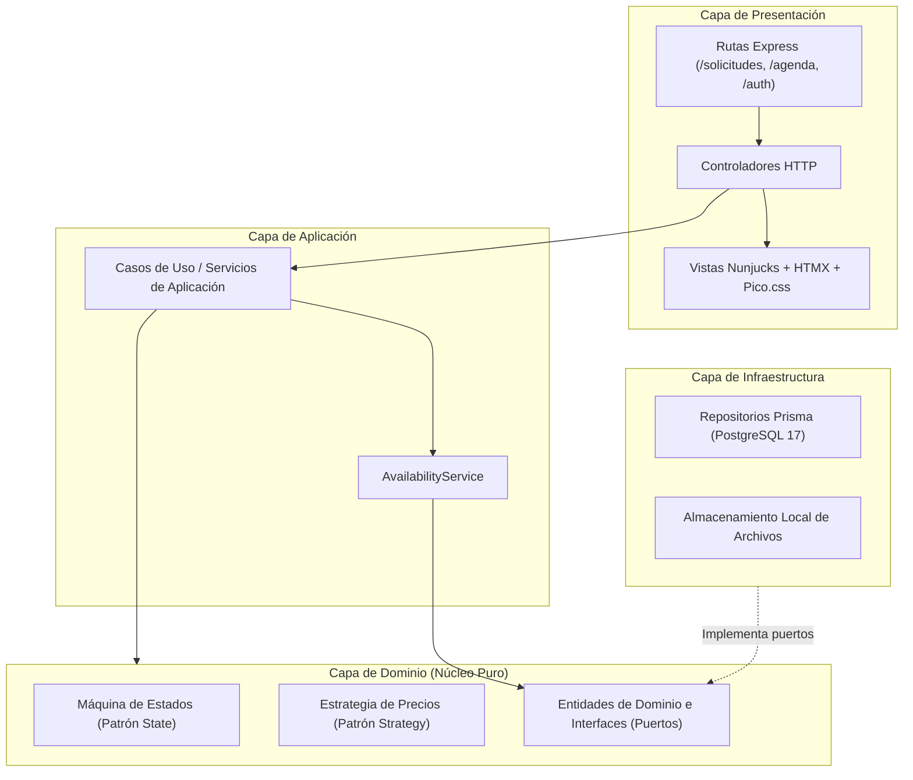
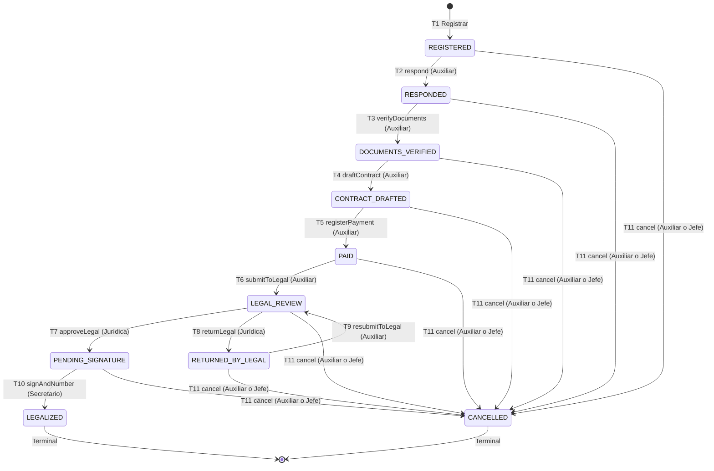

# Arquitectura del Sistema SGEC — Release 1.0

Sistema de Gestión de Escenarios y Bienes Culturales de la Secretaría de Cultura de Pereira.

---

## 1. Visión general del estilo arquitectónico

SGEC está construido como un **monolito modular en capas** (decisión `D-01`), ejecutándose como un proceso único en Node.js 22 con TypeScript estricto.

### Reglas de dependencia entre capas:
1. **Presentación → Aplicación → Dominio ← Infraestructura.**
2. La capa de **Dominio no importa Express, Prisma, Nunjucks ni módulos de sistema de archivos (`fs`)**. Permanece 100% pura y testeable en memoria.
3. La inversión de dependencias se logra mediante **interfaces de repositorio (puertos)** definidas en el dominio e implementadas en infraestructura.
4. La composición de dependencias se realiza de manera explícita sin frameworks pesados de inyección de dependencias.

---

## 2. Patrón de diseño principal: State (Ciclo de vida del trámite)

El ciclo de vida del trámite de alquiler se modela formalmente mediante el patrón **State** (decisión `D-02`). Cada estado encapsula sus transiciones válidas, los roles autorizados y las precondiciones exigidas. La entidad de contexto (`RentalContext`) delega todas las operaciones en el estado actual; **el estado nunca se muta directamente por fuera de la máquina**.

### 2.1 Diagrama de clases del patrón State

### 2.2 Diagrama de transiciones entre estados

### 2.3 Matriz de estados y transiciones

| Estado | Etiqueta UI | Transición | Destino | Roles autorizados | Precondiciones clave |
|---|---|---|---|---|---|
| `REGISTERED` | Registrada | `respond` | `RESPONDED` | `ADMIN_ASSISTANT` | Radicado de respuesta obligatorio (A-02); tarifa y valor cotizado válidos (A-07, A-08). |
| `REGISTERED` | Registrada | `cancel` | `CANCELLED` | `ADMIN_ASSISTANT`, `OFFICE_HEAD` | Motivo ≥ 10 caracteres. |
| `RESPONDED` | Respondida | `verifyDocuments` | `DOCUMENTS_VERIFIED` | `ADMIN_ASSISTANT` | Todos los documentos obligatorios verificados (`allMandatoryVerified: true`). |
| `RESPONDED` | Respondida | `cancel` | `CANCELLED` | `ADMIN_ASSISTANT`, `OFFICE_HEAD` | Motivo ≥ 10 caracteres. |
| `DOCUMENTS_VERIFIED` | Documentos verificados | `draftContract` | `CONTRACT_DRAFTED` | `ADMIN_ASSISTANT` | — |
| `DOCUMENTS_VERIFIED` | Documentos verificados | `cancel` | `CANCELLED` | `ADMIN_ASSISTANT`, `OFFICE_HEAD` | Motivo ≥ 10 caracteres. |
| `CONTRACT_DRAFTED` | Contrato elaborado | `registerPayment` | `PAID` | `ADMIN_ASSISTANT` | Recibo, banco, comprobante y factura completos; monto pagado == valor cotizado (A-08, AC-06.2). |
| `CONTRACT_DRAFTED` | Contrato elaborado | `cancel` | `CANCELLED` | `ADMIN_ASSISTANT`, `OFFICE_HEAD` | Motivo ≥ 10 caracteres. |
| `PAID` | Pagado | `submitToLegal` | `LEGAL_REVIEW` | `ADMIN_ASSISTANT` | — |
| `PAID` | Pagado | `cancel` | `CANCELLED` | `ADMIN_ASSISTANT`, `OFFICE_HEAD` | Motivo ≥ 10 caracteres. |
| `LEGAL_REVIEW` | En revisión jurídica | `approveLegal` | `PENDING_SIGNATURE` | `LEGAL` | 3 verificaciones marcadas: documentos, datos de arrendatario y cláusulas (CAR-07). |
| `LEGAL_REVIEW` | En revisión jurídica | `returnLegal` | `RETURNED_BY_LEGAL` | `LEGAL` | Observaciones ≥ 10 caracteres explicativos (CAR-07). |
| `LEGAL_REVIEW` | En revisión jurídica | `cancel` | `CANCELLED` | `ADMIN_ASSISTANT`, `OFFICE_HEAD` | Motivo ≥ 10 caracteres. |
| `RETURNED_BY_LEGAL` | Devuelto por Jurídica | `resubmitToLegal` | `LEGAL_REVIEW` | `ADMIN_ASSISTANT` | — |
| `RETURNED_BY_LEGAL` | Devuelto por Jurídica | `cancel` | `CANCELLED` | `ADMIN_ASSISTANT`, `OFFICE_HEAD` | Motivo ≥ 10 caracteres. |
| `PENDING_SIGNATURE` | Pendiente de firma | `signAndNumber` | `LEGALIZED` | `SECRETARY` | Asigna número consecutivo anual `ARR-AAAA-NNNN` (A-03). |
| `PENDING_SIGNATURE` | Pendiente de firma | `cancel` | `CANCELLED` | `ADMIN_ASSISTANT`, `OFFICE_HEAD` | Motivo ≥ 10 caracteres. |
| `LEGALIZED` | Legalizado | (ninguna) | — | — | Estado terminal inmutable. |
| `CANCELLED` | Cancelada | (ninguna) | — | — | Estado terminal inmutable; reserva liberada (RELEASED). |

---

## 3. Patrón Strategy (Cálculo de tarifas)

Para soportar las unidades de cobro establecidas en el Acuerdo de Tarifas (por hora o por día):

- **Interfaz `PricingStrategy`:** `calculate(startsAt, endsAt, unitPricePesos): PricingCalculationResult`.
- **`HourlyPricing`:** calcula `Math.ceil(diffMs / 3600000)` con mínimo de 1 hora (A-06) y manejo natural de cruce de medianoche (`D-06`).
- **`DailyPricing`:** calcula bloques de 24 horas o fracción `Math.ceil(diffHours / 24)` con mínimo de 1 día, evitando penalizar eventos nocturnos que concluyen en la madrugada siguiente (`D-06`).
- **Selector `getPricingStrategy(unit)`:** despacha la estrategia adecuada según la unidad de la tarifa.

---

## 4. Patrón Repository y protección anti-cruces

- **Puertos de catálogo y agenda:** `IVenueRepository`, `ISpaceRepository`, `ITariffRepository`, `IDocumentRequirementRepository`, `IReservationRepository`.
- **Adaptadores Prisma:** implementan las interfaces aislando al dominio de consultas SQL o tipos específicos del ORM.
- **Protección anti-cruces a doble nivel (ON-3):**
  1. *Nivel de aplicación:* `AvailabilityService.checkAvailability()` evalúa el rango semiabierto `[startsAt, endsAt)` (A-05) con la condición `startsAt < queryEnd AND endsAt > queryStart` para reservas activas (`HELD`, `CONFIRMED`).
  2. *Nivel de base de datos:* restricción de exclusión física `reservation_no_overlap` (`btree_gist` + `tstzrange`) en PostgreSQL 17. Cuando ocurre una colisión concurrente, la base de datos lanza el error `23P01`, que `PrismaReservationRepository` captura y transforma en un `ConflictError` tipado (código HTTP 409).
