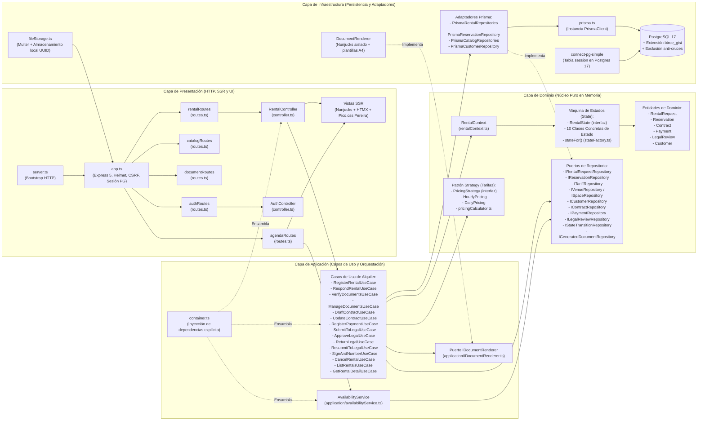
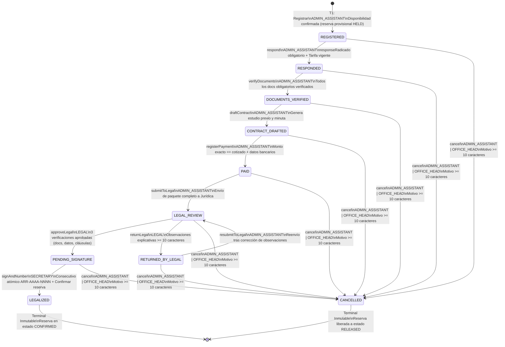
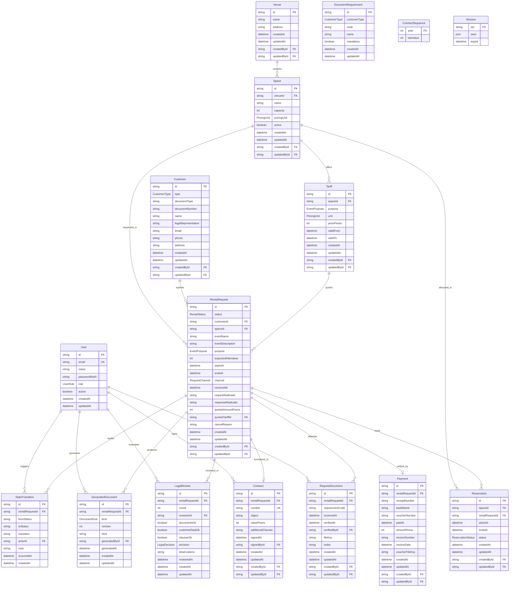
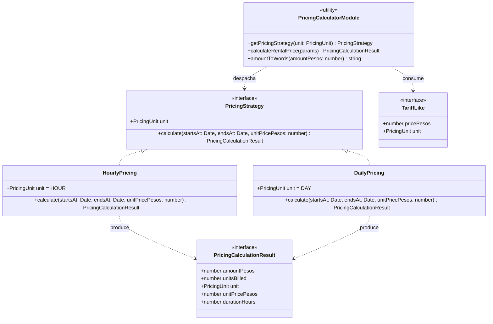
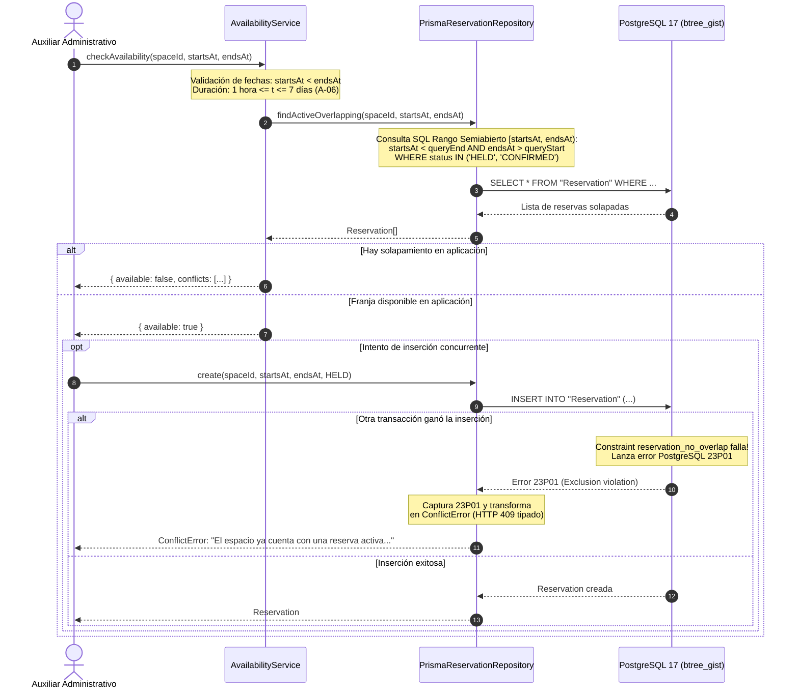
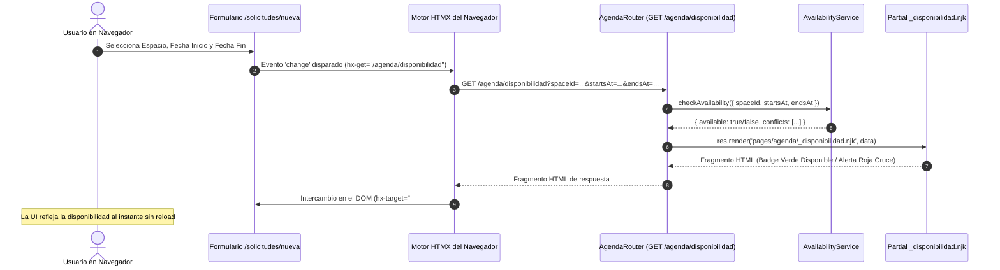

# Arquitectura del Sistema SGEC — Release 1.0

Sistema de Gestión de Escenarios y Bienes Culturales de la Secretaría de Cultura de Pereira.

---

## 1. Visión general del estilo arquitectónico

SGEC está construido como un **monolito modular en capas** (decisión `D-01`), ejecutándose como un proceso único en **Node.js 22** con **TypeScript** estricto (`strict: true`, sin tipos `any`), **Express 5**, **PostgreSQL 17** y **Prisma ORM**.

La arquitectura responde a las necesidades operativas de la Secretaría de Cultura de Pereira: elimina la dispersión del trámite en hojas de cálculo y documentos físicos desarticulados, unificando la verificación de agenda, cotización según tarifario oficial, validación de requisitos documentales, revisión jurídica y firma contractual en un flujo digital coherente y trazable.

### 1.1 Diagrama de capas y módulos del sistema



### 1.2 Reglas de dependencia entre capas

1. **Dirección única de dependencias:** Presentación → Aplicación → Dominio ← Infraestructura.
2. **Dominio puro y desacoplado:** La capa de Dominio (`src/modules/*/domain/`) **no importa Express, Prisma, Nunjucks, Multer ni módulos de sistema de archivos (`node:fs`)**. Permanece 100% pura y testeable en memoria sin necesidad de levantar bases de datos ni servicios externos.
3. **Inversión de dependencias (DIP):** Los casos de uso interactúan con abstracciones (interfaces de repositorio y adaptadores de documentos). La infraestructura adapta estas interfaces a la base de datos relacional y al sistema de archivos.
4. **Composición explícita sin magia:** El archivo [container.ts](file:///Users/pitoparker/Documents/Universidad/INGSOFT/src/container.ts) instancia los repositorios, servicios y casos de uso de manera explícita y tipada, evitando librerías de reflexión pesadas o anotaciones en tiempo de ejecución.
5. **Autenticación y autorización en servidor:** Toda mutación o consulta protegida verifica roles y permisos en el servidor mediante middleware RBAC (`requireAuth`, `requirePermission`) antes de alcanzar la capa de aplicación.

---

## 2. Patrón de diseño principal: State (Ciclo de vida del trámite)

El ciclo de vida del trámite de alquiler se modela formalmente mediante el patrón **State** (decisiones `D-02` y `D-08`). Cada estado encapsula sus transiciones válidas, los roles autorizados y las precondiciones exigidas. La entidad de contexto (`RentalContext`) delega todas las operaciones en el estado actual; **el estado nunca se muta directamente por fuera de la máquina**.

### 2.1 Diagrama de clases del patrón State

```mermaid
classDiagram
    class IRentalContext {
        <<interface>>
        +string id
        +RentalStatus status
        +string responseRadicado
        +number quotedAmountPesos
        +string quotedTariffId
        +string cancelReason
    }

    class RentalContext {
        +string id
        +RentalStatus status
        +RentalState currentState
        +string customerId
        +string spaceId
        +string eventName
        +string eventDescription
        +string purpose
        +number expectedAttendees
        +Date startsAt
        +Date endsAt
        +string channel
        +string requestRadicado
        +string responseRadicado
        +number quotedAmountPesos
        +string quotedTariffId
        +string cancelReason
        +StateTransitionRecord[] transitions
        +allowedTransitions() TransitionName[]
        +can(transition: TransitionName, actorRole: UserRole) CanTransitionResult
        +transition(transition: TransitionName, actorRole: UserRole, payload?: unknown, actorId?: string) StateTransitionRecord
    }

    class RentalState {
        <<interface>>
        +RentalStatus status
        +string label
        +allowedTransitions() TransitionName[]
        +can(transition: TransitionName, actorRole: UserRole) CanTransitionResult
        +apply(context: IRentalContext, transition: TransitionName, payload?: unknown) RentalState
    }

    class RegisteredState {
        +RentalStatus status = REGISTERED
        +string label = "Registrada"
        +allowedTransitions() ['respond', 'cancel']
        +can(transition, actorRole) CanTransitionResult
        +apply(ctx, transition, payload) RentalState
    }

    class RespondedState {
        +RentalStatus status = RESPONDED
        +string label = "Respondida"
        +allowedTransitions() ['verifyDocuments', 'cancel']
        +can(transition, actorRole) CanTransitionResult
        +apply(ctx, transition, payload) RentalState
    }

    class DocumentsVerifiedState {
        +RentalStatus status = DOCUMENTS_VERIFIED
        +string label = "Documentos verificados"
        +allowedTransitions() ['draftContract', 'cancel']
        +can(transition, actorRole) CanTransitionResult
        +apply(ctx, transition, payload) RentalState
    }

    class ContractDraftedState {
        +RentalStatus status = CONTRACT_DRAFTED
        +string label = "Contrato elaborado"
        +allowedTransitions() ['registerPayment', 'cancel']
        +can(transition, actorRole) CanTransitionResult
        +apply(ctx, transition, payload) RentalState
    }

    class PaidState {
        +RentalStatus status = PAID
        +string label = "Pagada"
        +allowedTransitions() ['submitToLegal', 'cancel']
        +can(transition, actorRole) CanTransitionResult
        +apply(ctx, transition, payload) RentalState
    }

    class LegalReviewState {
        +RentalStatus status = LEGAL_REVIEW
        +string label = "En revisión jurídica"
        +allowedTransitions() ['approveLegal', 'returnLegal', 'cancel']
        +can(transition, actorRole) CanTransitionResult
        +apply(ctx, transition, payload) RentalState
    }

    class ReturnedByLegalState {
        +RentalStatus status = RETURNED_BY_LEGAL
        +string label = "Devuelta por Jurídica"
        +allowedTransitions() ['resubmitToLegal', 'cancel']
        +can(transition, actorRole) CanTransitionResult
        +apply(ctx, transition, payload) RentalState
    }

    class PendingSignatureState {
        +RentalStatus status = PENDING_SIGNATURE
        +string label = "Pendiente de firma"
        +allowedTransitions() ['signAndNumber', 'cancel']
        +can(transition, actorRole) CanTransitionResult
        +apply(ctx, transition, payload) RentalState
    }

    class LegalizedState {
        +RentalStatus status = LEGALIZED
        +string label = "Legalizada"
        +allowedTransitions() []
        +can(transition, actorRole) CanTransitionResult
        +apply(ctx, transition, payload) RentalState
    }

    class CancelledState {
        +RentalStatus status = CANCELLED
        +string label = "Cancelada"
        +allowedTransitions() []
        +can(transition, actorRole) CanTransitionResult
        +apply(ctx, transition, payload) RentalState
    }

    class StateFactory {
        <<utility>>
        +stateFor(status: RentalStatus) RentalState
    }

    IRentalContext <|.. RentalContext
    RentalContext o-- RentalState : "currentState (delega comportamiento)"
    RentalState <|.. RegisteredState
    RentalState <|.. RespondedState
    RentalState <|.. DocumentsVerifiedState
    RentalState <|.. ContractDraftedState
    RentalState <|.. PaidState
    RentalState <|.. LegalReviewState
    RentalState <|.. ReturnedByLegalState
    RentalState <|.. PendingSignatureState
    RentalState <|.. LegalizedState
    RentalState <|.. CancelledState
    StateFactory ..> RentalState : "instancia y despacha"
```



### 2.2 Diagrama de estados del trámite



### 2.3 Matriz de estados y transiciones

| Estado Origen | Etiqueta UI | Transición | Estado Destino | Roles Autorizados | Precondiciones y Validaciones Clave | Efectos Colaterales en Dominio e Infraestructura |
|---|---|---|---|---|---|---|
| `REGISTERED` | Registrada | `respond` | `RESPONDED` | `ADMIN_ASSISTANT` | `responseRadicado` no vacío (A-02); tarifa vigente encontrada para espacio, propósito y fechas (A-07); cálculo válido de cotización. | Persiste `responseRadicado`, `quotedAmountPesos`, `quotedTariffId`; genera snapshot HTML de oficio de respuesta v1 (`DocumentRenderer`). |
| `REGISTERED` | Registrada | `cancel` | `CANCELLED` | `ADMIN_ASSISTANT`, `OFFICE_HEAD` | `reason` con longitud $\ge 10$ caracteres. | Libera reserva de espacio (`RELEASED`); persiste `cancelReason` y auditoría en `StateTransition`. |
| `RESPONDED` | Respondida | `verifyDocuments` | `DOCUMENTS_VERIFIED` | `ADMIN_ASSISTANT` | Todos los requisitos documentales obligatorios del cliente marcados como verificados (`allMandatoryVerified: true`). | Habilita etapa de elaboración contractual; registra transición de auditoría. |
| `RESPONDED` | Respondida | `cancel` | `CANCELLED` | `ADMIN_ASSISTANT`, `OFFICE_HEAD` | `reason` con longitud $\ge 10$ caracteres. | Libera reserva (`RELEASED`); registra motivo de cancelación. |
| `DOCUMENTS_VERIFIED` | Documentos verificados | `draftContract` | `CONTRACT_DRAFTED` | `ADMIN_ASSISTANT` | Ninguna restrictiva previa. Permite especificar objeto y cláusulas adicionales opcionales. | Crea registro `Contract` con valor igual a cotización; compila snapshots de Estudio Previo y Borrador de Contrato v1. |
| `DOCUMENTS_VERIFIED` | Documentos verificados | `cancel` | `CANCELLED` | `ADMIN_ASSISTANT`, `OFFICE_HEAD` | `reason` con longitud $\ge 10$ caracteres. | Libera reserva (`RELEASED`); registra motivo de cancelación. |
| `CONTRACT_DRAFTED` | Contrato elaborado | `registerPayment` | `PAID` | `ADMIN_ASSISTANT` | Recibo de caja, banco, número de comprobante, factura y fecha válidos; `amountPesos` exactamente igual a `quotedAmountPesos` (A-08, AC-06.2). | Registra entidad `Payment` con clave de comprobante subido; actualiza estado a `PAID`. |
| `CONTRACT_DRAFTED` | Contrato elaborado | `cancel` | `CANCELLED` | `ADMIN_ASSISTANT`, `OFFICE_HEAD` | `reason` con longitud $\ge 10$ caracteres. | Libera reserva (`RELEASED`); registra motivo de cancelación. |
| `PAID` | Pagada | `submitToLegal` | `LEGAL_REVIEW` | `ADMIN_ASSISTANT` | Pago previo verificado en estado `PAID`. | Radica paquete contractual para revisión jurídica; crea ronda inicial de revisión. |
| `PAID` | Pagada | `cancel` | `CANCELLED` | `ADMIN_ASSISTANT`, `OFFICE_HEAD` | `reason` con longitud $\ge 10$ caracteres. | Libera reserva (`RELEASED`); registra motivo de cancelación. |
| `LEGAL_REVIEW` | En revisión jurídica | `approveLegal` | `PENDING_SIGNATURE` | `LEGAL` | Tres checks obligatorios marcados como conformes: `documentsOk: true`, `customerDataOk: true`, `clausesOk: true` (CAR-07). | Crea registro `LegalReview` con decisión `APPROVED`; pasa trámite al Secretario para firma. |
| `LEGAL_REVIEW` | En revisión jurídica | `returnLegal` | `RETURNED_BY_LEGAL` | `LEGAL` | `observations` detalladas con longitud $\ge 10$ caracteres indicando faltantes o correcciones. | Crea registro `LegalReview` con decisión `RETURNED` y observaciones; notifica devolución a Auxiliar. |
| `LEGAL_REVIEW` | En revisión jurídica | `cancel` | `CANCELLED` | `ADMIN_ASSISTANT`, `OFFICE_HEAD` | `reason` con longitud $\ge 10$ caracteres. | Libera reserva (`RELEASED`); registra motivo de cancelación. |
| `RETURNED_BY_LEGAL` | Devuelta por Jurídica | `resubmitToLegal` | `LEGAL_REVIEW` | `ADMIN_ASSISTANT` | Ajustes realizados en documentos o cláusulas de contrato. | Reenvía paquete a Jurídica; incrementa número de ronda en `LegalReview` y actualiza minuta contractual. |
| `RETURNED_BY_LEGAL` | Devuelta por Jurídica | `cancel` | `CANCELLED` | `ADMIN_ASSISTANT`, `OFFICE_HEAD` | `reason` con longitud $\ge 10$ caracteres. | Libera reserva (`RELEASED`); registra motivo de cancelación. |
| `PENDING_SIGNATURE` | Pendiente de firma | `signAndNumber` | `LEGALIZED` | `SECRETARY` | Contrato borrador existente; solo el Secretario de Cultura puede ejecutar la acción. | Incrementa atómicamente `ContractSequence`, asigna número formal `ARR-AAAA-NNNN`, confirma reserva provisional (`HELD` $\rightarrow$ `CONFIRMED`) y congela versión final del contrato. |
| `PENDING_SIGNATURE` | Pendiente de firma | `cancel` | `CANCELLED` | `ADMIN_ASSISTANT`, `OFFICE_HEAD` | `reason` con longitud $\ge 10$ caracteres. | Libera reserva (`RELEASED`); registra motivo de cancelación. |
| `LEGALIZED` | Legalizada | *(ninguna)* | — | — | Estado terminal inmutable. No admite modificaciones ni cancelaciones posteriores. | Trámite finalizado exitosamente. Espacio confirmado en la programación cultural de la ciudad. |
| `CANCELLED` | Cancelada | *(ninguna)* | — | — | Estado terminal inmutable. | Reserva liberada definitivamente; franja horaria disponible para nuevas solicitudes. |

---

## 3. Diagrama ER completo de la base de datos

El esquema relacional implementado en **PostgreSQL 17** mediante **Prisma** soporta la totalidad de entidades requeridas por el trámite, integrando restricciones de unicidad, auditoría y una restricción física de exclusión para reservas.



### 3.1 Enumeraciones y restricciones clave del modelo

- **`UserRole`**: `OFFICE_HEAD` (Jefe de Oficina), `ADMIN_ASSISTANT` (Auxiliar Administrativo), `LEGAL` (Abogado de Jurídica), `SECRETARY` (Secretario de Cultura), `OPERATIONS_TECH` (Técnico Operativo), `MAINTENANCE_TECH` (Técnico de Mantenimiento).
- **`PricingUnit`**: `HOUR` (Por hora), `DAY` (Por día).
- **`EventPurpose`**: `LUCRATIVE` (Lucrativo / Comercial), `NON_LUCRATIVE` (Sin ánimo de lucro / Institucional).
- **`CustomerType`**: `NATURAL` (Persona Natural), `LEGAL` (Persona Jurídica).
- **`RentalStatus`**: `REGISTERED`, `RESPONDED`, `DOCUMENTS_VERIFIED`, `CONTRACT_DRAFTED`, `PAID`, `LEGAL_REVIEW`, `RETURNED_BY_LEGAL`, `PENDING_SIGNATURE`, `LEGALIZED`, `CANCELLED`.
- **`ReservationStatus`**: `HELD` (Bloqueo provisional), `CONFIRMED` (Confirmada definitivamente), `RELEASED` (Liberada por cancelación).
- **`RequestChannel`**: `VERBAL` (Verbal / Ventanilla), `WRITTEN` (Oficio físico), `EMAIL` (Correo electrónico institucional).
- **`LegalDecision`**: `APPROVED` (Favorable), `RETURNED` (Devuelto con observaciones).
- **`DocumentKind`**: `RESPONSE_LETTER` (Oficio de respuesta), `PRIOR_STUDY` (Estudio previo de conveniencia), `CONTRACT` (Minuta / Contrato de comodato o arrendamiento).
- **Restricción de unicidad en requisitos:** `DocumentRequirement(customerType, code)` asegura códigos únicos por tipo de persona.
- **Restricción de unicidad de cliente:** `Customer(type, documentNumber)` impide duplicidad de cédulas o NITs dentro del mismo tipo de solicitante.

---

## 4. Patrón Strategy (Cálculo de tarifas)

Para soportar de forma flexible y extensible las diferentes modalidades de cobro establecidas en el Acuerdo de Tarifas Municipal (decisión `D-06`), el sistema aplica el patrón **Strategy** aislando el algoritmo de tarificación.

### 4.1 Diagrama de clases del patrón Strategy



### 4.2 Lógica de cálculo y reglas de negocio

1. **Estrategia por horas (`HourlyPricing`):**
   - Evalúa la diferencia temporal exacta en milisegundos: `diffMs = endsAt.getTime() - startsAt.getTime()`.
   - Convierte a horas: `durationHours = diffMs / 3,600,000`.
   - Aplica redondeo de fracciones hacia el entero superior: `unitsBilled = Math.max(1, Math.ceil(durationHours))` (regla A-06, mínimo 1 hora facturada).
   - Calcula el total: `amountPesos = Math.round(unitsBilled * unitPricePesos)`.
   - Soporta de forma natural eventos que atraviesan la medianoche sin penalizaciones artificiosas.

2. **Estrategia por días (`DailyPricing`):**
   - Evalúa la duración total en horas: `diffHours = diffMs / 3,600,000`.
   - Factura en bloques de 24 horas o fracción: `unitsBilled = Math.max(1, Math.ceil(diffHours / 24))` (mínimo 1 día).
   - **Beneficio cívico (decisión `D-06`):** No penaliza con cobro de dos días completos a un evento cultural que inicia un viernes a las 7:00 PM y concluye a las 2:00 AM del sábado (duración 7 horas $\le 24$ horas $\rightarrow$ se factura como 1 día único).

3. **Conversión gramatical a letras (`amountToWords`):**
   - Implementa las directivas de la Real Academia Española para cifras en idioma español.
   - Aplica la regla de «de pesos» exclusivamente para múltiplos exactos de millón (`$ 1.000.000` $\rightarrow$ «un millón de pesos M/CTE»; `$ 1.500.000` $\rightarrow$ «un millón quinientos mil pesos M/CTE»).
   - Rechaza números negativos o decimales garantizando consistencia legal en todos los documentos expedidos.

---

## 5. Patrón Repository y protección anti-cruces de agenda

El acceso a datos se desacopla del dominio mediante interfaces de puerto (**Repository Pattern**), permitiendo que la lógica del negocio permanezca agnóstica a la base de datos o al ORM específico.

### 5.1 Diagrama de clases de repositorios

```mermaid
classDiagram
    class IVenueRepository {
        <<interface>>
        +findAll() Promise~Venue[]~
        +findById(id: string) Promise~Venue | null~
    }

    class ISpaceRepository {
        <<interface>>
        +findAll() Promise~Space[]~
        +findByVenueId(venueId: string) Promise~Space[]~
        +findById(id: string) Promise~Space | null~
    }

    class ITariffRepository {
        <<interface>>
        +findActiveTariff(spaceId: string, purpose: EventPurpose, date?: Date) Promise~Tariff | null~
        +findBySpaceId(spaceId: string) Promise~Tariff[]~
        +updatePrice(id: string, newPricePesos: number, updatedById?: string) Promise~Tariff~
    }

    class IDocumentRequirementRepository {
        <<interface>>
        +findByCustomerType(customerType: CustomerType) Promise~DocumentRequirement[]~
        +findAll() Promise~DocumentRequirement[]~
    }

    class ICustomerRepository {
        <<interface>>
        +findById(id: string) Promise~Customer | null~
        +findByTypeAndNumber(type: CustomerType, documentNumber: string) Promise~Customer | null~
        +upsert(input: UpsertCustomerInput) Promise~Customer~
    }

    class IReservationRepository {
        <<interface>>
        +create(data: CreateReservationInput) Promise~Reservation~
        +findById(id: string) Promise~Reservation | null~
        +findByRentalRequestId(rentalRequestId: string) Promise~Reservation[]~
        +findActiveOverlapping(spaceId: string, startsAt: Date, endsAt: Date, excludeId?: string) Promise~Reservation[]~
        +findByVenueAndRange(venueId: string, fromDate: Date, toDate: Date) Promise~Reservation[]~
        +updateStatus(id: string, status: ReservationStatus, updatedById?: string) Promise~Reservation~
    }

    class IRentalRequestRepository {
        <<interface>>
        +create(data: RentalInput) Promise~RentalRequest~
        +findById(id: string) Promise~RentalRequest | null~
        +update(id: string, data: Partial~RentalRequest~) Promise~RentalRequest~
        +findMany(filters: RentalListFilters) Promise~ListResult~
    }

    class PrismaVenueRepository {
        -PrismaClient prisma
        +findAll()
        +findById(id)
    }

    class PrismaSpaceRepository {
        -PrismaClient prisma
        +findAll()
        +findByVenueId(venueId)
        +findById(id)
    }

    class PrismaTariffRepository {
        -PrismaClient prisma
        +findActiveTariff(spaceId, purpose, date)
        +findBySpaceId(spaceId)
        +updatePrice(id, newPricePesos, updatedById)
    }

    class PrismaReservationRepository {
        -PrismaClient prisma
        +create(data)
        +findActiveOverlapping(spaceId, startsAt, endsAt, excludeId)
        +updateStatus(id, status, updatedById)
    }

    IVenueRepository <|.. PrismaVenueRepository
    ISpaceRepository <|.. PrismaSpaceRepository
    ITariffRepository <|.. PrismaTariffRepository
    IReservationRepository <|.. PrismaReservationRepository
```



### 5.2 Protección anti-cruces a doble nivel (ON-3)

La integridad de la agenda cultural es crítica para evitar conflictos de programación en teatros, auditorios y centros culturales municipales. SGEC implementa una defensa en profundidad en dos capas:



#### Nivel 1: Nivel de Aplicación (`AvailabilityService`)
- Evalúa el rango semiabierto $[startsAt, endsAt)$ (regla A-05): permite que un evento termine exactamente a las 14:00 y el siguiente inicie a las 14:00 sin generar falso conflicto.
- Condición evaluada: `startsAt < queryEnd AND endsAt > queryStart`.
- Filtra únicamente reservas activas (`HELD`, `CONFIRMED`). Las reservas en estado `RELEASED` (liberadas tras cancelación) se omiten.

#### Nivel 2: Nivel de Base de Datos (`reservation_no_overlap`)
- Implementada mediante la extensión nativa de PostgreSQL `btree_gist`:
  ```sql
  ALTER TABLE "Reservation" ADD CONSTRAINT reservation_no_overlap
    EXCLUDE USING gist ("spaceId" WITH =, tstzrange("startsAt", "endsAt", '[)') WITH &&)
    WHERE ("status" IN ('HELD', 'CONFIRMED'));
  ```
- Si dos peticiones concurrentes superan simultáneamente la validación de aplicación, la base de datos aborta la transacción perdedora con el código de error `23P01`.
- [PrismaReservationRepository](file:///Users/pitoparker/Documents/Universidad/INGSOFT/src/modules/agenda/infra/prismaReservationRepository.ts#L55-L61) intercepta `23P01` y lo traduce limpiamente a un `ConflictError` de dominio (HTTP 409), impidiendo inconsistencias físicas de agenda.

---

## 6. Flujo de renderizado de documentos y snapshots inmutables

Para garantizar seguridad jurídica, trazabilidad y reproducibilidad probatoria (decisión `D-09`), el sistema no renderiza documentos al vuelo en cada visualización. En su lugar, compila y almacena **snapshots HTML inmutables y versionados** en la tabla `GeneratedDocument`.

```mermaid
sequenceDiagram
    autonumber
    actor Actor as Usuario (Auxiliar / Jurídica / Secretario)
    participant Ctrl as RentalController
    participant UC as Caso de Uso (Respond / Draft / Sign)
    participant DocRend as DocumentRenderer
    participant Nunjucks as Nunjucks.Environment (Aislado)
    participant Prisma as PrismaClient
    participant DB as PostgreSQL (GeneratedDocument)

    Actor->>Ctrl: POST /solicitudes/:id/transiciones/:name
    Ctrl->>UC: execute(input)
    Note over UC: Valida permisos, ejecuta State.transition()<br/>y persiste cambios en BD
    
    UC->>DocRend: generate[DocumentKind](rentalId, actorId)
    
    DocRend->>Prisma: Consulta solicitud, cliente, espacio, tarifas y contrato
    Prisma-->>DocRend: Entidades completas hidratadas
    
    Note over DocRend: Resuelve versión documental:<br/>version = latestVersion + 1<br/>Formatea fechas y montos en letras (amountToWords)
    
    DocRend->>Nunjucks: render(templateName, context)
    Note over Nunjucks: Inyecta datos en plantilla institucional<br/>Aplica directivas CSS @page { size: A4; margin: 2cm; }
    Nunjucks-->>DocRend: String HTML congelado
    
    DocRend->>Prisma: generatedDocument.create({ rentalRequestId, kind, version, html, generatedById })
    Prisma->>DB: INSERT INTO "GeneratedDocument" (...)
    DB-->>Prisma: Registro persistido
    Prisma-->>DocRend: OK
    DocRend-->>UC: OK
    UC-->>Ctrl: Resultado exitoso
    Ctrl-->>Actor: Redirección con Flash Message
```

### 6.1 Los tres escenarios de generación documental

```mermaid
graph TD
    subgraph Escenario1["1. Oficio de Respuesta (T2: respond)"]
        E1_Trigger["Transición T2: RespondRentalUseCase"]
        E1_Action["DocumentRenderer.generateResponseLetter()"]
        E1_Template["templates/responseLetter.njk"]
        E1_Out["GeneratedDocument (RESPONSE_LETTER, v1)\nInforma viabilidad, liquidación y requisitos exigidos"]
        E1_Trigger --> E1_Action --> E1_Template --> E1_Out
    end

    subgraph Escenario2["2. Estudio Previo y Minuta Borrador (T4: draftContract / T9: resubmit)"]
        E2_Trigger["Transición T4 o T9: DraftContractUseCase / ResubmitToLegalUseCase"]
        E2_Action["DocumentRenderer.generatePriorStudyAndContract()"]
        E2_Templates["templates/priorStudy.njk\ntemplates/contract.njk"]
        E2_Out["GeneratedDocument (PRIOR_STUDY, v1)\nGeneratedDocument (CONTRACT, v1 o vn)\nSustento jurídico de conveniencia y borrador contractual"]
        E2_Trigger --> E2_Action --> E2_Templates --> E2_Out
    end

    subgraph Escenario3["3. Contrato Definitivo Legalizado (T10: signAndNumber)"]
        E3_Trigger["Transición T10: SignAndNumberUseCase"]
        E3_Action["DocumentRenderer.generateFinalContract()"]
        E3_Template["templates/contract.njk"]
        E3_Out["GeneratedDocument (CONTRACT, versión final)\nIncluye número oficial ARR-AAAA-NNNN y fecha formal de firma"]
        E3_Trigger --> E3_Action --> E3_Template --> E3_Out
    end
```



### 6.2 Estilos de impresión y directivas CSS A4

Las tres plantillas oficiales (`responseLetter.njk`, `priorStudy.njk`, `contract.njk`) aplican directivas de impresión profesional estándar:
- Formato de página A4 con márgenes uniformes: `@page { size: A4; margin: 2cm; }`.
- Tipografía serif legible a 12pt institucional y títulos jerárquicos a 14pt en negrita.
- Eliminación de sombras, bordes decorativos y colores de fondo que consuman tinta innecesariamente.
- Botonera de impresión de vista previa (`window.print()`) que se oculta automáticamente mediante la directiva `@media print { .no-print { display: none !important; } }`.

---

## 7. Flujo HTTP principal (Diagrama de secuencia)

A continuación se ilustra el flujo de extremo a extremo para una petición autenticada de mutación de estado (ejemplo: transición `respond`), evidenciando la interacción de cookies de sesión, tokens CSRF, autorización RBAC, caso de uso, máquina de estados y persistencia transaccional.

```mermaid
sequenceDiagram
    autonumber
    actor Browser as Navegador del Auxiliar
    participant HTTP as Pipeline Express (app.ts)
    participant AuthMW as requireAuth & requirePermission
    participant CSRF as doubleCsrfProtection
    participant Router as RentalRouter (routes.ts)
    participant Ctrl as RentalController (controller.ts)
    participant UC as RespondRentalUseCase (respondRentalUseCase.ts)
    participant Domain as RentalContext & RegisteredState
    participant Strat as pricingCalculator (Hourly / Daily)
    participant DB as PostgreSQL (Prisma $transaction)

    Browser->>HTTP: POST /solicitudes/:id/transiciones/respond<br/>Cookie: sgec.sid=...; Header: x-csrf-token=...<br/>Body: { responseRadicado: "RAD-2026-0042" }
    
    HTTP->>AuthMW: Verifica sesión connect-pg-simple en DB
    AuthMW-->>HTTP: Usuario autenticado (req.session.user: ADMIN_ASSISTANT)
    
    HTTP->>CSRF: Valida hash CSRF de cookie contra header/body
    CSRF-->>HTTP: Token válido
    
    HTTP->>AuthMW: Evalúa permiso 'rentals:respond'
    AuthMW-->>HTTP: Permiso concedido
    
    HTTP->>Router: Petición despachada al router
    Router->>Ctrl: ctrl.respond(req, res, next)
    
    Ctrl->>Ctrl: Valida esquema de entrada Zod (respondSchema)
    Ctrl->>UC: execute({ rentalRequestId, responseRadicado, actorId, actorRole })
    
    UC->>DB: findUnique({ id }) + TariffRepo.findActiveTariff()
    DB-->>UC: Solicitud actual + Tarifa activa aplicable
    
    UC->>Domain: new RentalContext(solicitudActual)
    UC->>Domain: context.can('respond', actorRole)
    Domain-->>UC: { allowed: true }
    
    UC->>Strat: calculateRentalPrice({ startsAt, endsAt, tariff })
    Strat-->>UC: { amountPesos: 150000, unitsBilled: 3, unit: 'HOUR' }
    
    UC->>Domain: context.transition('respond', actorRole, payload, actorId)
    Note over Domain: RegisteredState.apply():<br/>Valida radicado y tarifa<br/>Retorna nueva instancia RespondedState<br/>Genera StateTransitionRecord
    Domain-->>UC: StateTransitionRecord
    
    UC->>DB: prisma.$transaction(...)
    Note over DB: UPDATE "RentalRequest" SET status = 'RESPONDED', ...<br/>INSERT INTO "StateTransition" (...)
    DB-->>UC: Transacción confirmada (Atomic Commit)
    
    UC->>UC: DocumentRenderer.generateResponseLetter(id)
    Note over UC: Genera y almacena snapshot HTML v1
    
    UC-->>Ctrl: Resultado exitoso
    Ctrl-->>Browser: HTTP 303 Redirect a /solicitudes/:id (con Flash de éxito)
```

### 7.1 Flujo interactivo reactivo con HTMX (Agenda en tiempo real)

En el formulario de creación de solicitudes, la verificación de disponibilidad se ejecuta de manera reactiva sin recargar la página:



---

## 8. Estructura física del código

El código fuente del proyecto se organiza bajo una estructura modular orientada a dominio dentro de `src/`, garantizando una estricta separación de responsabilidades y facilidad de mantenimiento.

### 8.1 Árbol de código fuente (`src/`)

```
src/
├── app.ts                          # Configuración del servidor Express 5, middlewares de seguridad, Helmet, cookies, CSRF, sesión PG y registro de routers
├── server.ts                       # Punto de entrada de la aplicación, inicio del listener HTTP y manejo de apagado controlado (graceful shutdown)
├── container.ts                    # Contenedor central de inyección de dependencias; compone servicios, casos de uso y controladores
├── config/
│   └── env.ts                      # Validación y tipado estricto de variables de entorno mediante esquema Zod
├── shared/                         # Módulos transversales compartidos por todo el sistema
│   ├── errors.ts                   # Jerarquía de errores tipados (AppError, DomainError, ValidationError, NotFoundError, ForbiddenError, ConflictError, etc.)
│   ├── logger.ts                   # Logger estructurado de alto rendimiento con Pino y Pino-HTTP
│   ├── middleware/
│   │   ├── errorHandler.ts         # Manejador global de excepciones; formatea respuestas en HTML amigable o JSON según cabeceras Accept
│   │   └── flash.ts                # Middleware para mensajes flash de sesión tipo toast (éxito, error, advertencia)
│   └── utils/
│       ├── amountToWords.ts        # Conversión gramatical RAE de cifras numéricas a palabras en pesos colombianos (pesos M/CTE)
│       └── formatters.ts           # Utilidades para formatear moneda (COP), fechas estándar y fechas en zona horaria Bogotá (America/Bogota)
├── infra/
│   └── prisma.ts                   # Instancia única de PrismaClient conectada a PostgreSQL con extensiones de trazabilidad
└── modules/                        # Módulos funcionales del sistema
    ├── auth/                       # Autenticación, control de acceso RBAC y gestión de sesiones
    │   ├── controller.ts           # Controlador de login, logout y visualización de credenciales
    │   ├── csrf.ts                 # Configuración de protección CSRF mediante patrón Double Submit Cookie (doubleCsrfProtection)
    │   ├── middleware.ts           # Middlewares de guardia: requireAuth y requirePermission(permiso)
    │   ├── password.ts             # Hashing seguro y comparación de contraseñas mediante bcryptjs
    │   ├── permissions.ts          # Matriz de permisos RBAC por rol institucional (UserRole -> Permission[])
    │   ├── routes.ts               # Rutas HTTP públicas y autenticadas de auth (/login, /logout)
    │   └── types.ts                # Declaraciones de tipos para sesión Express (express-session Augmentation)
    ├── catalog/                    # Catálogo maestro de escenarios, espacios, tarifas y requisitos documentales
    │   ├── domain/
    │   │   ├── entities.ts         # Definiciones de tipos para Venue, Space, Tariff y DocumentRequirement
    │   │   └── repository.ts       # Puertos de repositorio: IVenueRepository, ISpaceRepository, ITariffRepository, IDocumentRequirementRepository
    │   ├── http/
    │   │   └── routes.ts           # Rutas para consultar y modificar tarifas vigentes (/tarifas)
    │   └── infra/
    │       └── prismaCatalogRepositories.ts # Implementaciones Prisma de los repositorios de catálogo
    ├── agenda/                     # Programación de eventos y protección anti-cruces de espacios
    │   ├── application/
    │   │   └── availabilityService.ts # Servicio de consulta de disponibilidad horaria y rango semiabierto
    │   ├── domain/
    │   │   ├── entities.ts         # Tipos para Reservation y resultados de verificación de disponibilidad
    │   │   └── repository.ts       # Puerto de repositorio IReservationRepository
    │   ├── http/
    │   │   └── routes.ts           # Rutas HTTP para calendario mensual (/agenda) y endpoint reactivo HTMX (/agenda/disponibilidad)
    │   └── infra/
    │       └── prismaReservationRepository.ts # Adaptador Prisma para reservas con captura del código Postgres 23P01
    ├── customers/                  # Gestión de solicitantes (personas naturales y jurídicas)
    │   ├── domain/
    │   │   ├── entities.ts         # Entidad Customer e inputs de creación/actualización
    │   │   └── repository.ts       # Puerto de repositorio ICustomerRepository
    │   └── infra/
    │       └── prismaCustomerRepository.ts # Adaptador Prisma con lógica de upsert atómico por tipo y número de documento
    ├── documents/                  # Generación y almacenamiento de snapshots documentales oficiales
    │   ├── documentRenderer.ts     # Implementación de IDocumentRenderer: orquesta Nunjucks y almacena snapshots en GeneratedDocument
    │   ├── formatters.ts           # Filtros personalizados Nunjucks (currency, amountWords, dateLong, dateTime, dateRange)
    │   ├── routes.ts               # Rutas para visualización e impresión de documentos congelados (/solicitudes/:id/documentos/:kind)
    │   └── templates/              # Plantillas Nunjucks institucionales con directivas CSS de impresión A4
    │       ├── responseLetter.njk  # Plantilla de Oficio de Respuesta formal
    │       ├── priorStudy.njk      # Plantilla de Estudio Previo de Conveniencia
    │       └── contract.njk        # Plantilla de Minuta y Contrato Definitivo
    └── rentals/                    # Módulo central del trámite de alquiler y formalización
        ├── domain/
        │   ├── entities.ts         # Entidades de dominio (RentalRequest, Contract, Payment, LegalReview, etc.)
        │   ├── repository.ts       # Puertos de persistencia (IRentalRequestRepository, IContractRepository, IPaymentRepository, etc.)
        │   ├── pricing/            # Patrón Strategy para liquidación de tarifas
        │   │   ├── pricingStrategy.ts   # Interfaz PricingStrategy y tipos de resultado
        │   │   ├── hourlyPricing.ts     # Estrategia de cobro por horas (redondeo hacia arriba, mínimo 1 hora)
        │   │   ├── dailyPricing.ts      # Estrategia de cobro por bloques de 24 horas
        │   │   └── pricingCalculator.ts # Selector getPricingStrategy() y orquestador calculateRentalPrice()
        │   └── states/             # Patrón State para el ciclo de vida de la solicitud
        │       ├── types.ts                # Enums y payloads de transición (RespondPayload, CancelPayload, etc.)
        │       ├── rentalState.ts          # Interfaz pura RentalState y contrato IRentalContext
        │       ├── rentalContext.ts        # Clase de contexto RentalContext (delega en currentState)
        │       ├── stateFactory.ts         # Registro y fábrica stateFor(status)
        │       ├── registeredState.ts      # Estado REGISTERED (permite respond, cancel)
        │       ├── respondedState.ts       # Estado RESPONDED (permite verifyDocuments, cancel)
        │       ├── documentsVerifiedState.ts # Estado DOCUMENTS_VERIFIED (permite draftContract, cancel)
        │       ├── contractDraftedState.ts # Estado CONTRACT_DRAFTED (permite registerPayment, cancel)
        │       ├── paidState.ts            # Estado PAID (permite submitToLegal, cancel)
        │       ├── legalReviewState.ts     # Estado LEGAL_REVIEW (permite approveLegal, returnLegal, cancel)
        │       ├── returnedByLegalState.ts # Estado RETURNED_BY_LEGAL (permite resubmitToLegal, cancel)
        │       ├── pendingSignatureState.ts # Estado PENDING_SIGNATURE (permite signAndNumber, cancel)
        │       ├── legalizedState.ts       # Estado terminal LEGALIZED (inmutable, sin transiciones)
        │       └── cancelledState.ts       # Estado terminal CANCELLED (inmutable, sin transiciones)
        ├── application/            # Casos de uso específicos del trámite
        │   ├── IDocumentRenderer.ts        # Puerto para renderizado de documentos
        │   ├── registerRentalUseCase.ts    # T1: Creación de solicitud y reserva provisional HELD
        │   ├── respondRentalUseCase.ts     # T2: Respuesta con tarifa cotizada y radicado formal
        │   ├── verifyDocumentsUseCase.ts   # T3: Validación del conjunto de documentos obligatorios
        │   ├── manageDocumentsUseCase.ts   # Gestión individual de recepción y archivo de documentos
        │   ├── draftContractUseCase.ts     # T4: Elaboración de borrador contractual y estudio previo
        │   ├── updateContractUseCase.ts    # Edición de objeto y cláusulas adicionales antes de firma
        │   ├── registerPaymentUseCase.ts   # T5: Registro de consignación bancaria y factura
        │   ├── submitToLegalUseCase.ts     # T6: Envío del expediente a revisión jurídica
        │   ├── approveLegalUseCase.ts      # T7: Aprobación jurídica tras verificar 3 condiciones
        │   ├── returnLegalUseCase.ts       # T8: Devolución jurídica motivada con observaciones
        │   ├── resubmitToLegalUseCase.ts   # T9: Reenvío a Jurídica tras corregir observaciones
        │   ├── signAndNumberUseCase.ts     # T10: Firma del Secretario y consecutivo anual atómico
        │   ├── cancelRentalUseCase.ts      # T11: Cancelación justificada y liberación de reserva
        │   ├── listRentalsUseCase.ts       # Búsqueda paginada y filtrado por estado de trámites
        │   └── getRentalDetailUseCase.ts   # Consulta de detalle completo y línea de tiempo de auditoría
        ├── http/                   # Capa web del módulo de trámites
        │   ├── controller.ts       # Controlador HTTP con métodos correspondientes a cada acción
        │   ├── routes.ts           # Definición de rutas Express con validación de permisos RBAC
        │   └── schemas.ts          # Esquemas de validación Zod para payloads de entrada
        └── infra/                  # Adaptadores de infraestructura del trámite
            ├── fileStorage.ts      # Configuración de Multer para subida segura de archivos a storage/
            └── prismaRentalRepositories.ts # Adaptadores Prisma para solicitudes, contratos, pagos y revisiones
```

### 8.2 Árbol de vistas y plantillas de presentación (`src/views/`)

```
src/views/
├── layouts/
│   └── base.njk                    # Plantilla base institucional: Pico.css + tema cívico Pereira, HTMX, navbar y toasts
├── partials/
│   ├── nav.njk                     # Barra de navegación superior responsiva con filtrado por rol y cinta cívica
│   ├── badge.njk                   # Macro para etiquetas de estado con colores diferenciados y texto accesible
│   ├── flash.njk                   # Renderizador de notificaciones flash en pantalla (alertas de éxito, error e info)
│   └── pagination.njk              # Componente de navegación paginada para listas de solicitudes
└── pages/
    ├── auth/
    │   └── login.njk               # Formulario de inicio de sesión institucional con selector de credenciales demo
    ├── home/
    │   └── index.njk               # Tablero principal con accesos rápidos según el rol del usuario conectado
    ├── solicitudes/
    │   ├── index.njk               # Listado general de trámites con filtros por estado, búsqueda y paginación
    │   ├── nueva.njk               # Asistente de radicación de nueva solicitud con consulta HTMX de disponibilidad
    │   └── detalle.njk             # Vista exhaustiva del trámite: resumen, requisitos, pagos, contratos y timeline auditable
    ├── agenda/
    │   ├── index.njk               # Visualizador de agenda cultural a 30 días con filtrado por escenario
    │   └── _disponibilidad.njk     # Fragmento parcial HTMX para retroalimentación instantánea de disponibilidad
    ├── tarifas/
    │   └── index.njk               # Matriz de tarifas vigentes por espacio y propósito con edición para Jefe de Oficina
    └── errors/
        ├── 400.njk                 # Pantalla de error de validación en la solicitud
        ├── 403.njk                 # Pantalla de acceso no autorizado (permiso denegado por RBAC)
        ├── 404.njk                 # Pantalla de recurso no encontrado
        └── 500.njk                 # Pantalla de error interno inesperado del servidor
```

---

## 9. Atributos de calidad del sistema

| Atributo de Calidad | Escenario / Riesgo Operativo | Estrategia Arquitectónica en SGEC | Mecanismo de Verificación y Métricas |
|---|---|---|---|
| **Integridad de Datos** | Solapamiento de eventos en un mismo espacio por peticiones concurrentes de reserva. | Doble barrera de protección: validación de rango semiabierto en `AvailabilityService` y restricción de exclusión física `reservation_no_overlap` (`btree_gist`) en PostgreSQL 17. | Prueba de concurrencia automatizada; captura y validación del código de error Postgres `23P01`. |
| **Integridad de Datos** | Colisiones en la numeración consecutiva anual de contratos (`ARR-AAAA-NNNN`). | Incremento atómico en bloque relacional mediante `INSERT ... ON CONFLICT ("year") DO UPDATE` sobre la tabla `ContractSequence`. | Pruebas de integración sobre `signAndNumberUseCase` validando unicidad secuencial estricta. |
| **Seguridad** | Ataques de falsificación de peticiones en sitios cruzados (CSRF) y secuestro de sesiones. | Patrón Double Submit Cookie con hash criptográfico (`doubleCsrfProtection`), cookies `HttpOnly` y `SameSite: lax`, almacenamiento de sesiones en Postgres (`connect-pg-simple`) y cabeceras de seguridad estrictas mediante Helmet CSP. | Verificación automatizada de rechazo de peticiones sin token CSRF y suites de pruebas de autenticación. |
| **Seguridad** | Acceso no autorizado o escalamiento de privilegios entre dependencias municipales. | Modelo RBAC evaluado estrictamente en servidor con middleware `requirePermission(permiso)`; el cliente nunca determina sus permisos. | Cobertura total de pruebas unitarias sobre matriz de permisos en [permissions.test.ts](file:///Users/pitoparker/Documents/Universidad/INGSOFT/tests/unit/permissions.test.ts). |
| **Mantenibilidad** | Acoplamiento rígido de reglas de negocio a detalles de implementación (ORM, framework web). | Arquitectura en capas con dominio puro: 0 importaciones de Prisma o Express en `domain/`; inversión de dependencias con interfaces de puerto. | Pruebas unitarias de la máquina de estados ejecutadas al 100% en memoria en milisegundos (618 pruebas). |
| **Mantenibilidad** | Crecimiento incontrolado de lógica condicional en el ciclo de vida del contrato. | Patrón State: cada estado es una clase independiente con responsabilidad única. Incorporar nuevos estados no requiere alterar estados existentes (Open/Closed Principle). | Suite table-driven que evalúa exhaustivamente la combinación $10 \times 10 \times 6$ (estado $\times$ transición $\times$ rol). |
| **Rendimiento** | Sobrecarga de procesamiento y tiempos lentos de carga en terminales de trabajo municipales. | Renderizado del lado del servidor (SSR) ultraliviano con Nunjucks + HTMX para reactividad parcial sin necesidad de compilar pesados bundles cliente de JavaScript. | Respuestas HTTP en menos de 50 ms en entorno local; páginas completamente operativas con menos de 100 KB transferidos. |
| **Trazabilidad y Auditoría** | Imposibilidad de justificar quién autorizó o modificó una solicitud ante organismos de control. | Cada transición exitosa inserta un registro inmutable en `StateTransition` con identificador de actor, fecha precisa, estado anterior, estado nuevo y notas. | Línea de tiempo visual en `detalle.njk` y pruebas de integración que verifican la secuencia histórica. |
| **Seguridad Jurídica** | Alteración retroactiva o discrepancia en el contenido de contratos y resoluciones emitidas. | Snapshots HTML congelados en `GeneratedDocument` (kind, version, html, actor, timestamp). Un documento emitido nunca se regenera al consultar su detalle. | Pruebas de inmutabilidad documental y directivas CSS A4 listas para impresión y firma. |
| **Accesibilidad y Usabilidad** | Operación inconsistente en equipos con distintos sistemas operativos o temas visuales. | Sistema de diseño institucional cívico forzado en modo claro (`data-theme="light"`), botones y badges con contraste WCAG AAA, foco accesible visible y compatibilidad total desde pantallas de 360px. | Pruebas de renderizado en [uiViews.test.ts](file:///Users/pitoparker/Documents/Universidad/INGSOFT/tests/unit/uiViews.test.ts) y verificación de contraste tipográfico. |

---

## 10. Registro de decisiones arquitectónicas (ADRs)

El diseño y construcción de SGEC Release 1.0 se fundamenta en un conjunto de Decisiones Arquitectónicas Registradas (ADRs) documentadas formalmente en [DECISIONS.md](file:///Users/pitoparker/Documents/Universidad/INGSOFT/DECISIONS.md):

### `D-01` · Estilo arquitectónico: Monolito modular en capas
- **Contexto:** Proyecto académico de alcance acotado y despliegue local, enfocado en el proceso de arrendamiento y comodato de la Secretaría de Cultura.
- **Decisión:** Adoptar un monolito modular en capas (presentación, aplicación, dominio, infraestructura) ejecutándose en un único proceso Node.js.
- **Alternativas descartadas:** Arquitectura de microservicios (sobrecosto innecesario de orquestación y latencia de red); SPA desacoplada con API REST (requiere dos procesos, configuración de CORS y duplicación de validaciones).
- **Consecuencias:** Despliegue extremadamente simple con un único comando; separación limpia que permite evolucionar hacia los Releases 2.0 y 3.0 sin deuda técnica.

### `D-02` · Patrón de diseño principal: State para el trámite contractual
- **Contexto:** El trámite contractual atraviesa 10 estados distintos con reglas de negocio, actores autorizados, efectos colaterales y precondiciones particulares en cada etapa.
- **Decisión:** Implementar el patrón **State** para gobernar el ciclo de vida del trámite; **Repository** para abstraer la persistencia; y **Strategy** para liquidar tarifas.
- **Alternativas descartadas:** Sentencias `switch/case` extensas dentro de los controladores o servicios (frágiles, propensas a regresiones y difíciles de testear); librerías externas de máquinas de estado como XState (ocultan el diseño orientado a objetos requerido por la cátedra).
- **Consecuencias:** Agregar o modificar transiciones se realiza de forma aislada en archivos individuales; la máquina es 100% comprobable en memoria con suites de pruebas unitarias puras.

### `D-03` · Interfaz con renderizado del lado del servidor (SSR)
- **Contexto:** La plataforma debe operar fluidamente en computadores de oficina pública sin requerir conexión a internet ni procesos complejos de compilación en el cliente.
- **Decisión:** Implementar Nunjucks como motor de plantillas SSR, HTMX para transiciones reactivas parciales y Pico.css enriquecido con la paleta cívica de Pereira servido localmente.
- **Alternativas descartadas:** Frameworks pesados de frontend tipo React o Angular (introducen cadenas de build complejas con Vite/Webpack y aumentan el consumo de memoria del cliente); Next.js (acopla la lógica de servidor a convenciones propietarias de enrutamiento).
- **Consecuencias:** Cero compilación de frontend, operación garantizada fuera de línea y tiempos de respuesta inmediatos.

### `D-04` · Restricción física de anti-cruces en la base de datos
- **Contexto:** Dos eventos no pueden ocupar el mismo espacio cultural en la misma franja horaria bajo ninguna circunstancia (objetivo no negociable ON-3).
- **Decisión:** Crear una restricción de exclusión física `reservation_no_overlap` en PostgreSQL utilizando la extensión `btree_gist` sobre el rango `tstzrange`, complementando la validación en el servicio de aplicación.
- **Alternativas descartadas:** Confiar exclusivamente en validaciones en código Node.js (vulnerable a condiciones de carrera por concurrencia); bloqueos pesados de tabla completa (degradan drásticamente el rendimiento).
- **Consecuencias:** Garantía matemática de cero colisiones de agenda a nivel de almacenamiento físico.

### `D-05` · Adopción de supuestos ante ausencia del Manual de Procedimientos
- **Contexto:** El Manual formal de Arrendamientos de la Secretaría de Cultura no estuvo disponible durante la fase de análisis.
- **Decisión:** Adoptar formalmente los 15 supuestos de negocio `A-01` a `A-15` documentados en `SPEC.md`, estableciendo formatos, tarifas de ejemplo y reglas operativas claramente señaladas.
- **Consecuencias:** El sistema resuelve de manera completa el ciclo administrativo; cualquier ajuste futuro del manual oficial requerirá únicamente afinar parámetros de configuración sin reescribir la arquitectura.

### `D-06` · Estrategias de precios y conversión gramatical de cifras
- **Contexto:** El tarifario municipal define cobros por hora o por día para eventos comerciales o sin ánimo de lucro, y los documentos oficiales exigen el valor expresado en letras colombianas.
- **Decisión:** Crear las estrategias `HourlyPricing` (redondeo hacia arriba con mínimo de 1 hora) y `DailyPricing` (bloques de 24 horas protegiendo eventos nocturnos). Crear el módulo utilitario `amountToWords` bajo directivas estrictas de la RAE con sufijo «pesos M/CTE».
- **Alternativas descartadas:** Facturar días por fecha calendario estricta (habría penalizado con cobro de dos días completos a un evento cultural que termine a la 1:00 AM del día siguiente); librerías genéricas de NPM (introducen modismos de otros países o dependencias externas no auditadas).
- **Consecuencias:** Liquidación justa, predecible y generación de minutas impecables jurídicamente.

### `D-07` · Rango semiabierto y traducción de error Postgres 23P01
- **Contexto:** La agenda debe permitir eventos contiguos y el sistema debe comunicar claramente al usuario cuando ocurre un conflicto concurrente.
- **Decisión:** Modelar las reservas como el intervalo semiabierto $[startsAt, endsAt)$ mediante la condición SQL `startsAt < queryEnd AND endsAt > queryStart` sobre estados activos (`HELD`, `CONFIRMED`). Mapear en `PrismaReservationRepository` el código nativo de Postgres `23P01` a un `ConflictError` tipado de dominio (HTTP 409).
- **Consecuencias:** Prevención de falsos positivos en franjas contiguas y retroalimentación transparente al usuario final.

### `D-08` · Congelación del contrato de RentalContext
- **Contexto:** Al concluir la modelación del dominio núcleo en la Fase 1, se requería una base inmutable sobre la cual edificar los casos de uso y vistas.
- **Decisión:** Congelar la interfaz y comportamiento de `RentalContext.transition(transition, actorRole, payload, actorId)`. Toda transición genera un registro auditable `StateTransitionRecord` y arroja excepciones tipadas ante transiciones inválidas (409), permisos insuficientes (403) o precondiciones rotas (400).
- **Consecuencias:** Contrato formal sólido respetado en todos los casos de uso implementados a lo largo de las Fases 2, 3 y 4.

### `D-09` · Snapshots HTML inmutables y estilos de impresión A4
- **Contexto:** La administración pública exige que los oficios, estudios previos y contratos emitidos conserven validez probatoria histórica inalterable.
- **Decisión:** Implementar `DocumentRenderer` para compilar plantillas Nunjucks y almacenar el HTML resultante de forma inmutable en `GeneratedDocument` con versión incremental. Diseñar hojas de estilo para impresión A4 con directivas `@page { size: A4; margin: 2cm; }`.
- **Alternativas descartadas:** Generación dinámica al vuelo en cada petición GET (vulnerable a cambios posteriores en tarifas o datos del solicitante); generación binaria de PDFs con Puppeteer/Chromium (excesivamente pesado para un entorno local y propenso a fallas por librerías nativas del sistema operativo).
- **Consecuencias:** Generación rápida y determinista; compatibilidad universal para imprimir o guardar como PDF desde cualquier navegador web.

### `D-10` · Gestión de riesgos en dependencias de desarrollo (`tinypool`)
- **Contexto:** La herramienta `npm audit` reportó avisos sobre la librería `tinypool` (dependencia transitiva del ejecutor de pruebas Vitest).
- **Decisión:** Aceptar el riesgo documentado dado que la librería opera exclusivamente en tiempo de desarrollo y pruebas automatizadas, sin estar presente en el entorno de ejecución en producción.
- **Consecuencias:** Estabilidad operativa mantenida sin forzar actualizaciones mayores que rompieran el arnés de pruebas.

### `D-11` · Guardia de estado en capa de aplicación (`updateContractUseCase`)
- **Contexto:** Durante la revisión de código de la Fase 4 se evaluó la presencia de una comprobación directa del estado de la solicitud en `updateContractUseCase`.
- **Decisión:** Admitir la comprobación como una guardia de precondición legítima de la capa de aplicación para generar un mensaje de error altamente contextualizado para la interfaz de usuario, preservando la exclusividad de la mutación de estado a través de `RentalContext`.
- **Consecuencias:** Mensajes descriptivos en pantalla sin vulnerar el principio de encapsulamiento del patrón State.

### `D-12` · Sistema de Diseño Institucional de Pereira y Unificación Visual
- **Contexto:** Se identificaron artefactos visuales derivados de la activación automática del modo oscuro en ciertos navegadores (Pico.css oscurecía encabezados sobre fondos claros) y contenedores vacíos de mensajes flash.
- **Decisión:** Forzar el modo claro institucional (`data-theme="light"`), eliminar artefactos de renderizado en `flash.njk` y establecer la identidad cívica municipal: Rojo Pereirano (`#cf1020`) como acento primario, Amarillo Pereirano (`#f59e0b`) para advertencias y revisión, cinta cívica superior en la barra de navegación y colores con contraste accesible WCAG AAA.
- **Consecuencias:** Presentación visual institucional pulida, consistente en cualquier dispositivo y libre de fallos visuales.
