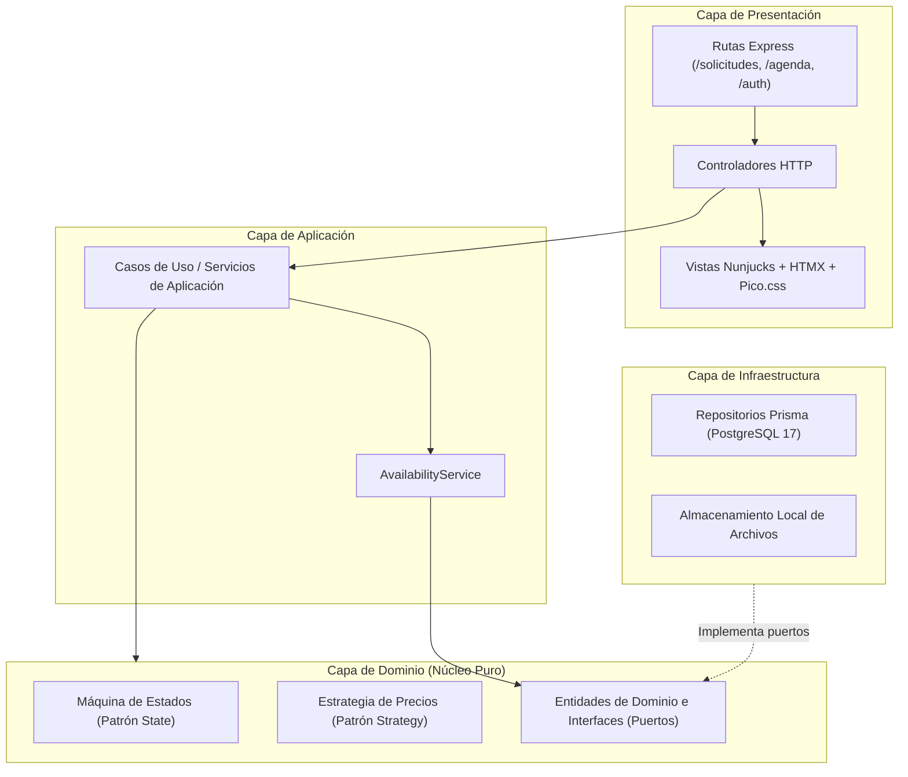
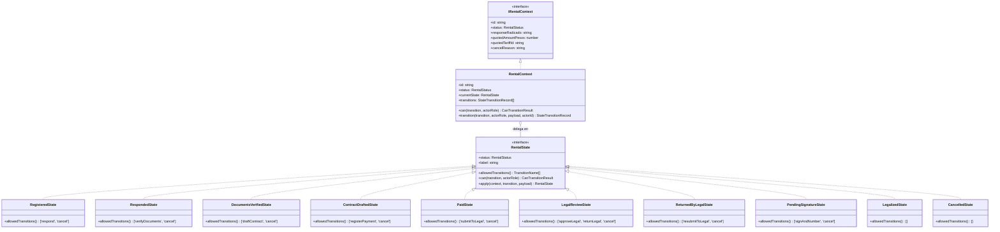
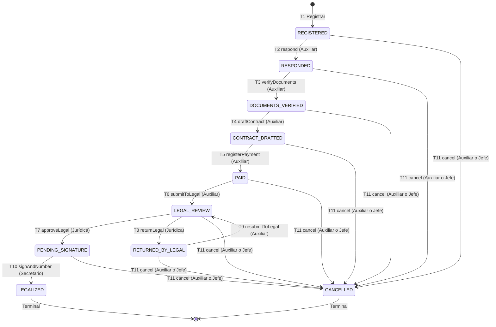

# Arquitectura del Sistema SGEC — Release 1.0

Sistema de Gestión de Escenarios y Bienes Culturales de la Secretaría de Cultura de Pereira.

---

## 1. Visión general del estilo arquitectónico

SGEC está construido como un **monolito modular en capas** (decisión `D-01`), ejecutándose como un proceso único en Node.js 22 con TypeScript estricto.



### Reglas de dependencia entre capas:
1. **Presentación → Aplicación → Dominio ← Infraestructura.**
2. La capa de **Dominio no importa Express, Prisma, Nunjucks ni módulos de sistema de archivos (`fs`)**. Permanece 100% pura y testeable en memoria.
3. La inversión de dependencias se logra mediante **interfaces de repositorio (puertos)** definidas en el dominio e implementadas en infraestructura.
4. La composición de dependencias se realiza de manera explícita sin frameworks pesados de inyección de dependencias.

---

## 2. Patrón de diseño principal: State (Ciclo de vida del trámite)

El ciclo de vida del trámite de alquiler se modela formalmente mediante el patrón **State** (decisión `D-02`). Cada estado encapsula sus transiciones válidas, los roles autorizados y las precondiciones exigidas. La entidad de contexto (`RentalContext`) delega todas las operaciones en el estado actual; **el estado nunca se muta directamente por fuera de la máquina**.

### 2.1 Diagrama de clases del patrón State



### 2.2 Diagrama de transiciones entre estados



### 2.3 Matriz de estados y transiciones

| Estado | Etiqueta UI | Transición | Destino | Roles autorizados | Precondiciones clave |
|---|---|---|---|---|---|
| `REGISTERED` | Registrada | `respond` | `RESPONDED` | `ADMIN_ASSISTANT` | Radicado de respuesta obligatorio (A-02); tarifa y valor cotizado válidos (A-07, A-08). |
| `REGISTERED` | Registrada | `cancel` | `CANCELLED` | `ADMIN_ASSISTANT`, `OFFICE_HEAD` | Motivo ≥ 10 caracteres. |
| `RESPONDED` | Respondida | `verifyDocuments` | `DOCUMENTS_VERIFIED` | `ADMIN_ASSISTANT` | Todos los documentos obligatorios verificados (`allMandatoryVerified: true`). |
| `RESPONDED` | Respondida | `cancel` | `CANCELLED` | `ADMIN_ASSISTANT`, `OFFICE_HEAD` | Motivo ≥ 10 caracteres. |
| `DOCUMENTS_VERIFIED` | Documentos verificados | `draftContract` | `CONTRACT_DRAFTED` | `ADMIN_ASSISTANT` | — |
| `DOCUMENTS_VERIFIED` | Documentos verificados | `cancel` | `CANCELLED` | `ADMIN_ASSISTANT`, `OFFICE_HEAD` | Motivo ≥ 10 caracteres. |
| `CONTRACT_DRAFTED` | Contrato elaborado | `registerPayment` | `PAID` | `ADMIN_ASSISTANT` | Recibo, banco, comprobante y factura completos; monto pagado == valor cotizado (A-08, AC-06.2). |
| `CONTRACT_DRAFTED` | Contrato elaborado | `cancel` | `CANCELLED` | `ADMIN_ASSISTANT`, `OFFICE_HEAD` | Motivo ≥ 10 caracteres. |
| `PAID` | Pagado | `submitToLegal` | `LEGAL_REVIEW` | `ADMIN_ASSISTANT` | — |
| `PAID` | Pagado | `cancel` | `CANCELLED` | `ADMIN_ASSISTANT`, `OFFICE_HEAD` | Motivo ≥ 10 caracteres. |
| `LEGAL_REVIEW` | En revisión jurídica | `approveLegal` | `PENDING_SIGNATURE` | `LEGAL` | 3 verificaciones marcadas: documentos, datos de arrendatario y cláusulas (CAR-07). |
| `LEGAL_REVIEW` | En revisión jurídica | `returnLegal` | `RETURNED_BY_LEGAL` | `LEGAL` | Observaciones ≥ 10 caracteres explicativos (CAR-07). |
| `LEGAL_REVIEW` | En revisión jurídica | `cancel` | `CANCELLED` | `ADMIN_ASSISTANT`, `OFFICE_HEAD` | Motivo ≥ 10 caracteres. |
| `RETURNED_BY_LEGAL` | Devuelto por Jurídica | `resubmitToLegal` | `LEGAL_REVIEW` | `ADMIN_ASSISTANT` | — |
| `RETURNED_BY_LEGAL` | Devuelto por Jurídica | `cancel` | `CANCELLED` | `ADMIN_ASSISTANT`, `OFFICE_HEAD` | Motivo ≥ 10 caracteres. |
| `PENDING_SIGNATURE` | Pendiente de firma | `signAndNumber` | `LEGALIZED` | `SECRETARY` | Asigna número consecutivo anual `ARR-AAAA-NNNN` (A-03). |
| `PENDING_SIGNATURE` | Pendiente de firma | `cancel` | `CANCELLED` | `ADMIN_ASSISTANT`, `OFFICE_HEAD` | Motivo ≥ 10 caracteres. |
| `LEGALIZED` | Legalizado | (ninguna) | — | — | Estado terminal inmutable. |
| `CANCELLED` | Cancelada | (ninguna) | — | — | Estado terminal inmutable; reserva liberada (RELEASED). |

---

## 3. Patrón Strategy (Cálculo de tarifas)

Para soportar las unidades de cobro establecidas en el Acuerdo de Tarifas (por hora o por día):

- **Interfaz `PricingStrategy`:** `calculate(startsAt, endsAt, unitPricePesos): PricingCalculationResult`.
- **`HourlyPricing`:** calcula `Math.ceil(diffMs / 3600000)` con mínimo de 1 hora (A-06) y manejo natural de cruce de medianoche (`D-06`).
- **`DailyPricing`:** calcula bloques de 24 horas o fracción `Math.ceil(diffHours / 24)` con mínimo de 1 día, evitando penalizar eventos nocturnos que concluyen en la madrugada siguiente (`D-06`).
- **Selector `getPricingStrategy(unit)`:** despacha la estrategia adecuada según la unidad de la tarifa.

---

## 4. Patrón Repository y protección anti-cruces

- **Puertos de catálogo y agenda:** `IVenueRepository`, `ISpaceRepository`, `ITariffRepository`, `IDocumentRequirementRepository`, `IReservationRepository`.
- **Adaptadores Prisma:** implementan las interfaces aislando al dominio de consultas SQL o tipos específicos del ORM.
- **Protección anti-cruces a doble nivel (ON-3):**
  1. *Nivel de aplicación:* `AvailabilityService.checkAvailability()` evalúa el rango semiabierto `[startsAt, endsAt)` (A-05) con la condición `startsAt < queryEnd AND endsAt > queryStart` para reservas activas (`HELD`, `CONFIRMED`).
  2. *Nivel de base de datos:* restricción de exclusión física `reservation_no_overlap` (`btree_gist` + `tstzrange`) en PostgreSQL 17. Cuando ocurre una colisión concurrente, la base de datos lanza el error `23P01`, que `PrismaReservationRepository` captura y transforma en un `ConflictError` tipado (código HTTP 409).

---

## 5. Renderizado de documentos y snapshots inmutables (D-09)

- **Servicio `DocumentRenderer`:** orquesta la consulta de información requerida e interactúa con el motor de plantillas Nunjucks para compilar HTML listo para impresión.
- **Inmutabilidad y versionamiento:** cada documento generado (Oficio de Respuesta, Estudio Previo, Contrato) se congela como un registro persistente `GeneratedDocument` (kind, version, html, generatedById, generatedAt). Los documentos servidos al usuario son snapshots estáticos inalterables (`A-15`), garantizando auditoría jurídica.
- **Estilos de impresión CSS A4:** las plantillas (`responseLetter.njk`, `priorStudy.njk`, `contract.njk`) aplican directivas `@page { size: A4; margin: 2cm; }`, tipografía serif a 12pt, eliminación de fondos/sombras y ocultamiento de botones de acción en `@media print`.

---

## 6. Estructura física del código (`src/`)

```
src/
├── app.ts                  # Configuración de Express 5, middlewares globales (Helmet, CSRF, sesión, pino)
├── server.ts               # Punto de entrada HTTP y arranque del servidor
├── container.ts            # Contenedor central de inyección de dependencias
├── config/
│   └── env.ts              # Validación de variables de entorno con Zod
├── shared/
│   ├── errors.ts           # Jerarquía de errores tipados (DomainError, NotFound, Conflict, etc.)
│   ├── logger.ts           # Logger estructurado con Pino
│   ├── middleware/         # Handlers centrales de error y soporte flash
│   └── utils/              # Conversión a letras (amountToWords), formateadores de fecha/moneda
├── infra/
│   └── prisma.ts           # Instancia y extensiones de Prisma Client
├── modules/
│   ├── auth/               # Autenticación con sesión PG, RBAC (requirePermission), hashing bcrypt
│   ├── catalog/            # Gestión de escenarios, espacios, tarifas y requisitos documentales
│   ├── agenda/             # Servicio de disponibilidad y repositorio de reservas con btree_gist
│   ├── customers/          # Clientes (personas naturales y jurídicas)
│   ├── documents/          # Renderizador de snapshots y plantillas imprimibles A4
│   └── rentals/            # Núcleo del trámite:
│       ├── domain/states/  # Patrón State (10 estados, RentalContext, StateFactory)
│       ├── domain/pricing/ # Patrón Strategy (HourlyPricing, DailyPricing)
│       ├── application/    # Casos de uso (T1 a T11, listados, consultas)
│       ├── http/           # Controladores, rutas y esquemas de validación Zod
│       └── infra/          # Repositorios Prisma y almacenamiento local de archivos
└── views/                  # Vistas Nunjucks SSR
    ├── layouts/            # Layout base responsivo con Pico.css y HTMX
    ├── partials/           # Navbar con filtrado por rol, badges de estado, flash messages
    └── pages/              # Pantallas (auth, home, solicitudes, agenda, tarifas, errors)
```

---

## 7. Atributos de calidad del sistema

| Atributo de Calidad | Estrategia Arquitectónica en SGEC |
|---|---|
| **Integridad de Datos** | Restricción de exclusión PostgreSQL (`btree_gist`), transacciones atómicas Prisma en cada mutación de estado, y secuencias serializadas para números de contrato `ARR-AAAA-NNNN`. |
| **Seguridad** | Autenticación basada en sesiones seguras en Postgres, RBAC evaluado estrictamente en servidor, tokens CSRF con doble verificación en cookie/body, cabeceras Helmet CSP y sanitización Zod. |
| **Mantenibilidad** | Dominio puro desacoplado de frameworks, 0 dependencias externas en reglas de negocio, 100% tipado estricto en TypeScript sin `any`, y patrón State para agregar estados sin modificar estados existentes (Open/Closed). |
| **Rendimiento** | Renderizado del lado del servidor (SSR) ultra-liviano, HTMX para transiciones reactivas sin sobrecosto de bundles JavaScript cliente, y consultas optimizadas mediante Prisma con índices en PostgreSQL. |
| **Trazabilidad y Auditoría** | Cada transición registra inmutablemente actor, fecha exacta, estado de origen, estado destino y notas explicativas (`StateTransition`), permitiendo reconstruir la línea de tiempo completa. |
| **Accesibilidad y Usabilidad** | Diseño responsivo desde pantallas de 360px (Pico.css adaptado), controles con foco visible contrastado, insignias de estado con color y texto simultáneo, y mensajes de confirmación en diálogos nativos. |

---

## 8. Registro de decisiones arquitectónicas (ADRs)

- **`D-01`**: Monolito modular en capas de proceso único.
- **`D-02`**: Patrón State para el ciclo de vida del trámite de alquiler.
- **`D-03`**: Renderizado en servidor con Nunjucks, HTMX y Pico.css sin compilación de frontend.
- **`D-04`**: Restricción de exclusión en base de datos (`btree_gist` + `tstzrange`) para evitar colisiones de agenda.
- **`D-05`**: Adopción de supuestos A-01 a A-15 ante ausencia del Manual de Procedimientos.
- **`D-06`**: Estrategias de precios (`HourlyPricing`, `DailyPricing`) y conversión gramatical en español (`amountToWords`).
- **`D-07`**: Rango semiabierto `[startsAt, endsAt)` y captura de código Postgres `23P01` a `ConflictError` 409.
- **`D-08`**: Contrato inmutable congelado de `RentalContext.transition()`.
- **`D-09`**: Snapshots HTML inmutables y plantillas CSS A4 para documentos oficiales.
- **`D-10`**: Gestión de riesgos de seguridad en dependencias de desarrollo (`tinypool` en test).
- **`D-11`**: Validación y guardias de estado en capa de aplicación con tipado estricto.

