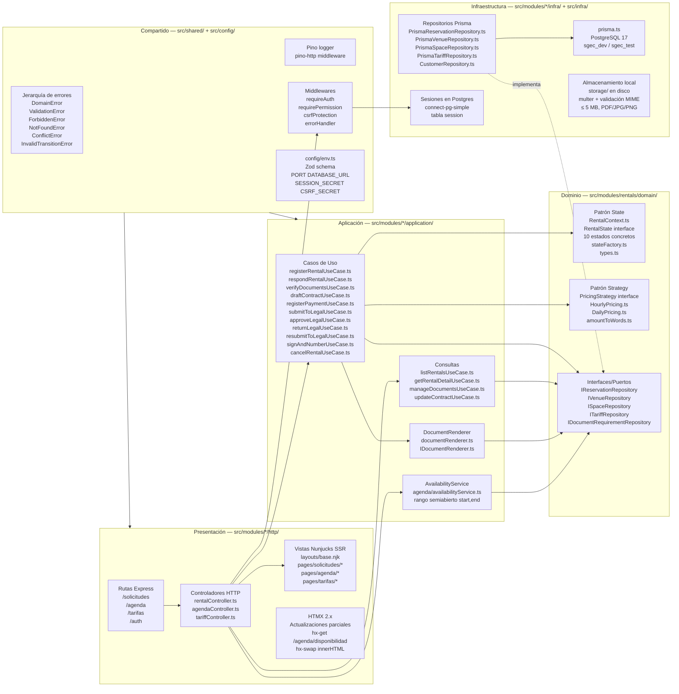
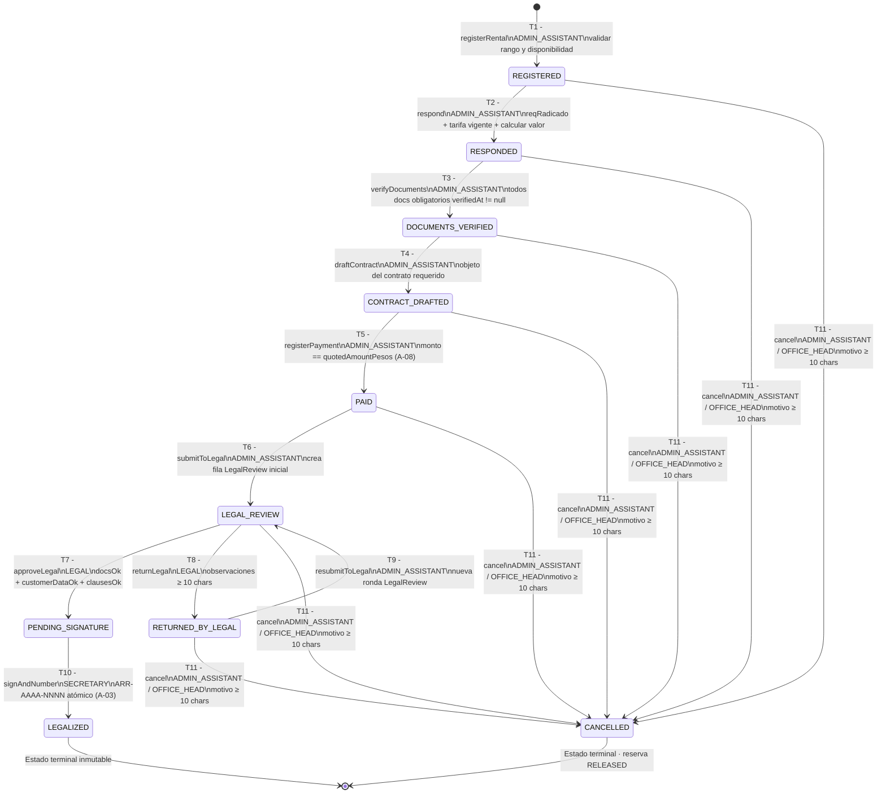
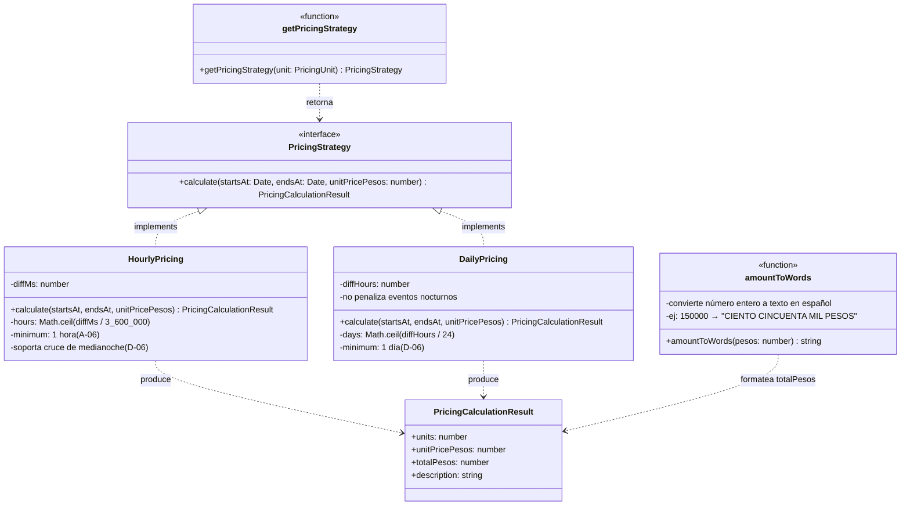
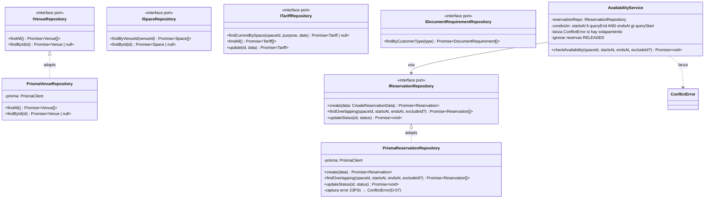
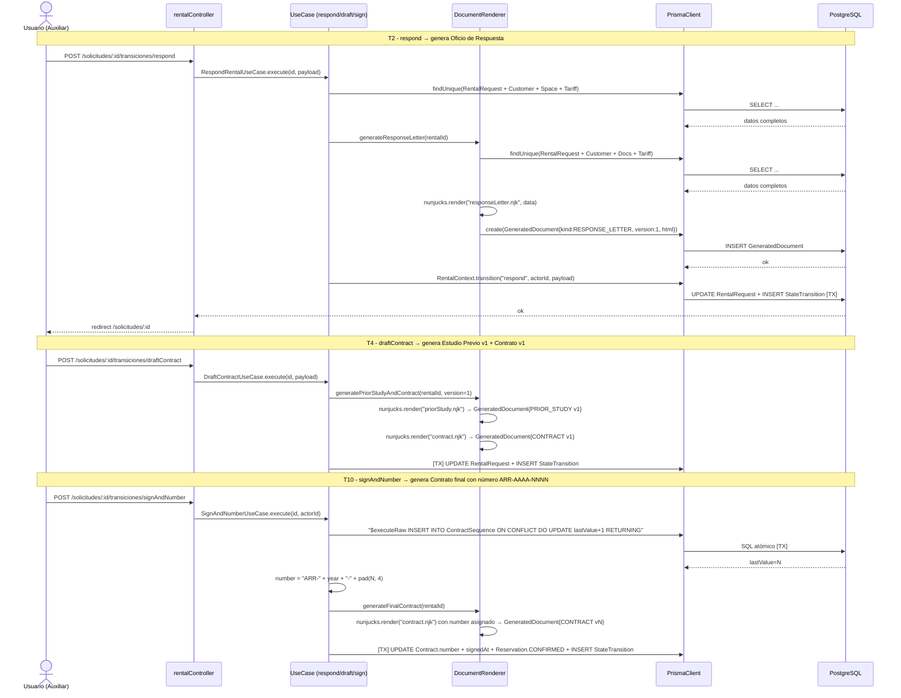
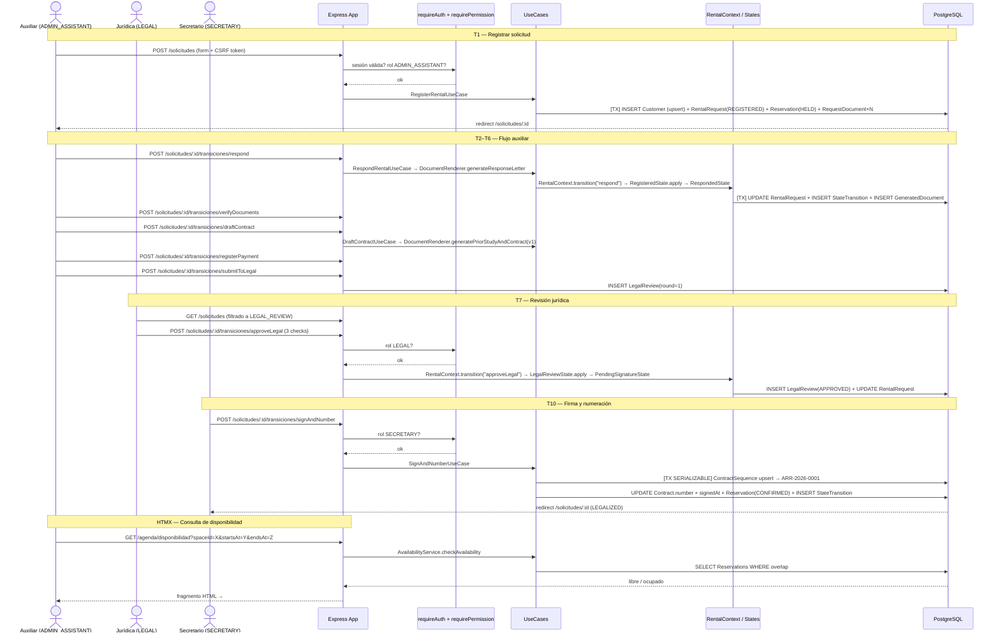

# Arquitectura del Sistema SGEC — Release 1.0

Sistema de Gestión de Escenarios y Bienes Culturales · Secretaría de Cultura de Pereira
Node.js 22 · TypeScript estricto · Express 5 · PostgreSQL 17 · Prisma ORM

---

## 1. Visión general del estilo arquitectónico

SGEC está construido como un **monolito modular en capas** (decisión `D-01`), ejecutándose como un proceso único en Node.js 22 con TypeScript estricto.



### Reglas de dependencia entre capas

1. **Presentación → Aplicación → Dominio ← Infraestructura.**
2. El **Dominio no importa Express, Prisma, Nunjucks ni `fs`**. Permanece 100% puro y testeable en memoria.
3. La inversión de dependencias se logra mediante **interfaces de repositorio (puertos)** definidas en el dominio e implementadas en infraestructura (`D-01`).
4. La composición de dependencias se realiza en `src/container.ts` sin frameworks pesados de DI.
5. Los controladores no contienen lógica de negocio; solo traducen HTTP ↔ casos de uso.

---

## 2. Patrón de diseño principal: State (Ciclo de vida del trámite)

El ciclo de vida del trámite de alquiler se modela formalmente mediante el **Patrón State** (decisión `D-02`). Cada estado encapsula sus transiciones válidas, los roles autorizados y las precondiciones. La entidad de contexto (`RentalContext`) delega todas las operaciones en el estado actual; el estado nunca se muta directamente por fuera de la máquina.

### 2.1 Diagrama de clases del Patrón State

```mermaid
classDiagram
    class RentalState {
        <<interface>>
        +status: RentalStatus
        +label: string
        +allowedTransitions() TransitionName[]
        +can(transition: TransitionName, actorRole: UserRole) CanTransitionResult
        +apply(ctx: IRentalContext, transition: TransitionName, payload: TransitionPayload) RentalState
    }

    class IRentalContext {
        <<interface>>
        +id: string
        +status: RentalStatus
        +responseRadicado: string | null
        +quotedAmountPesos: number | null
        +quotedTariffId: string | null
        +cancelReason: string | null
    }

    class RentalContext {
        +id: string
        +status: RentalStatus
        +currentState: RentalState
        +transitions: StateTransitionRecord[]
        +can(transition: TransitionName, actorRole: UserRole) CanTransitionResult
        +transition(transition: TransitionName, actorRole: UserRole, payload: TransitionPayload, actorId: string) Promise~StateTransitionRecord~
    }

    class stateFor {
        <<function factory>>
        +stateFor(status: RentalStatus) RentalState
    }

    class RegisteredState {
        +status: REGISTERED
        +label: "Registrada"
        +allowedTransitions() ["respond", "cancel"]
        +can(transition, actorRole) CanTransitionResult
        +apply(ctx, transition, payload) RentalState
    }

    class RespondedState {
        +status: RESPONDED
        +label: "Respondida"
        +allowedTransitions() ["verifyDocuments", "cancel"]
        +can(transition, actorRole) CanTransitionResult
        +apply(ctx, transition, payload) RentalState
    }

    class DocumentsVerifiedState {
        +status: DOCUMENTS_VERIFIED
        +label: "Documentos verificados"
        +allowedTransitions() ["draftContract", "cancel"]
        +can(transition, actorRole) CanTransitionResult
        +apply(ctx, transition, payload) RentalState
    }

    class ContractDraftedState {
        +status: CONTRACT_DRAFTED
        +label: "Contrato elaborado"
        +allowedTransitions() ["registerPayment", "cancel"]
        +can(transition, actorRole) CanTransitionResult
        +apply(ctx, transition, payload) RentalState
    }

    class PaidState {
        +status: PAID
        +label: "Pagado"
        +allowedTransitions() ["submitToLegal", "cancel"]
        +can(transition, actorRole) CanTransitionResult
        +apply(ctx, transition, payload) RentalState
    }

    class LegalReviewState {
        +status: LEGAL_REVIEW
        +label: "En revisión jurídica"
        +allowedTransitions() ["approveLegal", "returnLegal", "cancel"]
        +can(transition, actorRole) CanTransitionResult
        +apply(ctx, transition, payload) RentalState
    }

    class ReturnedByLegalState {
        +status: RETURNED_BY_LEGAL
        +label: "Devuelto por Jurídica"
        +allowedTransitions() ["resubmitToLegal", "cancel"]
        +can(transition, actorRole) CanTransitionResult
        +apply(ctx, transition, payload) RentalState
    }

    class PendingSignatureState {
        +status: PENDING_SIGNATURE
        +label: "Pendiente de firma"
        +allowedTransitions() ["signAndNumber", "cancel"]
        +can(transition, actorRole) CanTransitionResult
        +apply(ctx, transition, payload) RentalState
    }

    class LegalizedState {
        +status: LEGALIZED
        +label: "Legalizado"
        +allowedTransitions() []
        +can(transition, actorRole) FORBIDDEN
        +apply(ctx, transition, payload) throws InvalidTransitionError
    }

    class CancelledState {
        +status: CANCELLED
        +label: "Cancelada"
        +allowedTransitions() []
        +can(transition, actorRole) FORBIDDEN
        +apply(ctx, transition, payload) throws InvalidTransitionError
    }

    IRentalContext <|.. RentalContext : implements
    RentalContext o-- RentalState : delega en currentState
    stateFor ..> RentalState : crea
    RentalState <|.. RegisteredState : implements
    RentalState <|.. RespondedState : implements
    RentalState <|.. DocumentsVerifiedState : implements
    RentalState <|.. ContractDraftedState : implements
    RentalState <|.. PaidState : implements
    RentalState <|.. LegalReviewState : implements
    RentalState <|.. ReturnedByLegalState : implements
    RentalState <|.. PendingSignatureState : implements
    RentalState <|.. LegalizedState : implements
    RentalState <|.. CancelledState : implements
```



### 2.2 Diagrama de transiciones entre estados



### 2.3 Matriz de estados, transiciones y roles

| Estado | Etiqueta UI | Transición | Destino | Rol(es) autorizado(s) | Precondiciones clave |
|---|---|---|---|---|---|
| `REGISTERED` | Registrada | `respond` | `RESPONDED` | `ADMIN_ASSISTANT` | `responseRadicado` obligatorio (A-02); tarifa vigente (`validFrom ≤ hoy`, `validTo` null o futuro); valor calculado con `PricingStrategy`. |
| `REGISTERED` | Registrada | `cancel` | `CANCELLED` | `ADMIN_ASSISTANT`, `OFFICE_HEAD` | Motivo ≥ 10 caracteres. |
| `RESPONDED` | Respondida | `verifyDocuments` | `DOCUMENTS_VERIFIED` | `ADMIN_ASSISTANT` | Todos los `RequestDocument` marcados como obligatorios tienen `verifiedAt != null`. |
| `RESPONDED` | Respondida | `cancel` | `CANCELLED` | `ADMIN_ASSISTANT`, `OFFICE_HEAD` | Motivo ≥ 10 caracteres. |
| `DOCUMENTS_VERIFIED` | Docs verificados | `draftContract` | `CONTRACT_DRAFTED` | `ADMIN_ASSISTANT` | Se requiere campo `object` del contrato. |
| `DOCUMENTS_VERIFIED` | Docs verificados | `cancel` | `CANCELLED` | `ADMIN_ASSISTANT`, `OFFICE_HEAD` | Motivo ≥ 10 caracteres. |
| `CONTRACT_DRAFTED` | Contrato elaborado | `registerPayment` | `PAID` | `ADMIN_ASSISTANT` | Recibo, banco, comprobante, factura completos; `amountPesos == quotedAmountPesos` (AC-06.2). |
| `CONTRACT_DRAFTED` | Contrato elaborado | `cancel` | `CANCELLED` | `ADMIN_ASSISTANT`, `OFFICE_HEAD` | Motivo ≥ 10 caracteres. |
| `PAID` | Pagado | `submitToLegal` | `LEGAL_REVIEW` | `ADMIN_ASSISTANT` | Crea fila `LegalReview` inicial (ronda 1). |
| `PAID` | Pagado | `cancel` | `CANCELLED` | `ADMIN_ASSISTANT`, `OFFICE_HEAD` | Motivo ≥ 10 caracteres. |
| `LEGAL_REVIEW` | En revisión jurídica | `approveLegal` | `PENDING_SIGNATURE` | `LEGAL` | Las 3 verificaciones marcadas: `documentsOk`, `customerDataOk`, `clausesOk` (CAR-07). |
| `LEGAL_REVIEW` | En revisión jurídica | `returnLegal` | `RETURNED_BY_LEGAL` | `LEGAL` | Observaciones ≥ 10 caracteres (CAR-07). |
| `LEGAL_REVIEW` | En revisión jurídica | `cancel` | `CANCELLED` | `ADMIN_ASSISTANT`, `OFFICE_HEAD` | Motivo ≥ 10 caracteres. |
| `RETURNED_BY_LEGAL` | Devuelto por Jurídica | `resubmitToLegal` | `LEGAL_REVIEW` | `ADMIN_ASSISTANT` | Crea nueva ronda `LegalReview`; puede actualizar `object`/`additionalClauses`. |
| `RETURNED_BY_LEGAL` | Devuelto por Jurídica | `cancel` | `CANCELLED` | `ADMIN_ASSISTANT`, `OFFICE_HEAD` | Motivo ≥ 10 caracteres. |
| `PENDING_SIGNATURE` | Pendiente de firma | `signAndNumber` | `LEGALIZED` | `SECRETARY` | Número `ARR-AAAA-NNNN` asignado atómicamente (A-03); reserva → `CONFIRMED`. |
| `PENDING_SIGNATURE` | Pendiente de firma | `cancel` | `CANCELLED` | `ADMIN_ASSISTANT`, `OFFICE_HEAD` | Motivo ≥ 10 caracteres. |
| `LEGALIZED` | Legalizado | *(ninguna)* | — | — | Estado terminal inmutable. |
| `CANCELLED` | Cancelada | *(ninguna)* | — | — | Estado terminal; reserva → `RELEASED` (A-11). |

---

## 3. Modelo completo de la base de datos (Diagrama ER)

```mermaid
erDiagram
    User {
        uuid id PK
        string email UK
        string name
        string passwordHash
        UserRole role
        boolean active
        datetime createdAt
        datetime updatedAt
    }

    Venue {
        uuid id PK
        string name
        string address
        datetime createdAt
        datetime updatedAt
        uuid createdById
        uuid updatedById
    }

    Space {
        uuid id PK
        uuid venueId FK
        string name
        int capacity
        PricingUnit pricingUnit
        boolean active
        datetime createdAt
        datetime updatedAt
    }

    Tariff {
        uuid id PK
        uuid spaceId FK
        EventPurpose purpose
        PricingUnit unit
        int pricePesos
        datetime validFrom
        datetime validTo
        datetime createdAt
        datetime updatedAt
    }

    DocumentRequirement {
        uuid id PK
        CustomerType customerType
        string code
        string name
        boolean mandatory
        datetime createdAt
        datetime updatedAt
    }

    Customer {
        uuid id PK
        CustomerType type
        string documentType
        string documentNumber
        string name
        string legalRepresentative
        string email
        string phone
        string address
        datetime createdAt
        datetime updatedAt
    }

    RentalRequest {
        uuid id PK
        RentalStatus status
        uuid customerId FK
        uuid spaceId FK
        string eventName
        string eventDescription
        EventPurpose purpose
        int expectedAttendees
        timestamptz startsAt
        timestamptz endsAt
        RequestChannel channel
        datetime receivedAt
        string requestRadicado
        string responseRadicado
        int quotedAmountPesos
        uuid quotedTariffId FK
        string cancelReason
        datetime createdAt
        datetime updatedAt
    }

    Reservation {
        uuid id PK
        uuid spaceId FK
        uuid rentalRequestId FK
        timestamptz startsAt
        timestamptz endsAt
        ReservationStatus status
        datetime createdAt
        datetime updatedAt
    }

    RequestDocument {
        uuid id PK
        uuid rentalRequestId FK
        string requirementCode
        datetime receivedAt
        datetime verifiedAt
        uuid verifiedById FK
        string fileKey
        string notes
        datetime createdAt
        datetime updatedAt
    }

    Contract {
        uuid id PK
        uuid rentalRequestId FK UK
        string number UK
        string object
        int valuePesos
        string additionalClauses
        datetime signedAt
        uuid signedById FK
        datetime createdAt
        datetime updatedAt
    }

    Payment {
        uuid id PK
        uuid rentalRequestId FK UK
        string receiptNumber
        string bankName
        string voucherNumber
        datetime paidAt
        int amountPesos
        string invoiceNumber
        datetime invoiceDate
        string voucherFileKey
        datetime createdAt
        datetime updatedAt
    }

    LegalReview {
        uuid id PK
        uuid rentalRequestId FK
        int round
        uuid reviewerId FK
        boolean documentsOk
        boolean customerDataOk
        boolean clausesOk
        LegalDecision decision
        string observations
        datetime reviewedAt
        datetime createdAt
        datetime updatedAt
    }

    GeneratedDocument {
        uuid id PK
        uuid rentalRequestId FK
        DocumentKind kind
        int version
        text html
        uuid generatedById FK
        datetime generatedAt
        datetime createdAt
        datetime updatedAt
    }

    StateTransition {
        uuid id PK
        uuid rentalRequestId FK
        string fromStatus
        string toStatus
        string transition
        uuid actorId FK
        string note
        datetime occurredAt
        datetime createdAt
    }

    ContractSequence {
        int year PK
        int lastValue
    }

    Session {
        varchar sid PK
        json sess
        timestamp expire
    }

    Venue ||--o{ Space : "contiene"
    Space ||--o{ Tariff : "tiene tarifas"
    Space ||--o{ Reservation : "reservada en"
    Space ||--o{ RentalRequest : "solicitada en"
    Customer ||--o{ RentalRequest : "realiza"
    Tariff |o--o{ RentalRequest : "cotización congelada"
    RentalRequest ||--o{ Reservation : "genera"
    RentalRequest ||--o{ RequestDocument : "requiere"
    RentalRequest ||--o| Contract : "tiene"
    RentalRequest ||--o| Payment : "tiene"
    RentalRequest ||--o{ LegalReview : "revisada en"
    RentalRequest ||--o{ GeneratedDocument : "genera"
    RentalRequest ||--o{ StateTransition : "registra"
    User ||--o{ RequestDocument : "verifica"
    User ||--o{ Contract : "firma"
    User ||--o{ LegalReview : "revisa"
    User ||--o{ GeneratedDocument : "genera"
    User ||--o{ StateTransition : "actúa en"
```

### Restricciones y características especiales de la BD

| Elemento | Detalle |
|---|---|
| **Extensión `btree_gist`** | Habilitada en PostgreSQL 17 para soportar la restricción de exclusión en `Reservation`. |
| **Exclusion constraint `reservation_no_overlap`** | `EXCLUDE USING GIST (spaceId WITH =, tstzrange(startsAt, endsAt) WITH &&) WHERE (status IN ('HELD', 'CONFIRMED'))` — previene colisiones de agenda a nivel de BD. |
| **Secuencia de contratos** | `ContractSequence` con `INSERT ... ON CONFLICT DO UPDATE SET lastValue = lastValue + 1 RETURNING lastValue` (SQL crudo vía `prisma.$executeRaw`) para numeración atómica `ARR-AAAA-NNNN`. |
| **Índices** | `RentalRequest(status)`, `RentalRequest(customerId)`, `Reservation(spaceId, startsAt)`, `Session(expire)`. |
| **Unicidad compuesta** | `Customer(type, documentNumber)`, `DocumentRequirement(customerType, code)`, `Contract(rentalRequestId)`, `Contract(number)`, `Payment(rentalRequestId)`. |
| **Zona horaria** | Todos los timestamps de agenda usan `Timestamptz(3)` (con zona horaria); interpretados en `America/Bogota`. |

---

## 4. Patrón Strategy — Cálculo de tarifas



---

## 5. Patrón Repository y protección anti-cruces de agenda



### Doble nivel de protección anti-cruces (ON-3)

| Nivel | Mecanismo | Qué detecta |
|---|---|---|
| **Aplicación** | `AvailabilityService.checkAvailability()` evalúa el rango semiabierto `[startsAt, endsAt)` con la condición `startsAt < queryEnd AND endsAt > queryStart` para reservas `HELD` o `CONFIRMED`. | Conflictos en escrituras secuenciales. |
| **Base de datos** | Restricción de exclusión `EXCLUDE USING GIST (spaceId WITH =, tstzrange(startsAt, endsAt) WITH &&)`. El error Postgres `23P01` es capturado en `PrismaReservationRepository` y transformado en `ConflictError` (código HTTP 409). | Colisiones concurrentes (race conditions). |

---

## 6. Renderizado de documentos y snapshots inmutables



---

## 7. Flujo HTTP del camino feliz (T1 → T10)



---

## 8. Estructura física del código

```
/Users/pitoparker/Documents/Universidad/INGSOFT/
├── prisma/
│   ├── schema.prisma            # Esquema completo (15 modelos, 9 enums, restricción btree_gist)
│   ├── migrations/              # Migraciones SQL versionadas
│   └── seed.ts                  # Seed: 6 usuarios, 2 venues, spaces, tarifas, solicitud por estado
├── src/
│   ├── app.ts                   # Express 5: helmet, CSRF, sesión, pino-http, Nunjucks, rutas, errorHandler
│   ├── server.ts                # Puerto HTTP, arranque del servidor con logger
│   ├── container.ts             # Composición de dependencias (sin framework DI)
│   ├── config/
│   │   └── env.ts               # Validación Zod de variables de entorno
│   ├── shared/
│   │   ├── errors.ts            # DomainError, ValidationError, ForbiddenError, NotFoundError,
│   │   │                        #   ConflictError, InvalidTransitionError
│   │   ├── logger.ts            # Pino logger estructurado con serializers
│   │   ├── middleware/
│   │   │   ├── errorHandler.ts  # Mapea errores tipados a HTTP 400/403/404/409/422/500
│   │   │   └── flash.ts         # Flash messages via sesión (success/error/info)
│   │   └── utils/
│   │       ├── amountToWords.ts # Conversión número → texto en pesos COP (español)
│   │       └── formatters.ts    # formatDate, formatCurrency, formatDateRange
│   ├── infra/
│   │   └── prisma.ts            # PrismaClient singleton con extensiones de logging
│   └── modules/
│       ├── auth/
│       │   ├── authController.ts    # GET/POST /login, POST /logout
│       │   ├── authRoutes.ts        # Rutas con rate-limit (5 intentos/15min)
│       │   ├── permissions.ts       # Mapa rol → permisos; función hasPermission()
│       │   ├── requireAuth.ts       # Middleware: redirige a /login si no hay sesión
│       │   └── requirePermission.ts # Middleware: lanza ForbiddenError si falta permiso
│       ├── catalog/
│       │   ├── domain/              # Interfaces IVenueRepository, ISpaceRepository, etc.
│       │   └── infra/               # PrismaVenueRepository, PrismaSpaceRepository, etc.
│       ├── agenda/
│       │   ├── availabilityService.ts      # checkAvailability con rango [start,end)
│       │   ├── agendaController.ts         # GET /agenda, GET /agenda/disponibilidad
│       │   └── infra/PrismaReservationRepository.ts  # Captura 23P01 → ConflictError
│       ├── customers/
│       │   └── infra/CustomerRepository.ts # upsert por (type, documentNumber)
│       ├── documents/
│       │   ├── documentRenderer.ts         # Implementa IDocumentRenderer
│       │   ├── routes.ts                   # GET /solicitudes/:id/documentos/:kind
│       │   └── templates/
│       │       ├── responseLetter.njk      # Oficio de respuesta (kind=RESPONSE_LETTER)
│       │       ├── priorStudy.njk          # Estudio previo (kind=PRIOR_STUDY)
│       │       └── contract.njk            # Contrato de arrendamiento (kind=CONTRACT)
│       └── rentals/
│           ├── domain/
│           │   ├── states/
│           │   │   ├── types.ts                  # RentalStatus, TransitionName, UserRole, payloads
│           │   │   ├── rentalState.ts             # Interfaz RentalState
│           │   │   ├── rentalContext.ts            # RentalContext: delega en currentState
│           │   │   ├── stateFactory.ts             # stateFor(status): RentalState
│           │   │   ├── registeredState.ts          # T2 respond, T11 cancel
│           │   │   ├── respondedState.ts            # T3 verifyDocuments, T11 cancel
│           │   │   ├── documentsVerifiedState.ts   # T4 draftContract, T11 cancel
│           │   │   ├── contractDraftedState.ts     # T5 registerPayment, T11 cancel
│           │   │   ├── paidState.ts                # T6 submitToLegal, T11 cancel
│           │   │   ├── legalReviewState.ts         # T7 approveLegal, T8 returnLegal, T11 cancel
│           │   │   ├── returnedByLegalState.ts     # T9 resubmitToLegal, T11 cancel
│           │   │   ├── pendingSignatureState.ts    # T10 signAndNumber, T11 cancel
│           │   │   ├── legalizedState.ts           # Terminal inmutable
│           │   │   └── cancelledState.ts           # Terminal inmutable
│           │   └── pricing/
│           │       ├── pricingStrategy.ts          # Interfaz PricingStrategy
│           │       ├── hourlyPricing.ts             # Calcula por horas (ceil)
│           │       └── dailyPricing.ts              # Calcula por días (ceil/24h)
│           ├── application/
│           │   ├── IDocumentRenderer.ts             # Puerto: generateResponseLetter, etc.
│           │   ├── registerRentalUseCase.ts         # T1: valida, crea RentalRequest+Reservation
│           │   ├── respondRentalUseCase.ts           # T2: congela tarifa+valor, genera oficio
│           │   ├── verifyDocumentsUseCase.ts         # T3: verifica checklist documental
│           │   ├── draftContractUseCase.ts           # T4: crea Contract, genera docs v1
│           │   ├── registerPaymentUseCase.ts         # T5: valida monto==cotizado
│           │   ├── submitToLegalUseCase.ts           # T6: crea LegalReview round 1
│           │   ├── approveLegalUseCase.ts            # T7: 3 checks, PENDING_SIGNATURE
│           │   ├── returnLegalUseCase.ts             # T8: observaciones, RETURNED_BY_LEGAL
│           │   ├── resubmitToLegalUseCase.ts         # T9: nueva ronda
│           │   ├── signAndNumberUseCase.ts           # T10: ARR-AAAA-NNNN atómico
│           │   ├── cancelRentalUseCase.ts            # T11: libera reserva
│           │   ├── manageDocumentsUseCase.ts         # adjuntar/marcar/verificar docs
│           │   ├── updateContractUseCase.ts          # editar object/cláusulas
│           │   ├── listRentalsUseCase.ts             # listado paginado con filtros
│           │   └── getRentalDetailUseCase.ts         # detalle con timeline, docs, pago
│           ├── http/                                 # Controladores, rutas, schemas Zod
│           └── infra/                               # Repos Prisma, storage local (multer)
├── src/views/
│   ├── layouts/
│   │   └── base.njk            # Layout: listón cívico Pereira, nav por rol, flash, scripts
│   ├── partials/
│   │   ├── nav.njk             # Navegación con enlaces filtrados por currentUser.role
│   │   ├── badge.njk           # Insignia de estado con color + texto
│   │   ├── flash.njk           # Mensajes success/error/info (arrays vacíos → sin alertas)
│   │   └── pagination.njk      # Controles prev/next con conteo de páginas
│   └── pages/
│       ├── auth/login.njk              # Formulario de acceso con CSRF
│       ├── home/index.njk              # Dashboard con "Pendientes para mí" por rol
│       ├── solicitudes/
│       │   ├── index.njk               # Listado con filtros, tabla, paginación
│       │   ├── nueva.njk               # Formulario registro con HTMX disponibilidad
│       │   └── detalle.njk             # Expediente: acciones, timeline, docs, pago, jurídica
│       ├── agenda/
│       │   ├── index.njk               # Agenda 30 días (solo lectura)
│       │   └── _disponibilidad.njk     # Fragmento HTMX: libre/ocupado/incompleto
│       ├── tarifas/index.njk           # Tabla tarifas; edición inline HTMX (solo OFFICE_HEAD)
│       └── errors/
│           ├── 403.njk                 # Acceso denegado
│           ├── 404.njk                 # Página no encontrada
│           └── 500.njk                 # Error interno (sin stack trace al usuario)
├── tests/
│   ├── unit/                    # 679+ pruebas unitarias (estados, precios, dominio puro)
│   ├── integration/             # Pruebas integración con sgec_test (Supertest)
│   └── e2e/                     # 4 escenarios Playwright (happy-path, legal-return, agenda-conflict, cancellation)
├── public/
│   ├── css/app.css             # Sistema de diseño institucional Pereira (rojo #cf1020, amarillo #f59e0b)
│   └── vendor/                 # htmx.min.js, pico.min.css (sin CDN externo)
└── docs/
    ├── ARCHITECTURE.md          # Este documento
    ├── UI_INTERFACES.md         # Mockups y especificación de cada pantalla
    ├── TRAZABILIDAD.md          # Matriz CAR → AC → prueba
    └── PROTOCOLO_ACEPTACION.md  # Protocolo de aceptación con resultados obtenidos
```

---

## 9. Atributos de calidad del sistema

| Atributo | Estrategia en SGEC | Evidencia en el código |
|---|---|---|
| **Integridad de datos** | Restricción de exclusión PostgreSQL (`btree_gist` + `tstzrange`), transacciones Prisma atómicas en cada mutación de estado, numeración de contratos serializable `ARR-AAAA-NNNN`. | `PrismaReservationRepository.ts` captura `23P01`; `signAndNumberUseCase.ts` usa `$executeRaw` en TX. |
| **Seguridad** | Sesiones en Postgres con cookies `httpOnly`/`sameSite=lax`, RBAC evaluado estrictamente en servidor (`requirePermission`), tokens CSRF con doble verificación (`csrf-csrf`), cabeceras Helmet CSP, sanitización y validación con Zod en todos los endpoints con body. | `app.ts`, `permissions.ts`, `authRoutes.ts` (rate-limit 5/15min). |
| **Mantenibilidad** | Dominio 100% desacoplado de frameworks (sin `import` de Express/Prisma/fs en `domain/`), 0 `any` explícito, Patrón State permite añadir estados sin modificar los existentes (Open/Closed). | `rentalState.ts` interfaz pura; `stateFactory.ts` único punto de creación. |
| **Rendimiento** | SSR ultra-liviano (sin bundle JS cliente), HTMX para actualizaciones parciales sin SPA overhead, consultas Prisma optimizadas con índices en `status` y `customerId`. | `_disponibilidad.njk` fragmento de 3 líneas; `listRentalsUseCase` con paginación de 20/pág. |
| **Trazabilidad** | Cada transición registra inmutablemente: actor, fecha exacta, estado origen→destino, nota explicativa (`StateTransition`). Documentos como snapshots HTML inmutables con versión (`GeneratedDocument`). | `rentalContext.ts` escribe `StateTransition` en misma TX que el cambio de estado. |
| **Accesibilidad** | Responsive desde 360px (Pico.css), foco visible contrastado, badges con color + texto simultáneo (no solo color), diálogos nativos `<dialog>` para confirmaciones destructivas. | `badge.njk`, `app.css` (WCAG AA), `detalle.njk` con `<dialog>` nativo. |
| **Testabilidad** | Dominio puro testeable en memoria (sin BD), 789 pruebas (unit + integración + 4 E2E Playwright), cobertura ≥ 85% en `src/modules/rentals/domain/`. | `tests/unit/states/*.test.ts` sin Prisma; `tests/e2e/*.spec.ts` con Playwright. |

---

## 10. Registro de decisiones arquitectónicas (ADRs)

| ID | Decisión | Alternativas consideradas | Consecuencias |
|---|---|---|---|
| `D-01` | **Monolito modular en capas** de proceso único (no microservicios). | Microservicios, serverless. | Despliegue simple en una sola instancia; sin latencia de red entre módulos; escala vertical. |
| `D-02` | **Patrón State** para el ciclo de vida del trámite, con 10 clases concretas y `RentalContext`. | Switch/if sobre campo `status`, máquina de estados tabla-driven. | Extensión por adición (O/C), lógica por estado encapsulada, imposible ejecutar transición inválida. |
| `D-03` | **Renderizado en servidor con Nunjucks + HTMX** sin compilación de frontend (sin Webpack, Vite, React). | SPA React/Vue, Next.js. | Sin bundle JS en cliente; sin `node_modules` en el navegador; respuestas HTML directas desde Express. |
| `D-04` | **Restricción de exclusión** en BD con `btree_gist + tstzrange` para agenda. | Solo validación en aplicación. | Garantía absoluta contra solapamientos concurrentes a nivel de base de datos. |
| `D-05` | Adopción de **supuestos A-01 a A-15** ante ausencia del Manual de Procedimientos oficial. | Esperar documentación oficial. | Documenta criterios asumidos; permite avanzar; fácilmente ajustable cuando llegue el manual. |
| `D-06` | **`HourlyPricing`** (ceil horas) y **`DailyPricing`** (ceil días/24h) como estrategias independientes. | Fórmula única con switch. | Extensible a nuevas unidades (semanal, mensual) sin modificar las existentes. |
| `D-07` | **Rango semiabierto `[startsAt, endsAt)`** en PostgreSQL y captura del error `23P01` → `ConflictError` 409. | Rango cerrado; solo validación optimista. | Franjas contiguas no colisionan; errores de BD se convierten en respuestas HTTP tipadas. |
| `D-08` | **Contrato inmutable congelado** de `RentalContext.transition()` — firma pública estabilizada. | Firma fluida que puede cambiar. | Casos de uso y tests no se rompen si cambian implementaciones internas de estados. |
| `D-09` | **Snapshots HTML inmutables** como `GeneratedDocument` en BD para auditoría jurídica. | Regenerar documentos on-demand. | Auditoría de qué se envió en cada momento; no se pierde el estado del documento al cambiar datos. |
| `D-10` | Gestión de riesgo en dependencias de desarrollo (`tinypool` en tests). | Ignorar advisories en dev. | Documentado en PROGRESS.md; no afecta producción. |
| `D-11` | Validación y guardias de estado en **capa de aplicación** con tipado estricto TypeScript, no en controladores. | Validación en controladores. | Controladores delgados; lógica de validación reutilizable y testeable sin HTTP. |
