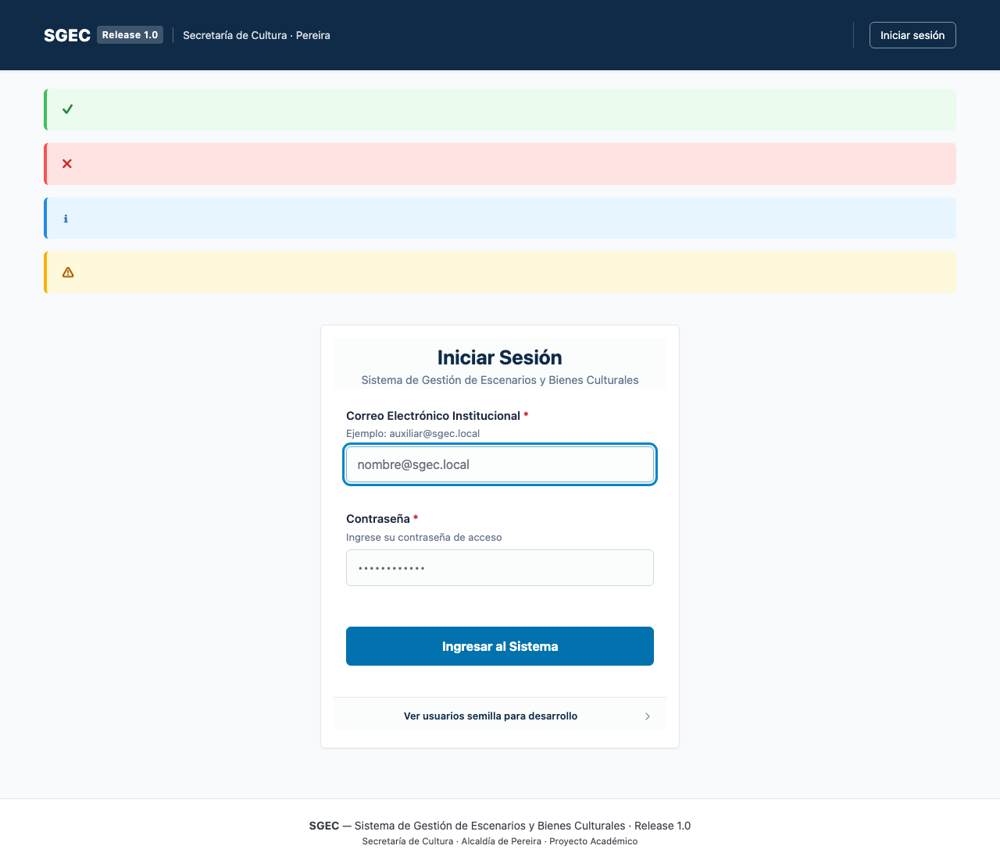
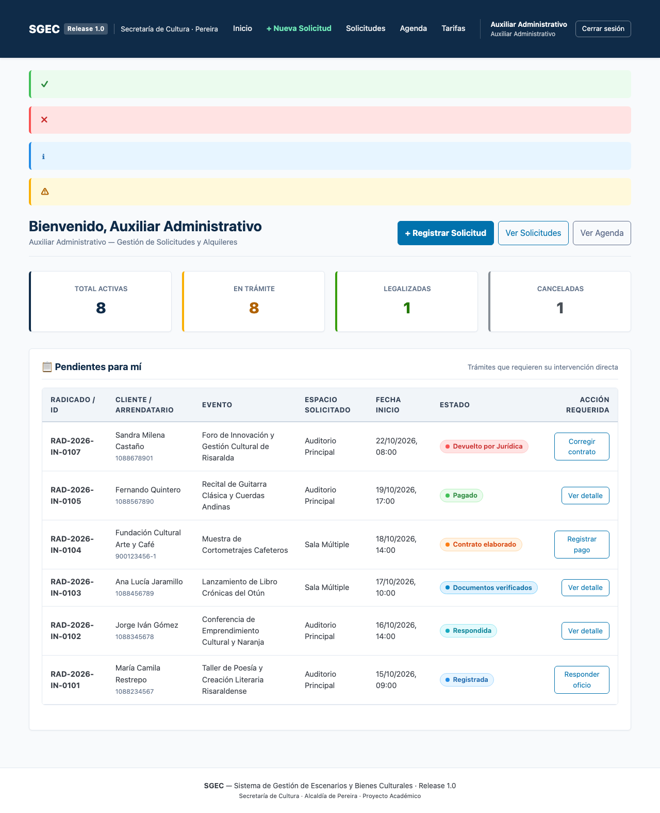
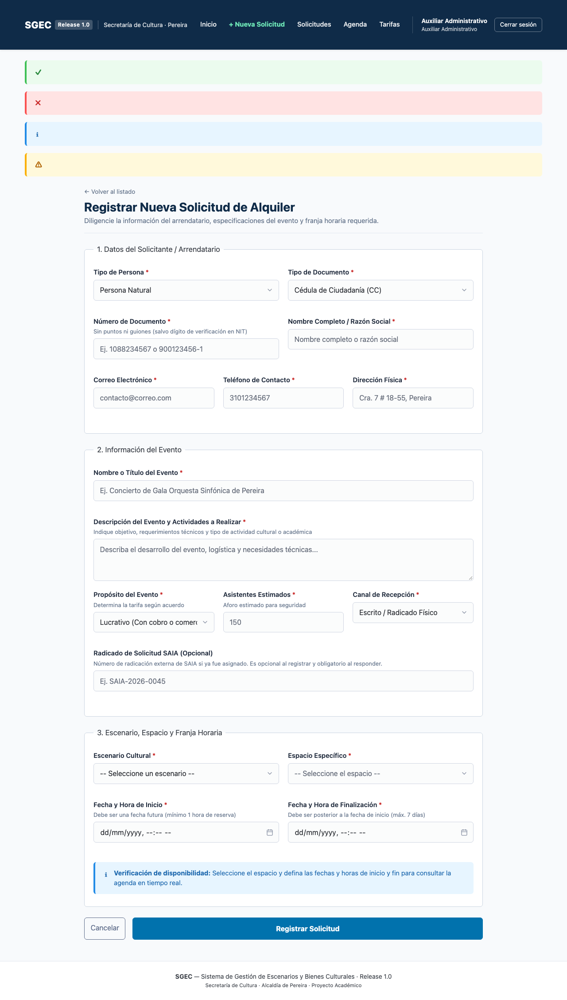
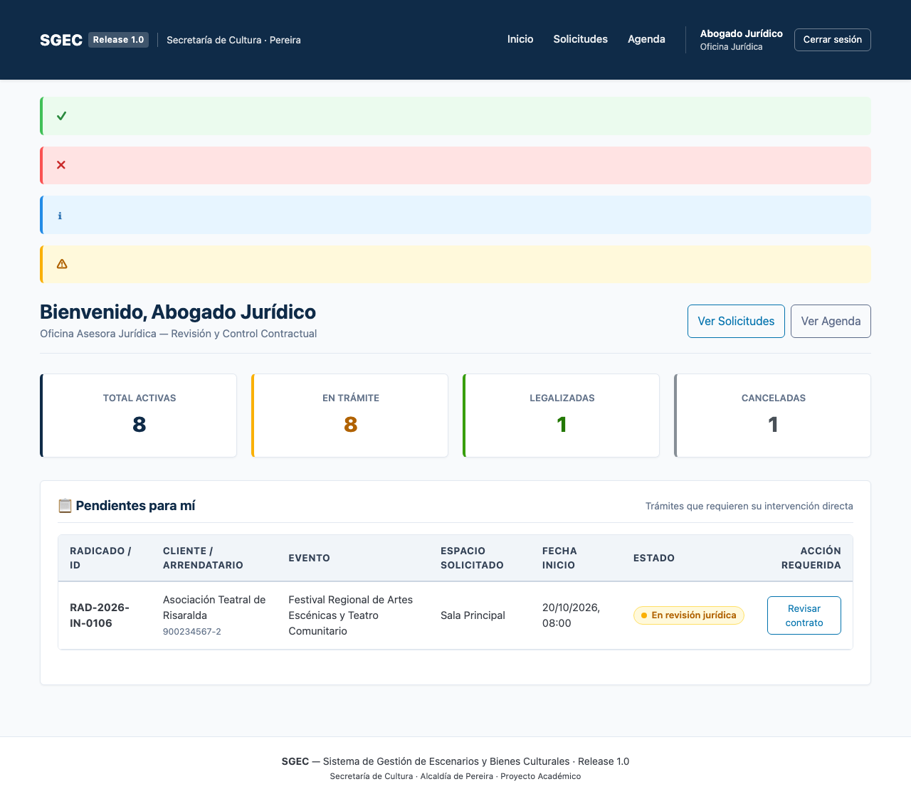
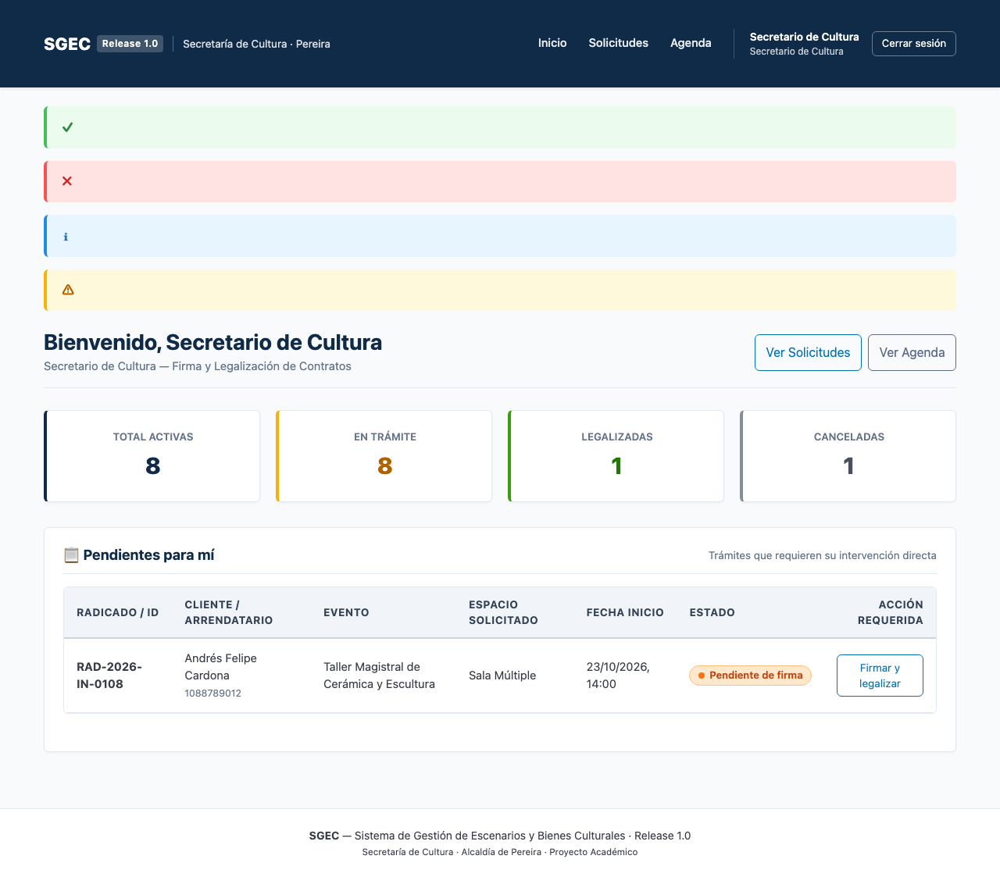
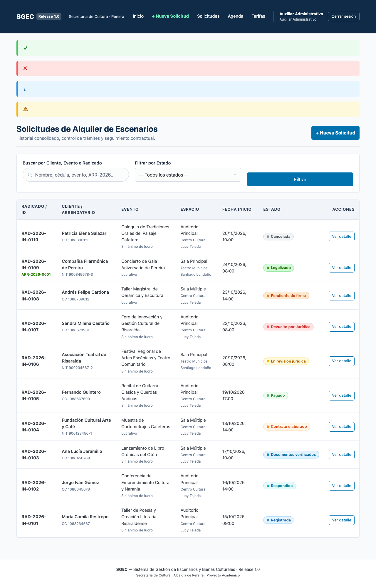
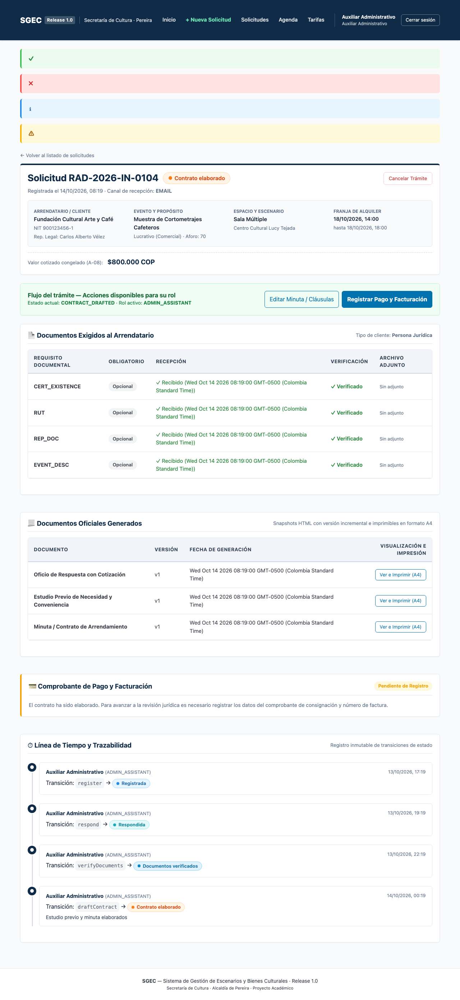
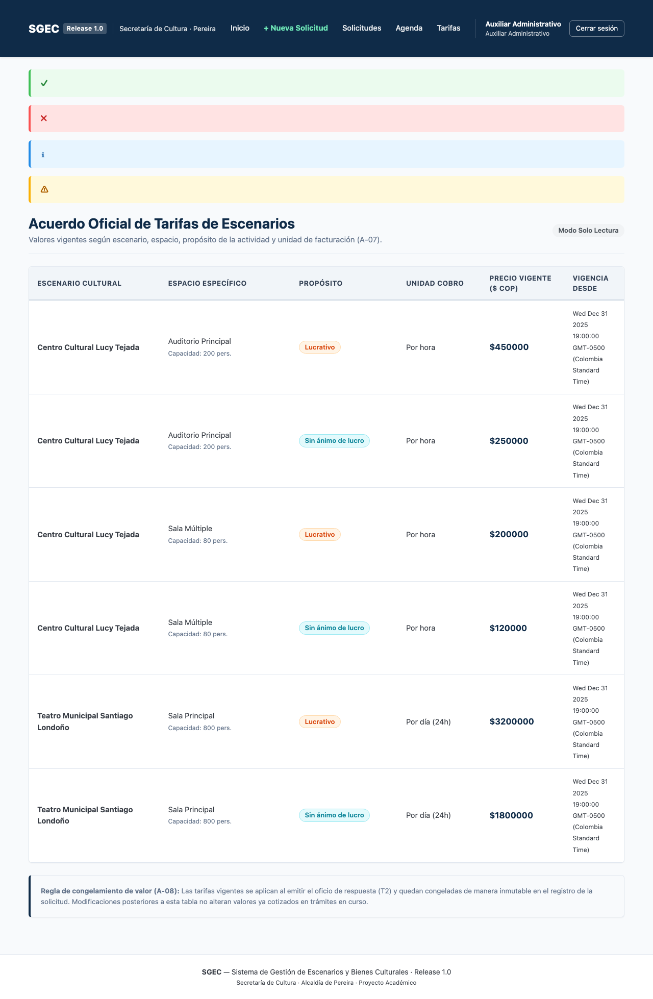
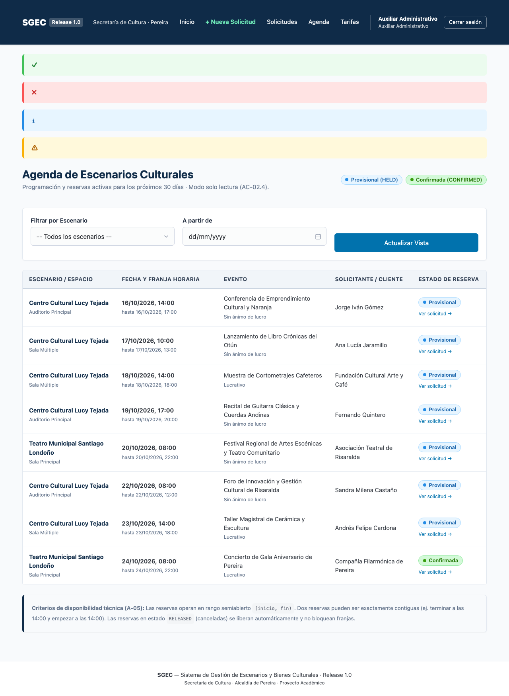
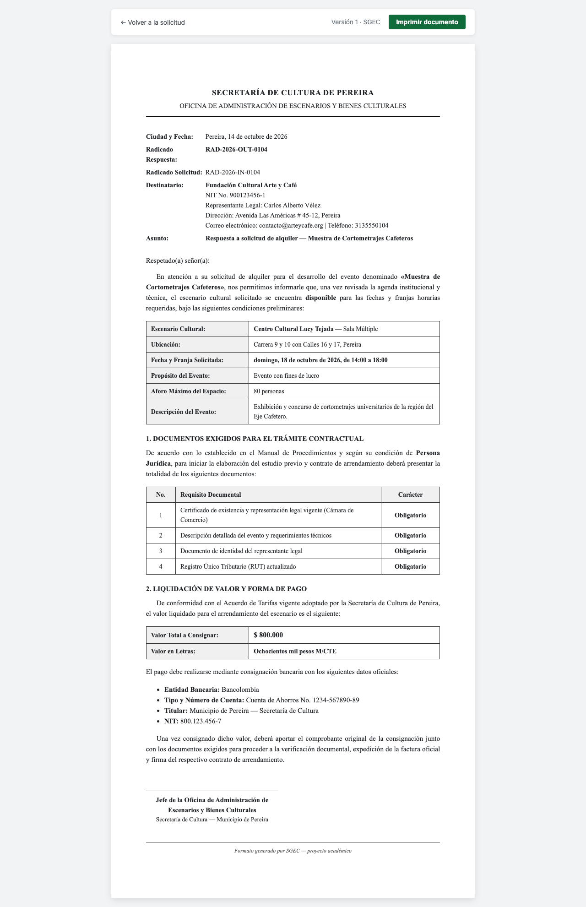

# Manual de Usuario del Sistema SGEC — Release 1.0

Sistema de Gestión de Escenarios y Bienes Culturales  
Secretaría de Cultura de Pereira — Proyecto Académico

---

## 1. Introducción y Acceso al Sistema

El **Sistema de Gestión de Escenarios y Bienes Culturales (SGEC)** es la plataforma oficial para la radicación, trámite contractual, verificación documental, recaudo y legalización del alquiler de escenarios culturales adscritos a la Secretaría de Cultura de Pereira (Centro Cultural Lucy Tejada y Teatro Municipal Santiago Londoño).

### 1.1 Pantalla de Inicio de Sesión
Para ingresar a la plataforma, abra su navegador web y diríjase a `http://localhost:3000/login`.

Ingrese sus credenciales institucionales:
- **Correo Electrónico:** Su dirección asignada (ej. `auxiliar@sgec.local`, `juridica@sgec.local`, etc.).
- **Contraseña:** Su clave de acceso institucional (inicial: `Cambiar123!`).

---

## 2. Guía de Operación por Roles

### 2.1 Auxiliar Administrativo (`ADMIN_ASSISTANT`)

El Auxiliar Administrativo es el encargado de la radicación inicial, verificación de requisitos y gestión de las etapas precontractuales.

#### A. Bandeja de Pendientes
Al iniciar sesión, el Auxiliar visualiza su panel de control con las solicitudes que requieren su atención inmediata: solicitudes nuevas por responder, contratos pendientes de pago y trámites devueltos por la Oficina Jurídica.

#### B. Registro de Nueva Solicitud (T1)
1. Haga clic en **«Nueva Solicitud»** en la barra superior o en el botón de acción rápida.
2. Complete los datos del solicitante (Persona Natural o Jurídica). Si la cédula o NIT ya existe en el sistema, los datos se completarán automáticamente.
3. Describa el evento, propósito (lucrativo o sin ánimo de lucro) y número estimado de asistentes.
4. Seleccione el escenario y espacio deseado, e indique la fecha y hora de inicio y fin. El sistema verificará de forma automática e inmediata la disponibilidad del espacio mediante HTMX.
5. Haga clic en **«Registrar Solicitud»**. El trámite quedará en estado **«Registrada»** y se creará una reserva temporal (`HELD`) en la agenda.

#### C. Responder Solicitud y Emitir Oficio (T2)
1. Ingrese al detalle de la solicitud en estado `Registrada`.
2. Haga clic en el botón **«Responder Solicitud y Emitir Oficio»**.
3. Ingrese el número de radicado oficial de salida (ej. `OFC-2027-010`).
4. Al confirmar, el sistema congela la tarifa vigente y el valor a consignar, realiza la transición a **«Respondida»** y genera el documento oficial de respuesta con formato A4.

#### D. Verificación Documental (T3)
1. En la pestaña **Documentos Exigidos al Arrendatario**, el Auxiliar revisa cada requisito según el tipo de cliente.
2. Puede adjuntar archivos digitales en formato PDF o imagen (hasta 5 MB) y marcar cada documento obligatorio como verificado.
3. Una vez validados todos los requisitos obligatorios, haga clic en **«Aprobar Checklist de Documentos»**. El estado cambiará a **«Documentos verificados»**.

#### E. Elaborar Estudio Previo y Minuta (T4)
1. Haga clic en **«Elaborar Estudio Previo y Contrato»**.
2. Puede ajustar el objeto contractual y agregar cláusulas especiales de ser necesario.
3. Al confirmar, el sistema genera la primera versión formal del estudio de conveniencia y de la minuta, avanzando al estado **«Contrato elaborado»**.

#### F. Registrar Soporte de Pago y Facturación (T5)
1. Una vez el solicitante consigne el valor exacto cotizado, haga clic en **«Registrar Pago y Facturación»**.
2. Diligencie el número de recibo oficial, banco de recaudo, número de comprobante, fecha y número de factura de venta. El monto debe coincidir exactamente con el valor cotizado.
3. Al guardar, el estado avanza a **«Pagado»**.

#### G. Radicar a Revisión Jurídica (T6 y T9)
1. Haga clic en **«Enviar Contrato a Revisión Jurídica»**. La solicitud pasará a estado **«En revisión jurídica»** y se activará en la bandeja del abogado asignado.
2. Si Jurídica devuelve el trámite con observaciones, aparecerá en estado **«Devuelto por Jurídica»**. El Auxiliar podrá abrir el diálogo **«Corregir y Reenviar a Jurídica»**, subsanar el texto de las cláusulas y radicar una nueva ronda de revisión.

---

### 2.2 Asesor Jurídico (`LEGAL`)

El Asesor Jurídico tiene competencia exclusiva sobre las solicitudes que se encuentran en estado **«En revisión jurídica»**.

#### A. Revisión y Dictamen Jurídico (T7 y T8)
1. Ingrese al detalle de la solicitud desde el listado o panel.
2. El Asesor Jurídico cuenta con dos opciones formales:
   - **Devolver con Observaciones (T8):** Si identifica inconsistencias documentales o clausulado ambiguo, hace clic en este botón, ingresa observaciones detalladas (mínimo 10 caracteres) y confirma. El contrato regresa al Auxiliar.
   - **Aprobar Revisión Jurídica (T7):** Para emitir concepto favorable, debe marcar obligatoriamente los tres checks de control normativo:
     - *1. Documentación completa, auténtica y con vigencia acreditada.*
     - *2. Datos y representación del arrendatario verificados en registros públicos.*
     - *3. Objeto, clausulado y obligaciones ajustados a la normatividad institucional.*
3. Al aprobar, el trámite avanza al estado **«Pendiente de firma»**.

---

### 2.3 Secretario de Cultura (`SECRETARY`)

El Secretario de Cultura representa legalmente a la entidad territorial y es la única autoridad facultada para suscribir el contrato.

#### A. Firma Electrónica y Legalización (T10)
1. El Secretario consulta las solicitudes en estado **«Pendiente de firma»**.
2. Revisa la minuta final y hace clic en **«Firmar y Legalizar Contrato»**.
3. Confirma el diálogo de advertencia de acción irreversible.
4. El sistema ejecuta una operación atómica:
   - Asigna el número consecutivo institucional anual: `ARR-AAAA-NNNN` (ej. `ARR-2026-0001`).
   - Actualiza la reserva de espacio de `HELD` a `CONFIRMED` definitiva.
   - Sella el contrato final haciéndolo 100% inmutable.
   - Cambia el estado a **«Legalizado»**.

---

### 2.4 Jefe de Oficina de Escenarios (`OFFICE_HEAD`)

El Jefe de Oficina supervisa la operación global, coordina la agenda y administra las tarifas.

#### A. Consulta Global y Línea de Tiempo
El Jefe puede acceder a cualquier solicitud, filtrar por cliente, radicado, número de contrato o estado, y consultar la línea de tiempo auditable completa de transiciones:

#### B. Cancelación de Solicitudes (T11)
Tanto el Jefe como el Auxiliar pueden cancelar una solicitud antes de su firma si el solicitante desiste:
1. Haga clic en **«Cancelar Trámite»**.
2. Ingrese el motivo formal de cancelación (mínimo 10 caracteres).
3. Al confirmar, la solicitud pasa a estado **«Cancelada»** y la franja horaria queda inmediatamente liberada (`RELEASED`) en la agenda. Si existía un pago registrado, se deja constancia de trámite de devolución contable (A-11).

#### C. Gestión del Catálogo de Tarifas
El Jefe de Oficina puede consultar y actualizar los valores vigentes por hora o por día para cada espacio y propósito:

---

### 2.5 Agenda General de Escenarios

Todos los roles autenticados tienen acceso a la vista de agenda general para consultar la ocupación de los escenarios culturales durante los próximos 30 días:

---

## 3. Consulta e Impresión de Documentos Oficiales

En cualquier momento del trámite, los usuarios autorizados pueden consultar e imprimir las versiones oficiales generadas con formato CSS A4:

Haciendo clic en el botón **«Imprimir Documento»**, se invocará la ventana de impresión nativa del navegador para exportar directamente a formato PDF o enviarlo a una impresora física con márgenes institucionales de 2 cm y tipografía reglamentaria.

---

## 4. Convención de Estados y Colores de Insignias

| Estado | Etiqueta en Pantalla | Color / Significado |
|---|---|---|
| `REGISTERED` | **Registrada** | Azul info — Solicitud radicada; reserva en espera temporal. |
| `RESPONDED` | **Respondida** | Azul cielo — Oficio de respuesta y cotización emitidos. |
| `DOCUMENTS_VERIFIED` | **Documentos verificados** | Cian — Checklist documental completo y acreditado. |
| `CONTRACT_DRAFTED` | **Contrato elaborado** | Naranja claro — Minuta redactada y estudio previo listo. |
| `PAID` | **Pagado** | Verde claro — Pago verificado contra valor cotizado. |
| `LEGAL_REVIEW` | **En revisión jurídica** | Amarillo alerta — En manos de la Oficina Jurídica. |
| `RETURNED_BY_LEGAL` | **Devuelto por Jurídica** | Rojo suave — Requiere subsanación o ajustes del Auxiliar. |
| `PENDING_SIGNATURE` | **Pendiente de firma** | Naranja oscuro — Aprobado por Jurídica, listo para el Secretario. |
| `LEGALIZED` | **Legalizado** | Verde éxito — Firmado y numerado formalmente; inmutable. |
| `CANCELLED` | **Cancelada** | Gris neutro — Desistido o revocado; agenda liberada. |
