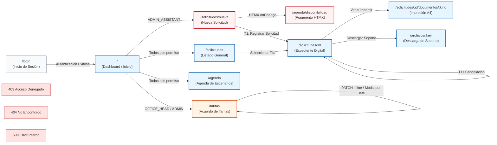

# SGEC — Especificación de Interfaces de Usuario y Mockups (Release 1.0)

> **Sistema de Gestión de Escenarios y Bienes Culturales**  
> **Secretaría de Cultura · Alcaldía de Pereira**  
> *Proyecto Académico de Ingeniería de Software*  
> **Rama de referencia:** `release/1.0`

---

## 1. Introducción

### 1.1 Propósito del Documento
El presente documento constituye la especificación canónica y exhaustiva de las interfaces de usuario del **Sistema de Gestión de Escenarios y Bienes Culturales (SGEC)** para el **Release 1.0**. Su propósito es definir la estructura visual, jerarquía informativa, flujos de interacción, semántica HTML, reglas de accesibilidad (WCAG 2.1 AA) y comportamiento dinámico mediante HTMX para todas las pantallas del sistema.

Este documento sirve como puente formal entre el modelado de dominio y arquitectura técnica (`ARCHITECTURE.md`), la especificación de requerimientos (`SPEC.md`) y la experiencia de usuario de los funcionarios de la Secretaría de Cultura de Pereira.

### 1.2 Stack Tecnológico de la Interfaz
La interfaz de usuario del SGEC se implementa bajo el paradigma **SSR (Server-Side Rendering)** enriquecido con hipermedia interactiva, prescindiendo deliberadamente de frameworks SPA complejos:

| Componente | Tecnología | Versión | Rol en la Arquitectura |
| :--- | :--- | :--- | :--- |
| **Motor de Plantillas** | Nunjucks | 3.2+ | Renderizado de vistas HTML en servidor con herencia de layouts y macros reutilizables. |
| **Hipermedia Reactiva** | HTMX | 2.x | Transiciones asíncronas, consultas de disponibilidad en tiempo real y edición inline sin recarga completa. |
| **Framework CSS Base** | Pico.css | 2.x | CSS semántico y ligero centrado en elementos HTML estándar, adaptado con variables de tema personalizadas. |
| **Estilos Institucionales** | CSS Nativo (`app.css`) | 1.0 | Tipografía del sistema, cuadrículas responsivas, componentes de tarjetas cívicas, línea de tiempo y paleta de colores de Pereira. |
| **Interacción Cliente** | Vanilla JavaScript | ES2022 | Control de menú hamburguesa móvil, apertura de diálogos nativos `<dialog>` y filtrado encadenado de escenarios. |

### 1.3 Paleta de Colores Institucional
El diseño visual adopta los colores cívicos de la bandera de Pereira (rojo y amarillo oro), complementados con tonos neutros modernos de la escala *Slate* para garantizar legibilidad, profesionalismo y altos niveles de contraste conforme al estándar **WCAG 2.1 Nivel AA**:

| Nombre del Color | Hex | Variable CSS | Rol y Uso en la Interfaz | Ratio de Contraste |
| :--- | :--- | :--- | :--- | :--- |
| **Rojo Pereirano Cívico** | `#cf1020` | `--sgec-primary` | Color primario de marca, botones principales, listón cívico superior, enlaces clave y acentos activos. | > 4.5:1 sobre blanco |
| **Rojo Intenso Hover** | `#b91c1c` | `--sgec-primary-hover` | Estado `:hover` y `:active` de botones primarios. | > 5.5:1 sobre blanco |
| **Tinte Rojo Suave** | `#fef2f2` | `--sgec-primary-light` | Fondos de avisos destacados, insignias de advertencia y contenedores de íconos. | Fondo decorativo |
| **Amarillo / Oro Pereirano** | `#f59e0b` | `--sgec-accent` | Acento cívico secundario, mitad derecha del listón cívico y advertencias de estado. | > 3.0:1 UI elementos |
| **Oro Intenso Hover** | `#d97706` | `--sgec-accent-hover` | Estado interactivo de botones de acento secundario. | > 4.5:1 sobre blanco |
| **Tinte Dorado Suave** | `#fffbeb` | `--sgec-accent-light` | Fondos de notas de cotización y estados pendientes. | Fondo decorativo |
| **Slate 900 Institucional** | `#0f172a` | `--sgec-secondary` | Encabezado principal (`site-header`), títulos de sección (`h1`, `h2`) y texto de alto contraste. | 16.5:1 sobre blanco |
| **Slate 50 Neutral Canvas** | `#f8fafc` | `--sgec-bg` | Fondo general de la aplicación (`body`), proporcionando descanso visual. | Fondo base |
| **Blanco Puro** | `#ffffff` | `--sgec-card-bg` | Superficie de tarjetas, modales y tablas de datos. | 21:1 sobre Slate 900 |
| **Slate 500 Texto Secundario** | `#64748b` | `--sgec-text-muted` | Metadatos, etiquetas secundarias, ayudas de formulario y fechas. | > 4.5:1 sobre blanco |
| **Slate 300 Bordes** | `#cbd5e1` | `--sgec-border` | Delimitadores de tabla, divisores de tarjeta y bordes de input. | Estructural |
| **Verde Éxito / Legalizado** | `#237804` | `--sgec-success` | Trámites legalizados (`LEGALIZED`), pagos confirmados y alertas exitosas. | > 5.2:1 sobre fondo claro |
| **Azul Info / Registrada** | `#1864ab` | `--sgec-info` | Solicitudes registradas (`REGISTERED`), reservas provisionales (`HELD`) y alertas informativas. | > 5.1:1 sobre fondo claro |

### 1.4 Convenciones de los Mockups en Texto
Los esquemas de pantalla presentados en este documento utilizan caracteres tipográficos Unicode y ASCII con las siguientes convenciones de representación:

- `┌─┐│└─┘`: Delimitadores de ventanas, tarjetas y contenedores estructurados.
- `[ Botón ]`: Botón accionable interactivo (`<button>` o `<a role="button">`).
- `[+ Botón Primario ]`: Botón de acción destacada (color rojo cívico `--sgec-primary`).
- `[ Botón Secundario ]`: Botón con contorno o estilo secundario (`outline secondary`).
- `[____]`: Campo de entrada de texto editable (`<input type="text">` o similar).
- `[▼ Desplegable]`: Selector de lista desplegable (`<select>`).
- `(•) Opción`: Botón de opción de radio seleccionado (`<input type="radio" checked>`).
- `( ) Opción`: Botón de opción de radio sin seleccionar.
- `[x] Casilla`: Casilla de verificación seleccionada (`<input type="checkbox" checked>`).
- `[ ] Casilla`: Casilla de verificación vacía.
- `(• Estado)`: Insignia visual o badge accesible (`.badge`) con dot de color.
- `├───┤`: Divisor horizontal o fila de tabla.
- `⚡`, `ℹ`, `✓`, `✗`, `⚠`: Indicadores visuales de estado y alertas institucionales.

---

## 2. Layout Base (`base.njk`)

El layout base estructura uniformemente la experiencia visual de toda la aplicación, garantizando coherencia institucional, navegación adaptativa y accesibilidad en todos los puntos de contacto.

### 2.1 Estructura del Layout Compartido
```
┌────────────────────────────────────────────────────────────────────────────────────────┐
│ [═══════════════════ LISTÓN CÍVICO DE PEREIRA (4px Rojo / Amarillo) ══════════════════] │
├────────────────────────────────────────────────────────────────────────────────────────┤
│ ▌▌▌ SGEC  Release 1.0                              [ Carlos Gómez                 ]    │
│     Secretaría de Cultura · Pereira                [ Auxiliar Administrativo ▾    ]    │
│                                                                                        │
│     [Inicio]  [+ Nueva Solicitud]  [Solicitudes]  [Agenda]  [Tarifas]  [Cerrar sesión] │
├────────────────────────────────────────────────────────────────────────────────────────┤
│                                                                                        │
│  [✓] Mensaje Flash de Éxito / Alerta del Sistema (aria-live="polite")                 │
│                                                                                        │
│  ════════════════════════════ CONTENIDO DE LA PANTALLA ══════════════════════════════  │
│  <main class="main-content" id="main-content">                                         │
│                                                       │
│  </main>                                                                               │
│                                                                                        │
├────────────────────────────────────────────────────────────────────────────────────────┤
│ SGEC — Sistema de Gestión de Escenarios y Bienes Culturales · Release 1.0              │
│ Secretaría de Cultura · Alcaldía de Pereira · Proyecto Académico                       │
│ Formato generado por SGEC — proyecto académico (solo visible al imprimir)              │
└────────────────────────────────────────────────────────────────────────────────────────┘
```

### 2.2 Componentes del Layout

#### A. Encabezado Institucional y Barra de Navegación (`site-header`)
1. **Listón Cívico Superior (`.civic-ribbon`)**: Franja horizontal de 4 píxeles de altura ubicada en el borde superior absoluto con gradiente exacto: 50% Rojo Pereirano (`#cf1020`) y 50% Amarillo Pereirano (`#f59e0b`).
2. **Identidad de Marca (`.brand-wrapper`)**: Logotipo textual "SGEC" con etiqueta "Release 1.0" y subtítulo institucional "Secretaría de Cultura · Pereira". Enlaza siempre a la raíz `/`.
3. **Botón Hamburguesa Móvil (`#nav-menu-toggle`)**: Botón con ícono `☰` y atributos `aria-expanded="false"` y `aria-controls="nav-content"`. Se visibiliza exclusivamente en pantallas con ancho menor a 768px.
4. **Enlaces de Navegación Condicionados por Rol**:
   - `Inicio` (`/`): Visible para todos los usuarios autenticados.
   - `+ Nueva Solicitud` (`/solicitudes/nueva`): Visible **únicamente** para el rol `ADMIN_ASSISTANT` (destacado en color menta/verde claro `#6ee7b7` con tipografía negrita).
   - `Solicitudes` (`/solicitudes`): Visible para `OFFICE_HEAD`, `ADMIN_ASSISTANT`, `LEGAL` y `SECRETARY`.
   - `Agenda` (`/agenda`): Visible para `OFFICE_HEAD`, `ADMIN_ASSISTANT`, `LEGAL`, `SECRETARY` y `OPERATIONS_TECH`.
   - `Tarifas` (`/tarifas`): Visible para `OFFICE_HEAD` y `ADMIN_ASSISTANT`.
5. **Bloque de Usuario Activo (`.nav-user`)**:
   - Nombre completo del funcionario autenticado.
   - Cargo formal traducido (ej. "Auxiliar Administrativo", "Jefe de Oficina", "Oficina Jurídica", "Secretario de Cultura", "Técnico Operativo", "Técnico Mantenimiento").
   - Botón "Cerrar sesión" encapsulado en un formulario `POST /logout` con token CSRF oculto.

#### B. Zona de Mensajes Flash (`partials/flash.njk`)
Se ubica inmediatamente al inicio del contenedor principal `<main>` y cuenta con el atributo `aria-live="polite"`. Solo se renderiza si existen mensajes en la sesión:
- **Éxito (`alert-success`)**: Fondo `#ebfbee`, texto `#2b8a3e`, borde `#b2f2bb`, ícono `✓`. Notifica creación de solicitudes, registro de pagos, transiciones aprobadas y cambios de tarifa.
- **Error (`alert-error` / `alert-danger`)**: Fondo `#ffe3e3`, texto `#c92a2a`, borde `#ffc9c9`, ícono `✗`. Notifica fallos de validación, colisiones en agenda o accesos no autorizados.
- **Advertencia (`alert-warning`)**: Fondo `#fff9db`, texto `#b06200`, borde `#ffe066`, ícono `⚠`. Notifica acciones irreversibles como firmas o cancelaciones.
- **Información (`alert-info`)**: Fondo `#e7f5ff`, texto `#1864ab`, borde `#a5d8ff`, ícono `ℹ`. Guía de diligenciamiento o recordatorios de procedimiento.

#### C. Contenedor Principal (`main.main-content`)
Ancho máximo delimitado a `1200px`, centrado horizontalmente con márgenes automáticos y espaciado lateral responsivo de `1rem` a `1.5rem`.

#### D. Pie de Página (`site-footer`)
Fijo al fondo de la vista mediante flexbox `min-height: 100vh`. Incluye créditos académicos y la leyenda requerida de generación. Además, incorpora un bloque oculto en pantalla (`.print-footer-notice`) que solo se imprime en papel A4 mediante `@media print`.

#### E. Comportamiento Responsive (< 768px)
- El menú de navegación (`nav-content`) colapsa horizontalmente y se oculta.
- Al pulsar el botón hamburguesa, conmuta la clase `.is-active` y actualiza `aria-expanded="true"`.
- Los elementos de navegación se apilan verticalmente ocupando el 100% del ancho del dispositivo.
- Las tablas activan scroll horizontal automático mediante el contenedor `.table-responsive`.

---

## 3. Pantallas Detalladas del Sistema

### 3.1 Inicio de Sesión (`/login`)

#### 1. Identificación y Metadatos
- **Título de la Pantalla:** Iniciar Sesión — SGEC
- **Ruta HTTP:** `GET /login` | `POST /login`
- **Roles con Acceso:** Público / Usuarios no autenticados (`ANONYMOUS`). Si el usuario ya cuenta con sesión activa, es redirigido automáticamente a `/`.
- **Propósito:** Autenticar formalmente a los funcionarios de la Secretaría de Cultura mediante credenciales corporativas, establecer la sesión HTTP segura cifrada en cookie de servidor e inicializar el contexto de permisos según el rol asignado.

#### 2. Mockup en Texto
```
┌────────────────────────────────────────────────────────────────────────────────────────┐
│ [═══════════════════ LISTÓN CÍVICO DE PEREIRA (4px Rojo / Amarillo) ══════════════════] │
│ ▌▌▌ SGEC · Release 1.0                         Secretaría de Cultura · Alcaldía Pereira│
├────────────────────────────────────────────────────────────────────────────────────────┤
│                                                                                        │
│                        ┌─────────────────────────────────────┐                         │
│                        │               🏛️                   │                         │
│                        │           Iniciar Sesión            │                         │
│                        │   Secretaría de Cultura · Pereira   │                         │
│                        │   Sistema de Gestión de Escenarios  │                         │
│                        ├─────────────────────────────────────┤                         │
│                        │ [✗] Credenciales incorrectas.       │                         │
│                        │     Intentos restantes: 3           │                         │
│                        ├─────────────────────────────────────┤                         │
│                        │ Correo Institucional *              │                         │
│                        │ [ auxiliar@sgec.local             ] │                         │
│                        │ <small>Ejemplo: usuario@sgec.local  │                         │
│                        │                                     │                         │
│                        │ Contraseña *                        │                         │
│                        │ [ ••••••••••••••••                ] │                         │
│                        │ <small>Ingrese su clave de acceso   │                         │
│                        │                                     │                         │
│                        │ [    INGRESAR AL SISTEMA          ] │                         │
│                        ├─────────────────────────────────────┤                         │
│                        │ ▸ Usuarios de prueba para evaluación│                         │
│                        │   Auxiliar:     auxiliar@sgec.local │                         │
│                        │   Jefe Oficina: jefe@sgec.local     │                         │
│                        │   Jurídica:     juridica@sgec.local │                         │
│                        │   Secretario:   secretario@sgec.local│                        │
│                        │   Operativo:    operativo@sgec.local│                         │
│                        │   Mantenimiento:mantenimiento@sgec.l│                         │
│                        │   Clave:        Cambiar123!         │                         │
│                        └─────────────────────────────────────┘                         │
│                                                                                        │
├────────────────────────────────────────────────────────────────────────────────────────┤
│ SGEC · Release 1.0 — Alcaldía de Pereira                                               │
└────────────────────────────────────────────────────────────────────────────────────────┘
```

#### 3. Elementos de la Interfaz
| Elemento | Tipo | Comportamiento / Interacción | Notas de Accesibilidad |
| :--- | :--- | :--- | :--- |
| **Tarjeta Central** | `<article>` | Contenedor centrado vertical y horizontalmente (ancho máx. 480px) con sombra suave y acento cívico. | Semántica de contenedor independiente. |
| **Alerta de Error** | `<div>.alert-error` | Visible condicionalmente ante credenciales inválidas o bloqueo de tasa. | `role="alert"`, contraste rojo `#c92a2a`. |
| **Correo Institucional** | `<input type="email">` | Campo obligatorio, autofocus, validación de formato email. Mantiene el valor ingresado tras error. | `<label for="email">`, `autocomplete="email"`. |
| **Contraseña** | `<input type="password">` | Campo obligatorio, caracteres ocultos. | `<label for="password">`, `autocomplete="current-password"`. |
| **Token CSRF** | `<input type="hidden">` | Token criptográfico de protección contra falsificación de solicitudes en sitios cruzados. | Invisible al usuario. |
| **Botón Ingresar** | `<button type="submit">` | Envía el formulario vía `POST /login`. Color rojo Pereirano con foco accesible. | Etiqueta explícita de acción. |
| **Detalles de Prueba** | `<details>` | Acordeón nativo con la lista de usuarios y contraseña del seed para evaluación académica. | Accesible vía teclado con tecla Enter/Espacio. |

#### 4. Flujos de Acción
1. **Ingreso Exitoso:** El usuario ingresa email y contraseña válidos -> El servidor valida credenciales con bcrypt -> Regenera la cookie de sesión HTTP-only -> Redirige a `/` con mensaje flash de bienvenida.
2. **Credenciales Inválidas:** El servidor detecta fallo de clave -> Incrementa el contador de intentos fallidos en memoria/caché -> Renderiza nuevamente la vista con HTTP 401 y mensaje de error indicando intentos restantes.
3. **Bloqueo por Rate Limiting:** Al acumular 5 intentos fallidos consecutivos desde la misma dirección IP/cuenta -> Se activa bloqueo temporal durante 15 minutos -> Responde HTTP 429 con mensaje disuasorio.

#### 5. Estados Especiales
- **Error de validación de formato:** El navegador bloquea el envío nativamente si el email carece del carácter `@` o dominio.
- **Sesión expirada previa:** Si el usuario fue expulsado por inactividad, se muestra alerta informativa en la cabecera: "Su sesión ha expirado. Por favor ingrese nuevamente".

---

### 3.2 Inicio / Dashboard (`/`)

#### 1. Identificación y Metadatos
- **Título de la Pantalla:** Panel de Control — SGEC
- **Ruta HTTP:** `GET /`
- **Roles con Acceso:** Todos (`OFFICE_HEAD`, `ADMIN_ASSISTANT`, `LEGAL`, `SECRETARY`, `OPERATIONS_TECH`, `MAINTENANCE_TECH`). Usuarios sin sesión ven pantalla de bienvenida institucional.
- **Propósito:** Centralizar las alertas operativas del funcionario, presentar métricas globales consolidadas del estado de los trámites y proveer accesos directos hacia las acciones pendientes bajo su directa responsabilidad.

#### 2. Mockup en Texto (Vista para Auxiliar Administrativo - `ADMIN_ASSISTANT`)
```
┌────────────────────────────────────────────────────────────────────────────────────────┐
│ ▌▌▌ SGEC | Release 1.0                             Carlos Gómez (Auxiliar) [Cerrar]    │
│     [Inicio]  [+ Nueva Solicitud]  [Solicitudes]  [Agenda]  [Tarifas]                  │
├────────────────────────────────────────────────────────────────────────────────────────┤
│                                                                                        │
│  Bienvenido, Carlos Gómez                                                              │
│  Auxiliar Administrativo — Gestión de Solicitudes y Alquileres                         │
│  ────────────────────────────────────────────────────────────────────────────────────  │
│  [+ Registrar Solicitud]   [ Consultar Solicitudes ]   [ Ver Agenda de Escenarios ]    │
│                                                                                        │
│  ┌────────────────┐ ┌────────────────┐ ┌────────────────┐ ┌────────────────┐          │
│  │ TOTAL ACTIVAS  │ │   EN TRÁMITE   │ │  LEGALIZADAS   │ │   CANCELADAS   │          │
│  │       12       │ │       7        │ │       4        │ │       1        │          │
│  └────────────────┘ └────────────────┘ └────────────────┘ └────────────────┘          │
│                                                                                        │
│  📋 Pendientes para mí                                                                 │
│  Trámites que requieren su intervención directa                                        │
│  ┌──────────────────────────────────────────────────────────────────────────────────┐  │
│  │ Radicado/ID  Cliente            Evento            Espacio    F. Inicio  Estado   │  │
│  ├──────────────────────────────────────────────────────────────────────────────────┤  │
│  │ SAIA-2026-01 Corporación Arte   Festival Danza    Auditorio  24/10 14h  (• Reg)  │  │
│  │              1088234567                           Lucy Tej.  [ Responder oficio ]│  │
│  ├──────────────────────────────────────────────────────────────────────────────────┤  │
│  │ SAIA-2026-08 Fundación Lírica   Concierto Coros   Teatro     28/10 18h  (• DevJ) │  │
│  │              900123456-1                          Santiago L.[ Corregir contrato]│  │
│  ├──────────────────────────────────────────────────────────────────────────────────┤  │
│  │ SAIA-2026-11 Juan Pérez V.      Seminario HistoriaSala Múlti 02/11 08h  (• CtrD) │  │
│  │              18594022                             Lucy Tej.  [ Registrar pago   ]│  │
│  └──────────────────────────────────────────────────────────────────────────────────┘  │
│                                                                                        │
└────────────────────────────────────────────────────────────────────────────────────────┘
```

#### 3. Elementos de la Interfaz
| Elemento | Tipo | Comportamiento / Interacción | Notas de Accesibilidad |
| :--- | :--- | :--- | :--- |
| **Encabezado de Bienvenida** | `<h1>` + `<p>` | Muestra el nombre dinámico del usuario y su rol oficial descriptivo. | Jerarquía de encabezados nivel 1. |
| **Botones de Acción Rápida** | Grupo `<a>.button` | Enlaces directos a las funciones más frecuentes según el rol activo. | Foco interactivo con alto contraste. |
| **Tarjetas de Estadísticas** | Cuadrícula de 4 `<article>` | Muestra conteos en vivo: Total Activas, En Trámite, Legalizadas y Canceladas. | Números de gran tamaño con etiqueta descriptiva en mayúsculas. |
| **Sección "Pendientes para mí"** | `<section>` | Contenedor principal con listado personalizado según el rol del usuario conectado. | `aria-labelledby="pendientes-heading"`. |
| **Tabla de Trámites Pendientes** | `<table>` | Muestra exclusivamente las solicitudes donde el rol activo debe ejecutar la siguiente transición. | Cabeceras de columna con `scope="col"`. |
| **Botón de Acción Contextual** | `<a role="button">` | Lleva directamente al detalle `/solicitudes/:id` preconfigurado con el botón de acción correspondiente. | Texto específico: "Responder oficio", "Registrar pago", "Revisar contrato", "Firmar y legalizar". |
| **Estado Vacío Amigable** | `<div>` | Ícono de verificación verde `✓`, título positivo y sugerencias de navegación si no hay tareas pendientes. | Mensaje relajante que evita incertidumbre operativa. |

#### 4. Flujos de Acción
1. **Acceso desde Pendientes:** El funcionario hace clic en "Responder oficio" -> Es dirigido a `/solicitudes/:id` donde el formulario o botón de responder ya está visible y enfocado.
2. **Acceso Rápido a Nueva Solicitud:** El auxiliar hace clic en `+ Registrar Solicitud` -> Navega a `/solicitudes/nueva`.
3. **Consulta de Historial:** Si no hay pendientes, el funcionario pulsa "Consultar historial de solicitudes" -> Navega a `/solicitudes`.

#### 5. Estados Especiales según el Rol Conectado
- **Auxiliar Administrativo (`ADMIN_ASSISTANT`):**
  - Pendientes: Solicitudes en `REGISTERED` (por responder), `RETURNED_BY_LEGAL` (por corregir), y `CONTRACT_DRAFTED` (por registrar pago).
- **Oficina Jurídica (`LEGAL`):**
  - Pendientes: Solicitudes en `LEGAL_REVIEW` asignadas para revisión contractual.
  - Botón de acción: "Revisar contrato".
- **Secretario de Cultura (`SECRETARY`):**
  - Pendientes: Solicitudes en `PENDING_SIGNATURE` aprobadas por jurídica.
  - Botón de acción: "Firmar y legalizar".
- **Jefe de Oficina (`OFFICE_HEAD`):**
  - Visualiza el resumen estadístico global y el historial completo sin tareas bloqueantes directas, con capacidad de supervisión y cancelación.
- **Técnico Operativo (`OPERATIONS_TECH`):**
  - Visualiza tarjeta informativa y botón directo a "Ver agenda de escenarios".
- **Técnico Mantenimiento (`MAINTENANCE_TECH`):**
  - Mensaje explicativo institucional: "Módulo de mantenimiento e inventario de bienes programado para Release 3.0".

---

### 3.3 Listado de Solicitudes (`/solicitudes`)

#### 1. Identificación y Metadatos
- **Título de la Pantalla:** Solicitudes de Alquiler de Escenarios — SGEC
- **Ruta HTTP:** `GET /solicitudes`
- **Roles con Acceso:** `OFFICE_HEAD` (completo), `ADMIN_ASSISTANT` (completo), `LEGAL` (filtrado automático a `LEGAL_REVIEW`), `SECRETARY` (filtrado a `PENDING_SIGNATURE` y `LEGALIZED`).
- **Propósito:** Proporcionar una bandeja integral de consulta, búsqueda y filtrado de todas las solicitudes radicadas en el sistema, permitiendo auditar estados, radicados SAIA, eventos y clientes.

#### 2. Mockup en Texto
```
┌────────────────────────────────────────────────────────────────────────────────────────┐
│ ▌▌▌ SGEC | Solicitudes de Alquiler de Escenarios                   Carlos Gómez [Salir]│
├────────────────────────────────────────────────────────────────────────────────────────┤
│                                                                                        │
│  Solicitudes de Alquiler de Escenarios                    [+ Nueva Solicitud]          │
│  Historial consolidado, control de trámites y seguimiento contractual                  │
│                                                                                        │
│  ┌─ Filtros de Búsqueda ────────────────────────────────────────────────────────────┐  │
│  │ Buscar por Cliente, Evento o Radicado        Filtrar por Estado                  │  │
│  │ [ Festival de Danza                        ] [ (•) Registrada                ▾ ] │  │
│  │                                              [   Filtrar   ]   [ Limpiar ]       │  │
│  └──────────────────────────────────────────────────────────────────────────────────┘  │
│                                                                                        │
│  ┌──────────────────────────────────────────────────────────────────────────────────┐  │
│  │ Radicado/ID    Cliente/Arrendatario  Evento        Espacio   F. Inicio  Estado   │  │
│  ├──────────────────────────────────────────────────────────────────────────────────┤  │
│  │ SAIA-2026-0045 Corporación Cultural  Festival      Auditorio 24/10/2026 (• Reg)  │  │
│  │                NIT: 900.456.789-1    Danza Pereira Lucy Tej. 14:00      [Ver]    │  │
│  ├──────────────────────────────────────────────────────────────────────────────────┤  │
│  │ SAIA-2026-0042 Fundación Lírica      Gala Ópera    Teatro    28/10/2026 (• CtrD) │  │
│  │                NIT: 890.123.456-0    Otoño         Santiago  18:00      [Ver]    │  │
│  ├──────────────────────────────────────────────────────────────────────────────────┤  │
│  │ SAIA-2026-0039 Pedro Nel Gómez       Conferencia   Sala Múlt 01/11/2026 (• Leg)  │  │
│  │ ARR-2026-0012  CC: 10.882.345        Filosofía     Lucy Tej. 08:00      [Ver]    │  │
│  └──────────────────────────────────────────────────────────────────────────────────┘  │
│                                                                                        │
│  Página 1 de 3 (Mostrando 20 de 48 solicitudes)           [ Anterior ]  [ Siguiente ]  │
│                                                                                        │
└────────────────────────────────────────────────────────────────────────────────────────┘
```

#### 3. Elementos de la Interfaz
| Elemento | Tipo | Comportamiento / Interacción | Notas de Accesibilidad |
| :--- | :--- | :--- | :--- |
| **Botón + Nueva Solicitud** | `<a role="button">.primary` | Visible **exclusivamente** para el rol `ADMIN_ASSISTANT`. Conduce al formulario `/solicitudes/nueva`. | Contraste alto con fondo rojo institucional. |
| **Búsqueda Texto Libre (`q`)** | `<input type="search">` | Busca coincidencias en nombre de cliente, número de documento, nombre de evento y números de radicado o contrato. | Etiqueta asociada `<label for="search-query">`. |
| **Filtro de Estado (`status`)** | `<select>` | Selector desplegable con los 10 estados formales del ciclo de vida. | Soporta opción vacía "-- Todos los estados --". |
| **Botón Filtrar** | `<button type="submit">` | Aplica los parámetros en la URL vía método GET. | Gatilla consulta paginada. |
| **Botón Limpiar** | `<a>.outline.secondary` | Se muestra únicamente si hay filtros activos (`q` o `status`) para reiniciar la vista a `/solicitudes`. | Restaura parámetros sin recargas complejas. |
| **Tabla de Resultados** | `<table>` | 7 columnas estructuradas con filas zebra y efecto hover. En pantallas estrechas permite scroll horizontal. | `aria-label="Listado de solicitudes"`. |
| **Insignia de Estado** | `.badge` | Macro `renderBadge` con indicador de color (dot circular) y texto explícito accesible. | `role="status"` y `aria-label="Estado: ..."`. |
| **Enlace de Detalle** | `<a>.outline` | Botón "Ver" por cada fila que conduce a `/solicitudes/:id`. | Fila clickeable con destino claro. |
| **Controles de Paginación** | `<nav>` | Botones "Anterior" y "Siguiente" con preservación de parámetros de búsqueda (`q` y `status`). | Bloqueo accesible (`disabled` / `aria-disabled`) en primera y última página. |

#### 4. Flujos de Acción
1. **Búsqueda por Radicado:** El usuario ingresa `SAIA-2026` y pulsa Enter -> La URL cambia a `/solicitudes?q=SAIA-2026` -> La tabla renderiza las filas coincidentes.
2. **Filtrado por Estado:** El usuario selecciona "En revisión jurídica" -> Hace clic en "Filtrar" -> Se listan únicamente solicitudes en estado `LEGAL_REVIEW`.
3. **Navegación Paginada:** El usuario pulsa "Siguiente" -> La vista carga la página 2 preservando los filtros aplicados.

#### 5. Estados Especiales
- **Sin resultados coincidentes:** Si la búsqueda no arroja registros, la tabla muestra una fila única con el mensaje: "No se encontraron solicitudes que coincidan con los criterios de búsqueda".
- **Restricción por Rol Legal:** Si ingresa un usuario con rol `LEGAL`, el sistema fuerza el filtro de base de datos a `LEGAL_REVIEW` de forma transparente.

---

### 3.4 Nueva Solicitud (`/solicitudes/nueva`)

#### 1. Identificación y Metadatos
- **Título de la Pantalla:** Registrar Nueva Solicitud de Alquiler — SGEC
- **Ruta HTTP:** `GET /solicitudes/nueva` | `POST /solicitudes/nueva`
- **Roles con Acceso:** Exclusivo para `ADMIN_ASSISTANT`. Otros roles reciben error HTTP 403.
- **Propósito:** Capturar la información jurídica del solicitante, especificaciones técnicas del evento cultural y coordinar la franja horaria requerida, validando en tiempo real la disponibilidad del espacio mediante HTMX antes del registro definitivo.

#### 2. Mockup en Texto
```
┌────────────────────────────────────────────────────────────────────────────────────────┐
│ ▌▌▌ SGEC | Nueva Solicitud                                         Carlos Gómez [Salir]│
├────────────────────────────────────────────────────────────────────────────────────────┤
│ ← Volver al listado                                                                    │
│ Registrar Nueva Solicitud de Alquiler                                                  │
│ Diligencie la información del solicitante, especificaciones y disponibilidad           │
│                                                                                        │
│ ┌─ 1. Datos del Solicitante / Arrendatario ─────────────────────────────────────────┐  │
│ │ Tipo de Persona *                         Tipo de Documento *                     │  │
│ │ [ (•) Persona Jurídica (Empresa/Ent)  ▾ ] [ (•) Cédula de Ciudadanía (CC)     ▾ ] │  │
│ │                                                                                   │  │
│ │ Número de Documento *                     Nombre Completo / Razón Social *        │  │
│ │ [ 900.456.789-1                         ] [ Corporación Cultural Danza Pereira  ] │  │
│ │                                                                                   │  │
│ │ Nombre del Representante Legal * (Solo si es persona jurídica)                    │  │
│ │ [ María Elena Restrepo Salazar                                                  ] │  │
│ │                                                                                   │  │
│ │ Correo Electrónico *       Teléfono de Contacto *   Dirección Física *            │  │
│ │ [ contacto@cultura.org   ] [ 3104567890           ] [ Cra 7 # 18-55, Pereira    ] │  │
│ └───────────────────────────────────────────────────────────────────────────────────┘  │
│                                                                                        │
│ ┌─ 2. Información del Evento ───────────────────────────────────────────────────────┐  │
│ │ Nombre o Título del Evento *                                                      │  │
│ │ [ Concierto de Gala Danza Contemporánea y Tradicional                            ] │  │
│ │                                                                                   │  │
│ │ Descripción del Evento y Actividades a Realizar *                                 │  │
│ │ [ Presentación de 12 agrupaciones folclóricas del departamento de Risaralda...  ] │  │
│ │                                                                                   │  │
│ │ Propósito del Evento *    Asistentes Estimados *   Canal de Recepción *           │  │
│ │ [ (•) Sin ánimo de lucro▾] [ 450                  ] [ (•) Escrito / Físico      ▾] │  │
│ │                                                                                   │  │
│ │ Radicado de Solicitud SAIA (Opcional en registro, obligatorio al responder)       │  │
│ │ [ SAIA-2026-0089                                                                ] │  │
│ └───────────────────────────────────────────────────────────────────────────────────┘  │
│                                                                                        │
│ ┌─ 3. Escenario, Espacio y Franja Horaria (Consulta HTMX) ──────────────────────────┐  │
│ │ Escenario Cultural *                      Espacio Específico *                    │  │
│ │ [ Centro Cultural Lucy Tejada         ▾ ] [ Teatro Municipal Lucy Tejada      ▾ ] │  │
│ │                                                                                   │  │
│ │ Fecha y Hora de Inicio *                  Fecha y Hora de Finalización *          │  │
│ │ [ 2026-10-24 14:00                      ] [ 2026-10-24 22:00                    ] │  │
│ │                                                                                   │  │
│ │ ┌─ WIDGET HTMX (#disponibilidad-result) ────────────────────────────────────────┐ │  │
│ │ │ [✓] ¡Espacio disponible!                                                      │ │  │
│ │ │     La franja seleccionada se encuentra libre. Al registrar la solicitud      │ │  │
│ │ │     se creará una reserva provisional (HELD) automáticamente.                 │ │  │
│ │ └───────────────────────────────────────────────────────────────────────────────┘ │  │
│ └───────────────────────────────────────────────────────────────────────────────────┘  │
│                                                                                        │
│                                                 [ Cancelar ]   [+ Registrar Solicitud] │
└────────────────────────────────────────────────────────────────────────────────────────┘
```

#### 3. Elementos de la Interfaz
| Elemento | Tipo | Comportamiento / Interacción | Notas de Accesibilidad |
| :--- | :--- | :--- | :--- |
| **Tipo de Persona** | `<select>` | `NATURAL` o `LEGAL`. Al seleccionar `LEGAL`, JavaScript descubre el campo de Representante Legal. | `<label for="customerType">`. |
| **Tipo de Documento** | `<select>` | `CC`, `NIT`, `CE`, `PASSPORT`. | Relacionado con validación de formato. |
| **Número Documento** | `<input type="text">` | Campo de texto alfanumérico. Validación de dígito en NIT. | Ayuda contextual visible. |
| **Representante Legal** | `<input type="text">` | Contenedor `#legal-representative-group`. Se muestra solo para persona jurídica. | Atributo `required` condicionado dinámicamente. |
| **Propósito del Evento** | `<select>` | `LUCRATIVE` (comercial) o `NON_LUCRATIVE` (cultural/gratuito). Determina la tarifa legal aplicable. | Aclara impacto tarifario. |
| **Selector de Escenario** | `<select id="venueSelector">` | Filtra el select secundario de espacios mediante atributo `data-venue`. | Desacopla la selección por sede. |
| **Selector de Espacio** | `<select id="spaceId">` | Incluye directivas HTMX (`hx-get="/agenda/disponibilidad"`, `hx-trigger="change"`, `hx-target="#disponibilidad-result"`). | Integración reactiva transparente. |
| **Fecha Inicio y Fin** | `<input type="datetime-local">` | Disparan consulta HTMX ante evento `change`. Requiere inicio < fin, mínimo 1 hora de alquiler y máximo 7 días. | Validación en cliente y servidor. |
| **Widget de Disponibilidad** | `<div id="disponibilidad-result">` | Fragmento HTML reemplazado con `hx-swap="outerHTML"`. Notifica estado libre o colisión horaria. | `aria-live="polite"`. |
| **Botón Registrar** | `<button type="submit">` | Valida el formulario y crea el registro con reserva `HELD` e inicializa el checklist documental. | Botón primario prominente. |

#### 4. Flujos de Acción
1. **Selección Dinámica de Escenario:** El usuario selecciona "Teatro Santiago Londoño" -> El script cliente filtra las opciones del selector `spaceId` mostrando únicamente los espacios de dicha sede.
2. **Consulta Reactiva con HTMX:** Al elegir espacio, fecha de inicio y fecha de fin -> HTMX dispara una petición GET en segundo plano a `/agenda/disponibilidad?spaceId=...&startsAt=...&endsAt=...` -> El servidor verifica solapamientos con reservas `HELD` y `CONFIRMED` -> El widget se pinta verde (disponible) o rojo (conflicto con detalle de la solicitud existente).
3. **Validación de Fechas en Navegador:** Si el usuario elige una fecha de fin anterior al inicio -> JavaScript muestra alerta visual inline y bloquea el botón de envío.
4. **Envío del Formulario:** El auxiliar pulsa "Registrar Solicitud" -> El servidor ejecuta la transacción T1 dentro de Prisma -> Redirige a `/solicitudes/:id` con mensaje flash exitoso.

#### 5. Estados Especiales
- **Espacio en conflicto:** Si la franja ya está reservada, el widget muestra alerta roja detallando el ID de la solicitud en conflicto y su franja horaria ocupada, impidiendo el registro erróneo.

---

### 3.5 Detalle de Solicitud (`/solicitudes/:id`)

#### 1. Identificación y Metadatos
- **Título de la Pantalla:** Detalle de Solicitud [Radicado] — SGEC
- **Ruta HTTP:** `GET /solicitudes/:id` | `POST /solicitudes/:id/transiciones/:name` | `PATCH /solicitudes/:id/contrato`
- **Roles con Acceso:** Todos los roles autenticados (las acciones de transición y edición se habilitan estrictamente según la matriz de estados y roles).
- **Propósito:** Constituir el expediente digital centralizado del trámite de alquiler, permitiendo gestionar el ciclo de vida contractual (T2 a T11), verificar documentos del arrendatario, previsualizar minutas generadas, auditar comprobantes de pago y registrar revisiones jurídicas con plena trazabilidad inmutable.

#### 2. Mockup en Texto (Vista en Estado `CONTRACT_DRAFTED` para Auxiliar Administrativo)
```
┌────────────────────────────────────────────────────────────────────────────────────────┐
│ ▌▌▌ SGEC | Expediente Digital Solicitud                            Carlos Gómez [Salir]│
├────────────────────────────────────────────────────────────────────────────────────────┤
│ ← Volver al listado de solicitudes                                                     │
│                                                                                        │
│ ┌─ ENCABEZADO DE EXPEDIENTE ────────────────────────────────────────────────────────┐  │
│ │ Solicitud SAIA-2026-0045              (• CONTRATO ELABORADO)  [ Cancelar Trámite ]│  │
│ │ Registrada el 20/10/2026 10:15 · Canal: ESCRITO                                   │  │
│ │                                                                                   │  │
│ │ ┌───────────────────┐ ┌───────────────────┐ ┌───────────────────┐ ┌─────────────┐ │  │
│ │ │ ARRENDATARIO      │ │ EVENTO            │ │ ESCENARIO/ESPACIO │ │ FRANJA HOR. │ │  │
│ │ │ Corp. Arte Pereira│ │ Festival Danza    │ │ Centro Lucy Tejada│ │ 24/10 14:00 │ │  │
│ │ │ NIT 900.456.789-1 │ │ Sin ánimo lucro   │ │ Auditorio Princ.  │ │ hasta 22:00 │ │  │
│ │ └───────────────────┘ └───────────────────┘ └───────────────────┘ └─────────────┘ │  │
│ │                                                                                   │  │
│ │ Valor cotizado congelado (A-08): $1.200.000 COP (Un millón doscientos mil pesos)  │  │
│ └───────────────────────────────────────────────────────────────────────────────────┘  │
│                                                                                        │
│ ┌─ PANEL DE ACCIONES DEL TRÁMITE (Flujo State Machine) ─────────────────────────────┐  │
│ │ Estado actual: CONTRACT_DRAFTED · Rol: ADMIN_ASSISTANT                            │  │
│ │ [ Editar Minuta / Cláusulas ]                  [+ Registrar Pago y Facturación ]  │  │
│ └───────────────────────────────────────────────────────────────────────────────────┘  │
│                                                                                        │
│ ┌─ 1. Documentos Exigidos al Arrendatario (Checklist CAR-04) ───────────────────────┐  │
│ │ Requisito                Obligatorio  Recepción       Verificación   Adjunto      │  │
│ │ RUT Actualizado          [Obligatorio]✓ 20/10 10:20   ✓ Verificado   [Descargar]  │  │
│ │ Cédula Representante     [Obligatorio]✓ 20/10 10:22   ✓ Verificado   [Descargar]  │  │
│ │ Cámara de Comercio       [Obligatorio]✓ 20/10 10:25   ✓ Verificado   [Descargar]  │  │
│ │ Póliza de Responsabilidad[Opcional]   Pendiente       Sin verificar  [Subir doc]  │  │
│ └───────────────────────────────────────────────────────────────────────────────────┘  │
│                                                                                        │
│ ┌─ 2. Documentos Oficiales Generados (Snapshots Imprimibles A4) ────────────────────┐  │
│ │ Documento                         Versión    Fecha Generación   Acción            │  │
│ │ Oficio de Respuesta con Cotización  v1       20/10/2026 11:30   [Ver e Imprimir]  │  │
│ │ Estudio Previo de Necesidad         v1       21/10/2026 09:15   [Ver e Imprimir]  │  │
│ │ Minuta de Contrato de Arrendamiento v2       21/10/2026 10:00   [Ver e Imprimir]  │  │
│ └───────────────────────────────────────────────────────────────────────────────────┘  │
│                                                                                        │
│ ┌─ 3. Comprobante de Pago y Facturación (Pendiente) ────────────────────────────────┐  │
│ │ Contrato elaborado. Registre el comprobante bancario para avanzar a Jurídica.    │  │
│ └───────────────────────────────────────────────────────────────────────────────────┘  │
│                                                                                        │
│ ┌─ 4. Línea de Tiempo y Trazabilidad Inmutable ─────────────────────────────────────┐  │
│ │ ● Carlos Gómez (Auxiliar) — 20/10 10:15 | Transición: T1_REGISTER                 │  │
│ │   Solicitud radicada inicialmente con reserva HELD.                               │  │
│ │ ● Carlos Gómez (Auxiliar) — 20/10 11:30 | Transición: T2_RESPOND → (• Respondida)│  │
│ │   Oficio emitido con radicado OFC-2026-0128. Cotización congelada.                │  │
│ │ ● Carlos Gómez (Auxiliar) — 21/10 09:00 | Transición: T3_VERIFY_DOCUMENTS        │  │
│ │   Documentos jurídicos validados satisfactoriamente.                              │  │
│ │ ● Carlos Gómez (Auxiliar) — 21/10 10:00 | Transición: T4_DRAFT_CONTRACT          │  │
│ │   Minuta contractual generada versión v1.                                         │  │
│ └───────────────────────────────────────────────────────────────────────────────────┘  │
│                                                                                        │
└────────────────────────────────────────────────────────────────────────────────────────┘
```

#### 3. Elementos de la Interfaz y Pestañas
| Elemento | Tipo | Comportamiento / Interacción | Notas de Accesibilidad |
| :--- | :--- | :--- | :--- |
| **Badge de Estado Grande** | `.badge.badge-lg` | Insignia superior con indicador luminoso y etiqueta accesible. | `role="status"`. |
| **Panel de Acciones** | `<aside>` / `.card` | Barra destacada en verde/azul que expone **únicamente** los botones válidos para el rol y estado actual. | Evita clics erráticos o confusos. |
| **Checklist Documental** | `<table>` | Lista los documentos requeridos (RUT, Cédula, Cámara Comercio, etc.), si fueron recibidos, verificados y botón de descarga. | Permite adjuntar archivos PDF/JPG de hasta 5 MB. |
| **Documentos Generados** | `<table>` | Historial de versiones generadas (Oficio, Estudio Previo, Contrato) con enlace a vista imprimible A4. | Botón abre nueva pestaña con `@media print`. |
| **Tarjeta de Pago** | `.card` | Muestra recibo, banco, número de transacción, fecha, factura y valor pagado. | Borde verde cuando está validado. |
| **Rondas Jurídicas** | `<table>` | Muestra el histórico de rondas de revisión: dictamen (Aprobado/Devuelto), verificación de los 3 checks y observaciones. | Visible tras pasar por Jurídica. |
| **Línea de Tiempo** | `.timeline` | Lista vertical cronológica de `StateTransitions` con actor, cargo, fecha, estado destino y nota. | Registro de auditoría forense inmutable. |

#### 4. Modales de Transición (`<dialog>` nativos)
El sistema utiliza diálogos nativos HTML5 activados mediante JavaScript (`dialog.showModal()`):

##### A. Modal T2: Responder Solicitud (`#dialog-responder`)
- **Rol:** `ADMIN_ASSISTANT` en estado `REGISTERED`.
- **Campos:** `responseRadicado` (Radicado de salida SAIA obligatorio, ej. `OFC-2026-0128`).
- **Comportamiento:** Calcula y congela el valor cotizado en pesos y letras según tarifas vigentes (A-08), genera el snapshot del Oficio de Respuesta (v1) y transiciona a `RESPONDED`.

##### B. Modal T4: Elaborar Contrato (`#dialog-elaborar-contrato`)
- **Rol:** `ADMIN_ASSISTANT` en estado `DOCUMENTS_VERIFIED`.
- **Campos:** `object` (textarea con el objeto del contrato prellenado) y `additionalClauses` (textarea opcional).
- **Comportamiento:** Genera el borrador del Estudio Previo y la Minuta del Contrato (v1) y transiciona a `CONTRACT_DRAFTED`.

##### C. Modal Editar Minuta (`#dialog-editar-contrato`)
- **Rol:** `ADMIN_ASSISTANT` en estados `CONTRACT_DRAFTED`, `PAID` o `RETURNED_BY_LEGAL`.
- **Campos:** `object` y `additionalClauses`.
- **Comportamiento:** Realiza un POST a `/solicitudes/:id/contrato`, actualiza las cláusulas y regenera automáticamente nuevas versiones incrementales (v2, v3...) de los documentos HTML sin alterar el estado del trámite.

##### D. Modal T5: Registrar Pago (`#dialog-registrar-pago`)
- **Rol:** `ADMIN_ASSISTANT` en estado `CONTRACT_DRAFTED`.
- **Campos:** `receiptNumber` (Recibo oficial), `bankName` (Entidad recaudadora), `voucherNumber` (N° de consignación), `paidAt` (Fecha de pago), `invoiceNumber` (N° Factura de venta), `invoiceDate` (Fecha de factura), `amountPesos` (Monto que debe coincidir con el valor cotizado) y `voucherFile` (Comprobante adjunto PDF/JPG).
- **Comportamiento:** Almacena el soporte físico en `storage/`, vincula el pago al contrato y transiciona a `PAID`.

##### E. Modal T7: Aprobar Jurídica (`#dialog-aprobar-juridica`)
- **Rol:** `LEGAL` en estado `LEGAL_REVIEW`.
- **Campos:** 3 casillas de verificación obligatorias (CAR-07):
  1. `[x] documentsOk`: Documentación completa, auténtica y vigente.
  2. `[x] customerDataOk`: Datos y representación verificados en registros públicos.
  3. `[x] clausesOk`: Objeto, clausulado y obligaciones ajustadas a la norma.
  - `observations` (textarea conceptual opcional).
- **Comportamiento:** Registra la ronda de revisión con decisión `APPROVED` y transiciona a `PENDING_SIGNATURE`.

##### F. Modal T8: Devolver por Jurídica (`#dialog-devolver-juridica`)
- **Rol:** `LEGAL` en estado `LEGAL_REVIEW`.
- **Campos:** `observations` (textarea obligatorio con mínimo 10 caracteres detallando los hallazgos).
- **Comportamiento:** Registra la ronda con decisión `RETURNED`, transiciona a `RETURNED_BY_LEGAL` y retorna el trámite al Auxiliar.

##### G. Modal T9: Reenviar a Jurídica (`#dialog-reenviar-juridica`)
- **Rol:** `ADMIN_ASSISTANT` en estado `RETURNED_BY_LEGAL`.
- **Campos:** `additionalClauses` (cláusulas corregidas) y `note` (explicación de ajustes).
- **Comportamiento:** Regenera versión documental y reenvía a Jurídica en estado `LEGAL_REVIEW`.

##### H. Modal T10: Firmar y Legalizar (`#dialog-firmar-contrato`)
- **Rol:** `SECRETARY` en estado `PENDING_SIGNATURE`.
- **Alerta:** Advertencia visual prominente: "Acción Irreversible: Se asignará atómicamente el número consecutivo anual oficial (ej. ARR-2026-NNNN), se confirmará definitivamente la reserva y se sellará el contrato final de forma inmutable".
- **Comportamiento:** Ejecuta `signAndNumber`, asigna el número oficial consecutivo, pasa la reserva de `HELD` a `CONFIRMED`, genera la versión definitiva del contrato y transiciona a `LEGALIZED`.

##### I. Modal T11: Cancelar Trámite (`#dialog-cancelar`)
- **Rol:** `OFFICE_HEAD` o `ADMIN_ASSISTANT` en cualquier estado no terminal.
- **Campos:** `reason` (textarea obligatorio con mínimo 10 caracteres).
- **Alerta:** Advierte que la reserva de espacio pasará inmediatamente a `RELEASED` liberando la franja en la agenda. Si la solicitud ya estaba pagada (`PAID`), advierte sobre el trámite administrativo de devolución de dinero.
- **Comportamiento:** Cancela definitivamente el trámite y transiciona a `CANCELLED`.

---

### 3.6 Agenda de Escenarios (`/agenda`)

#### 1. Identificación y Metadatos
- **Título de la Pantalla:** Agenda de Escenarios Culturales — SGEC
- **Ruta HTTP:** `GET /agenda`
- **Roles con Acceso:** `OFFICE_HEAD`, `ADMIN_ASSISTANT`, `LEGAL`, `SECRETARY`, `OPERATIONS_TECH`.
- **Propósito:** Proporcionar una visión consolidada y en modo estricto de **solo lectura** de la ocupación, ensayos y eventos confirmados o provisionales en todos los escenarios culturales del municipio de Pereira para los próximos 30 días.

#### 2. Mockup en Texto
```
┌────────────────────────────────────────────────────────────────────────────────────────┐
│ ▌▌▌ SGEC | Agenda de Escenarios Culturales                         Carlos Gómez [Salir]│
├────────────────────────────────────────────────────────────────────────────────────────┤
│                                                                                        │
│  Agenda de Escenarios Culturales                    (• Provisional HELD)               │
│  Programación y reservas activas para los próximos  (• Confirmada CONFIRMED)           │
│  30 días · Modo solo lectura (AC-02.4)                                                 │
│                                                                                        │
│  ┌─ Filtros de la Agenda ───────────────────────────────────────────────────────────┐  │
│  │ Filtrar por Escenario Cultural               A partir de la fecha                │  │
│  │ [ Centro Cultural Lucy Tejada             ▾] [ 2026-10-24                      ] │  │
│  │                                              [ Actualizar Vista ]   [ Limpiar ]  │  │
│  └──────────────────────────────────────────────────────────────────────────────────┘  │
│                                                                                        │
│  ┌──────────────────────────────────────────────────────────────────────────────────┐  │
│  │ Escenario / Espacio   Fecha y Horario       Evento / Actividad   Cliente  Estado │  │
│  ├──────────────────────────────────────────────────────────────────────────────────┤  │
│  │ Centro Lucy Tejada    24/10/2026 14:00      Festival de Danza    Corp.    (• HELD│  │
│  │ Auditorio Principal   hasta 22:00           Sin ánimo de lucro   Arte     Provis)│  │
│  │                                                                  Pereira  [Ver]  │  │
│  ├──────────────────────────────────────────────────────────────────────────────────┤  │
│  │ Centro Lucy Tejada    26/10/2026 08:00      Taller de Poesía     Alcaldía (• CONF│  │
│  │ Sala Múltiple         hasta 12:00           Cultural Gratuito    Pereira  Confir)│  │
│  │                                                                           [Ver]  │  │
│  ├──────────────────────────────────────────────────────────────────────────────────┤  │
│  │ Teatro Santiago L.    28/10/2026 18:00      Gala Ópera Otoño     Fund.    (• CONF│  │
│  │ Sala Principal        hasta 23:30           Comercial/Lucrativo  Lírica   Confir)│  │
│  │                                                                           [Ver]  │  │
│  └──────────────────────────────────────────────────────────────────────────────────┘  │
│                                                                                        │
└────────────────────────────────────────────────────────────────────────────────────────┘
```

#### 3. Elementos de la Interfaz
| Elemento | Tipo | Comportamiento / Interacción | Notas de Accesibilidad |
| :--- | :--- | :--- | :--- |
| **Leyenda de Estados** | Grupo `.badge` | Muestra de referencia: azul para `Provisional (HELD)` y verde para `Confirmada (CONFIRMED)`. | Claridad conceptual inmediata. |
| **Filtro por Escenario** | `<select name="venueId">` | Envía automáticamente el formulario ante evento `onchange="this.form.submit()"`. | Permite aislar sedes específicas. |
| **Filtro por Fecha** | `<input type="date">` | Permite consultar reservas a partir de una fecha específica. | Predeterminado al día actual. |
| **Tabla de Reservas** | `<table>` | Columnas: Escenario/Espacio, Franja Horaria, Evento/Propósito, Cliente y Estado. | Cabeceras con `scope="col"`. |
| **Enlace al Trámite** | `<a>.outline` | Conduce al detalle de la solicitud vinculada a la reserva. | Solo si el usuario cuenta con rol de gestión. |

#### 4. Flujos de Acción
1. **Filtrado Rápido por Sede:** El usuario selecciona "Teatro Municipal Santiago Londoño" -> La vista se recarga mostrando únicamente las fechas comprometidas en dicha sala.
2. **Auditoría de Disponibilidad:** El funcionario verifica visualmente si un fin de semana se encuentra copado antes de radicar nuevas solicitudes.

#### 5. Estados Especiales
- **Sin reservas activas:** Si no existen eventos programados en el horizonte temporal consultado, se despliega: "No existen reservas programadas para los criterios seleccionados".

---

### 3.7 Disponibilidad en Tiempo Real (`/agenda/disponibilidad`) — Fragmento HTMX

#### 1. Identificación y Metadatos
- **Título de la Pantalla:** Widget de Consulta de Disponibilidad (Fragmento Parcial)
- **Ruta HTTP:** `GET /agenda/disponibilidad?spaceId=...&startsAt=...&endsAt=...`
- **Roles con Acceso:** Consumido dinámicamente mediante HTMX desde el formulario de Nueva Solicitud (`ADMIN_ASSISTANT`).
- **Propósito:** Validar asíncronamente y en milisegundos si la terna (Espacio, Fecha Inicio, Fecha Fin) presenta colisiones con reservas activas (`HELD` o `CONFIRMED`), informando visualmente al usuario sin recargar la página.

#### 2. Mockups de los 3 Estados del Fragmento

##### Estado A: Datos Incompletos (Azul Informativo)
```
┌─ #disponibilidad-result (aria-live="polite") ──────────────────────────────────────────┐
│ ℹ Verificación de disponibilidad:                                                      │
│   Seleccione el espacio y defina las fechas y horas de inicio y fin para               │
│   consultar la agenda en tiempo real.                                                  │
└────────────────────────────────────────────────────────────────────────────────────────┘
```

##### Estado B: Espacio Libre y Disponible (Verde Éxito)
```
┌─ #disponibilidad-result (aria-live="polite") ──────────────────────────────────────────┐
│ ✓ ¡Espacio disponible!                                                                 │
│   La franja seleccionada se encuentra libre. Al registrar la solicitud se creará       │
│   una reserva provisional (HELD).                                                      │
└────────────────────────────────────────────────────────────────────────────────────────┘
```

##### Estado C: Espacio Ocupado / Conflicto Horario (Rojo Alerta)
```
┌─ #disponibilidad-result (aria-live="polite") ──────────────────────────────────────────┐
│ ⚠ Espacio no disponible                                                                │
│   Conflicto con la reserva de la solicitud #SAIA-2026-0042 — Estado: (• Registrada)    │
│   Franja ocupada: 24/10/2026 14:00 a 24/10/2026 20:00                                  │
└────────────────────────────────────────────────────────────────────────────────────────┘
```

#### 3. Elementos de la Interfaz
| Elemento | Tipo | Comportamiento / Interacción | Notas de Accesibilidad |
| :--- | :--- | :--- | :--- |
| **Contenedor Raíz** | `<div id="disponibilidad-result">` | Nodo destino de HTMX (`hx-target="#disponibilidad-result"` con `hx-swap="outerHTML"`). | Atributo `aria-live="polite"` para lectores de pantalla. |
| **Alerta Informativa** | `<div>.alert-info` | Se renderiza cuando falta alguno de los 3 parámetros requeridos. | Ícono `ℹ` (`&#8505;`). |
| **Alerta de Éxito** | `<div>.alert-success` | Se renderiza cuando no hay solapamientos en base de datos. | Ícono `✓` (`&#10003;`). |
| **Alerta de Conflicto** | `<div>.alert-error` | Se renderiza cuando existe solapamiento temporal. Desglosa radicado en conflicto y horario exacto. | Ícono `⚠` (`&#9888;`). |

---

### 3.8 Acuerdo Oficial de Tarifas (`/tarifas`)

#### 1. Identificación y Metadatos
- **Título de la Pantalla:** Acuerdo Oficial de Tarifas de Escenarios — SGEC
- **Ruta HTTP:** `GET /tarifas` | `POST /tarifas` | `PATCH /tarifas/:id`
- **Roles con Acceso:** `OFFICE_HEAD` (edición y modificación de tarifas), `ADMIN_ASSISTANT` (modo estricto de solo lectura). Otros roles no tienen enlace directo.
- **Propósito:** Exhibir los valores oficiales vigentes de arrendamiento por escenario, espacio y propósito, permitiendo al Jefe de Oficina actualizar los precios según los decretos municipales, y garantizando la aplicación del supuesto de congelamiento de valor (A-08).

#### 2. Mockup en Texto (Vista para Jefe de Oficina - `OFFICE_HEAD`)
```
┌────────────────────────────────────────────────────────────────────────────────────────┐
│ ▌▌▌ SGEC | Acuerdo Oficial de Tarifas                              Dra. Patricia [Salir│
├────────────────────────────────────────────────────────────────────────────────────────┤
│                                                                                        │
│  Acuerdo Oficial de Tarifas de Escenarios         (• Modo Edición Habilitado)          │
│  Valores vigentes según escenario, propósito y unidad de facturación                   │
│                                                                                        │
│  ┌──────────────────────────────────────────────────────────────────────────────────┐  │
│  │ Escenario       Espacio            Propósito   Unidad Cobro  Precio COP  Acción  │  │
│  ├──────────────────────────────────────────────────────────────────────────────────┤  │
│  │ Centro Cultural Auditorio          Lucrativo   Por hora      $ 150.000   [ Modif]│  │
│  │ Lucy Tejada     Capacidad: 300 pers.                         Desde: 01/01        │  │
│  ├──────────────────────────────────────────────────────────────────────────────────┤  │
│  │ Centro Cultural Auditorio          Sin ánimo   Por hora      $  80.000   [ Modif]│  │
│  │ Lucy Tejada     Capacidad: 300 pers.de lucro                 Desde: 01/01        │  │
│  ├──────────────────────────────────────────────────────────────────────────────────┤  │
│  │ Centro Cultural Sala Múltiple      Sin ánimo   Por hora      $  40.000   [ Modif]│  │
│  │ Lucy Tejada     Capacidad: 80 pers. de lucro                 Desde: 01/01        │  │
│  ├──────────────────────────────────────────────────────────────────────────────────┤  │
│  │ Teatro MunicipalSala Principal     Lucrativo   Por día (24h) $2.500.000  [ Modif]│  │
│  │ Santiago LondoñoCapacidad: 850 pers.                         Desde: 01/01        │  │
│  └──────────────────────────────────────────────────────────────────────────────────┘  │
│                                                                                        │
│  ┌─ Regla de Congelamiento de Valor (A-08) ─────────────────────────────────────────┐  │
│  │ Las tarifas vigentes se aplican al emitir el oficio de respuesta (T2) y quedan    │  │
│  │ congeladas de manera inmutable en el registro de la solicitud. Modificaciones    │  │
│  │ posteriores a esta tabla no alteran valores ya cotizados en trámites en curso.    │  │
│  └──────────────────────────────────────────────────────────────────────────────────┘  │
│                                                                                        │
│  ┌─ MODAL: Modificar Tarifa Vigente (#dialog-editar-tarifa) ────────────────────────┐  │
│  │ Actualice el valor aplicable para nuevas cotizaciones en:                        │  │
│  │ Auditorio Principal (Centro Cultural Lucy Tejada)                                │  │
│  │                                                                                  │  │
│  │ Nuevo Precio ($ COP) *                                                           │  │
│  │ [ 180000                                                                       ] │  │
│  │ <small>Valor en pesos enteros colombianos (sin centavos)                         │  │
│  │                                                                                  │  │
│  │                                          [ Cancelar ]   [ Guardar Nueva Tarifa ] │  │
│  └──────────────────────────────────────────────────────────────────────────────────┘  │
│                                                                                        │
└────────────────────────────────────────────────────────────────────────────────────────┘
```

#### 3. Elementos de la Interfaz
| Elemento | Tipo | Comportamiento / Interacción | Notas de Accesibilidad |
| :--- | :--- | :--- | :--- |
| **Insignia de Modo** | `.badge` | Indica "Modo Edición Habilitado" (azul) para `OFFICE_HEAD` o "Modo Solo Lectura" (gris) para `ADMIN_ASSISTANT`. | Claridad de permisos de usuario. |
| **Tabla de Tarifas** | `<table>` | Lista todas las combinaciones activas de sede, sala, modalidad y costo. | Cabeceras con `scope="col"`. |
| **Botón Modificar** | `<button>.outline` | Visible **únicamente** para `OFFICE_HEAD`. Invoca la función JavaScript `openEditTariffModal(...)`. | Pasa id, nombre del espacio y precio actual al modal. |
| **Nota de Congelamiento** | `<div>.card` | Tarjeta explicativa con borde rojo que recuerda la regla de inmutabilidad contractual A-08. | Información normativa relevante. |
| **Modal de Edición** | `<dialog>` | Diálogo nativo con formulario POST/PATCH hacia `/tarifas/:id`. | Bloqueo de interacción de fondo. |
| **Campo Nuevo Precio** | `<input type="number">` | Campo con `min="0"` y `step="1000"`, validando cantidades enteras positivas en COP. | `<label for="newPricePesos">`. |

#### 4. Flujos de Acción
1. **Modificación de Tarifa por Jefe de Oficina:** El Jefe pulsa "Modificar" en el renglón del Auditorio -> El modal se despliega con el precio actual ($150.000) -> El Jefe escribe `180000` y pulsa "Guardar Nueva Tarifa" -> El servidor actualiza la tarifa en Prisma -> Redirige a `/tarifas` con mensaje flash exitoso.
2. **Consulta por Auxiliar:** El Auxiliar Administrativo ingresa a `/tarifas` -> Visualiza todos los precios y sedes sin botones de modificación ni modales activos.

#### 5. Estados Especiales
- **Inmutabilidad de cotizaciones previas:** Cualquier trámite que haya transitado por T2 (Oficio emitido) preserva su valor histórico en `quotedAmountPesos`, ignorando incrementos futuros en esta tabla.

---

### 3.9 Documentos Imprimibles Oficiales (`/solicitudes/:id/documentos/:kind`)

#### 1. Identificación y Metadatos
- **Título de la Pantalla:** Visualización e Impresión de Documento Oficial — SGEC
- **Ruta HTTP:** `GET /solicitudes/:id/documentos/:kind`
  - `kind = RESPONSE_LETTER`: Oficio de Respuesta con Cotización Congelada.
  - `kind = PRIOR_STUDY`: Estudio Previo de Necesidad y Conveniencia.
  - `kind = CONTRACT`: Minuta / Contrato de Arrendamiento Oficial.
- **Roles con Acceso:** Funcionarios autenticados con permisos sobre el trámite.
- **Propósito:** Renderizar una previsualización de alta fidelidad tipográfica del documento legal generado y permitir su impresión directa en papel tamaño A4 conforme a los estándares de archivo documental de la Alcaldía de Pereira.

#### 2. Mockup en Texto (Previsualización en Pantalla)
```
┌────────────────────────────────────────────────────────────────────────────────────────┐
│ ┌─ BARRA DE HERRAMIENTAS (no-print) ────────────────────────────────────────────────┐  │
│ │ 📄 Contrato de Arrendamiento · Versión v2 (21/10/2026)      [🖨️ Imprimir Documento]│  │
│ │ Solicitud SAIA-2026-0045 · Secretaría de Cultura           [ ← Volver al Trámite ]│  │
│ └───────────────────────────────────────────────────────────────────────────────────┘  │
│                                                                                        │
│          ┌───────────────────────────────────────────────────────────────┐             │
│          │                 ALCALDÍA DE PEREIRA                           │             │
│          │                SECRETARÍA DE CULTURA                          │             │
│          │        CONTRATO DE ARRENDAMIENTO DE BIEN INMUEBLE             │             │
│          │                    No. ARR-2026-0012                          │             │
│          │                                                               │             │
│          │ Entre los suscritos a saber: por una parte, la SECRETARÍA DE │             │
│          │ CULTURA DE PEREIRA, representada por el señor Secretario de   │             │
│          │ Cultura, y por la otra parte CORPORACIÓN CULTURAL DANZA       │             │
│          │ PEREIRA, con NIT 900.456.789-1, representada legalmente por  │             │
│          │ MARÍA ELENA RESTREPO SALAZAR, se celebra el presente contrato:│             │
│          │                                                               │             │
│          │ CLÁUSULA PRIMERA. OBJETO: El ARRENDADOR entrega a título de   │             │
│          │ arrendamiento temporal el Auditorio Principal del Centro     │             │
│          │ Cultural Lucy Tejada para el evento "Festival de Danza"...    │             │
│          │                                                               │             │
│          │ CLÁUSULA SEGUNDA. VALOR Y FORMA DE PAGO: El valor total del   │             │
│          │ presente arrendamiento es de $1.200.000 COP (UN MILLÓN       │             │
│          │ DOSCIENTOS MIL PESOS M/CTE), cancelados según recibo oficial  │             │
│          │ de caja No. REC-10293 de fecha 21/10/2026...                  │             │
│          │                                                               │             │
│          │ ___________________________      ___________________________  │             │
│          │ SECRETARIO DE CULTURA            ARRENDATARIO                 │             │
│          │ Alcaldía de Pereira              C.C. 42.123.456              │             │
│          │                                                               │             │
│          │ [ Pie institucional: Formato generado por SGEC - Release 1.0 ]│             │
│          └───────────────────────────────────────────────────────────────┘             │
│                                                                                        │
└────────────────────────────────────────────────────────────────────────────────────────┘
```

#### 3. Elementos de la Interfaz
| Elemento | Tipo | Comportamiento / Interacción | Notas de Accesibilidad |
| :--- | :--- | :--- | :--- |
| **Barra de Impresión** | `<div>.print-toolbar` | Contenedor flotante con clase `.no-print`. Desaparece por completo al imprimir en papel. | `role="toolbar"`. |
| **Botón Imprimir** | `<button>.print-btn` | Dispara el cuadro de diálogo del navegador mediante `onclick="window.print()"`. Color verde oscuro `#106b3a`. | Accesible por teclado. |
| **Botón Volver** | `<a>.back-btn` | Retorna al expediente digital `/solicitudes/:id`. | Navegación de retorno intuitiva. |
| **Hoja Simulada A4** | `<div>.document-container` | Contenedor blanco con sombra suave, ancho de 210mm y márgenes de 2cm, simulando una hoja física real. | Tipografía serif Times New Roman / Liberation Serif de 12pt. |
| **Membrete Oficial** | `<header>` | Escudo institucional de Pereira, títulos formales en mayúsculas sostenidas y número consecutivo. | Estándar de la administración municipal. |
| **Pie de Página A4** | `<footer>` | Leyenda obligatoria: "Formato generado por SGEC — proyecto académico · Secretaría de Cultura de Pereira". | Visible tanto en pantalla como en impresión. |

#### 4. Reglas de Estilos de Impresión (`@media print`)
- Todo el encabezado del sitio (`site-header`), menú, botones y barra de herramientas se ocultan estrictamente (`display: none !important`).
- El fondo gris del body se neutraliza a blanco puro (`background: transparent`).
- La hoja A4 se formatea según `@page { size: A4; margin: 2cm; }` para encajar perfectamente sin saltos de página indeseados.

---

### 3.10 Descarga de Archivos Adjuntos (`/archivos/:key`)

#### 1. Identificación y Metadatos
- **Título:** Servicio Seguro de Descarga de Archivos
- **Ruta HTTP:** `GET /archivos/:key`
- **Roles con Acceso:** Funcionarios autenticados con sesión activa. Peticiones anónimas reciben error HTTP 401.
- **Propósito:** Servir de forma controlada y segura los documentos adjuntados por los solicitantes (cédulas, RUT, comprobantes de pago) almacenados localmente en el directorio del servidor `storage/`, previniendo accesos no autorizados a información confidencial.

#### 2. Comportamiento y Flujo Técnico
Esta ruta no renderiza una plantilla HTML; es un endpoint de transferencia binaria de archivos:
1. El usuario pulsa un enlace "Descargar archivo" o "Ver soporte" en el expediente de la solicitud.
2. La solicitud llega a `GET /archivos/:key` acompañada de la cookie de sesión.
3. El middleware `requireAuth` comprueba la autenticidad y vigencia de la sesión.
4. El controlador busca el archivo físico en `storage/` validando que la clave esté sanitizada contra ataques de salto de directorio (*path traversal*).
5. El servidor responde con los encabezados:
   - `Content-Disposition: inline; filename="..."` o `attachment`
   - `Content-Type: application/pdf` (o `image/jpeg`, `image/png`)
   - `X-Content-Type-Options: nosniff`
6. Si el archivo no existe físicamente en disco, responde con la vista de error HTTP 404.

---

### 3.11 Páginas de Error del Sistema

Las páginas de error heredan el layout base completo (`base.njk`), ofreciendo una experiencia institucional clara y amigable sin exponer información sensible ni detalles técnicos del backend.

#### A. Error 403 · Acceso Denegado (`/errors/403.njk`)
- **Ruta:** Desplegada ante rechazo de autorización en middleware `requireRole(...)`.
- **Propósito:** Notificar al funcionario que su perfil no cuenta con los privilegios para ejecutar la acción o visualizar la pantalla solicitada.
- **Mockup:**
```
┌────────────────────────────────────────────────────────────────────────────────────────┐
│ ▌▌▌ SGEC | Acceso Denegado                                        Carlos Gómez [Salir]│
├────────────────────────────────────────────────────────────────────────────────────────┤
│                                                                                        │
│                        ┌─────────────────────────────────────┐                         │
│                        │                 ⚠️                  │                         │
│                        │        403 · Acceso Denegado        │                         │
│                        │                                     │                         │
│                        │ No cuenta con los permisos          │                         │
│                        │ requeridos para acceder a este      │                         │
│                        │ recurso o ejecutar esta acción.     │                         │
│                        │                                     │                         │
│                        │ Si considera que debería tener      │                         │
│                        │ acceso, comuníquese con el          │                         │
│                        │ administrador del sistema.          │                         │
│                        │                                     │                         │
│                        │         [ Volver al Inicio ]        │                         │
│                        └─────────────────────────────────────┘                         │
│                                                                                        │
└────────────────────────────────────────────────────────────────────────────────────────┘
```
- **Elementos Clave:** Ícono de advertencia rojo `#c92a2a`, mensaje comprensible, botón primario para retornar a `/`.

#### B. Error 404 · Página No Encontrada (`/errors/404.njk`)
- **Ruta:** Desplegada ante rutas inexistentes o expedientes de solicitud no encontrados.
- **Propósito:** Guiar al usuario cuando un enlace está roto o la URL escrita no corresponde a un recurso válido.
- **Mockup:**
```
┌────────────────────────────────────────────────────────────────────────────────────────┐
│ ▌▌▌ SGEC | Página no encontrada                                   Carlos Gómez [Salir]│
├────────────────────────────────────────────────────────────────────────────────────────┤
│                                                                                        │
│                        ┌─────────────────────────────────────┐                         │
│                        │                 🔍                  │                         │
│                        │      404 · Página no encontrada     │                         │
│                        │                                     │                         │
│                        │ La página, solicitud o recurso al   │                         │
│                        │ que intenta acceder no existe o fue │                         │
│                        │ movido a otra ubicación.            │                         │
│                        │                                     │                         │
│                        │ Verifique la dirección URL o vuelva │                         │
│                        │ al panel principal del sistema.     │                         │
│                        │                                     │                         │
│                        │         [ Volver al Inicio ]        │                         │
│                        └─────────────────────────────────────┘                         │
│                                                                                        │
└────────────────────────────────────────────────────────────────────────────────────────┘
```
- **Elementos Clave:** Ícono de lupa, mensaje orientativo y botón para retornar a `/`.

#### C. Error 500 · Error Interno del Servidor (`/errors/500.njk`)
- **Ruta:** Desplegada ante excepciones no controladas en el servidor Express.
- **Propósito:** Registrar el incidente de manera segura y presentar una pantalla institucional al usuario sin revelar jamás el stack trace ni datos de depuración técnica en producción.
- **Mockup:**
```
┌────────────────────────────────────────────────────────────────────────────────────────┐
│ ▌▌▌ SGEC | Error Interno                                          Carlos Gómez [Salir]│
├────────────────────────────────────────────────────────────────────────────────────────┤
│                                                                                        │
│                        ┌─────────────────────────────────────┐                         │
│                        │                 ⚠️                  │                         │
│                        │   500 · Error Interno del Servidor  │                         │
│                        │                                     │                         │
│                        │ Ocurrió un error inesperado al      │                         │
│                        │ procesar su solicitud.              │                         │
│                        │                                     │                         │
│                        │ ID de seguimiento:                  │                         │
│                        │ [ req-8f92b4c1 ]                    │                         │
│                        │                                     │                         │
│                        │ El incidente ha sido registrado. Si │                         │
│                        │ el problema persiste, comuníquelo   │                         │
│                        │ a soporte técnico con este código.  │                         │
│                        │                                     │                         │
│                        │         [ Volver al Inicio ]        │                         │
│                        └─────────────────────────────────────┘                         │
│                                                                                        │
└────────────────────────────────────────────────────────────────────────────────────────┘
```
- **Elementos Clave:** Identificador único de trazabilidad (`reqId`) en bloque `<code>` para que el usuario pueda reportarlo al equipo de soporte, sin exponer la traza técnica de Node.js o Prisma.

---

## 4. Mapa de Navegación del Sistema

El siguiente diagrama sintetiza los flujos de navegación entre pantallas y los accesos condicionados por rol:



---

## 5. Matriz de Acceso y Permisos por Rol

La siguiente matriz detalla el nivel de autorización aplicable a cada pantalla y función del sistema:
- **`✓` Acceso Completo:** El rol puede consultar, interactuar y ejecutar todas las acciones de la pantalla.
- **`★` Acceso Parcial / Condicionado:** El rol tiene acceso de solo lectura o sus datos se filtran automáticamente a su ámbito de competencia.
- **`✗` Sin Acceso:** El acceso está denegado por el servidor retornando código HTTP 403 o redirección.

| Pantalla / Recurso | Ruta HTTP | `OFFICE_HEAD` (Jefe) | `ADMIN_ASSISTANT` (Auxiliar) | `LEGAL` (Jurídica) | `SECRETARY` (Secretario) | `OPERATIONS_TECH` (Operativo) | `MAINTENANCE_TECH` (Mantenimiento) | `ANONYMOUS` (Sin sesión) |
| :--- | :--- | :---: | :---: | :---: | :---: | :---: | :---: | :---: |
| **Inicio de Sesión** | `/login` | ✗ (Redirige) | ✗ (Redirige) | ✗ (Redirige) | ✗ (Redirige) | ✗ (Redirige) | ✗ (Redirige) | **✓** |
| **Dashboard / Inicio** | `/` | **✓** | **✓** | **✓** | **✓** | **★** (Agenda) | **★** (Bienvenida) | **★** (Pública) |
| **Listado Solicitudes** | `/solicitudes` | **✓** (Todas) | **✓** (Todas) | **★** (Solo Legal) | **★** (Solo Firma) | ✗ | ✗ | ✗ |
| **Nueva Solicitud** | `/solicitudes/nueva` | ✗ | **✓** | ✗ | ✗ | ✗ | ✗ | ✗ |
| **Detalle Solicitud** | `/solicitudes/:id` | **✓** (Supervisa) | **✓** (T2-T6, T9) | **★** (T7, T8) | **★** (T10) | ✗ | ✗ | ✗ |
| **Cancelar Trámite** | `/transiciones/cancel` | **✓** (T11) | **✓** (T11) | ✗ | ✗ | ✗ | ✗ | ✗ |
| **Agenda Escenarios** | `/agenda` | **✓** (Lectura) | **✓** (Lectura) | **✓** (Lectura) | **✓** (Lectura) | **✓** (Lectura) | ✗ | ✗ |
| **Disponibilidad HTMX**| `/agenda/disponibilidad`| ✗ | **✓** | ✗ | ✗ | ✗ | ✗ | ✗ |
| **Acuerdo de Tarifas** | `/tarifas` | **✓** (Edición) | **★** (Solo lectura) | ✗ | ✗ | ✗ | ✗ | ✗ |
| **Docs Imprimibles** | `/documentos/:kind` | **✓** | **✓** | **✓** | **✓** | ✗ | ✗ | ✗ |
| **Descarga Archivos** | `/archivos/:key` | **✓** | **✓** | **✓** | **✓** | ✗ | ✗ | ✗ |

---

> [!NOTE]
> **Conformidad con Requerimientos y Supuestos del Proyecto:**
> - **A-02:** Los radicados SAIA se capturan formalmente en la solicitud y son exigidos para la emisión del Oficio de Respuesta (T2).
> - **A-07 / A-08:** Las tarifas oficiales se consultan de la base de datos y se congelan de forma inmutable en el registro de la solicitud al responder (T2).
> - **A-11:** La cancelación de trámites pagados libera la agenda pero requiere trámite de devolución administrativo.
> - **A-13:** Los documentos generados cuentan con versionado incremental (`v1..vN`) e incluyen el pie de página institucional obligatorio al imprimir.
