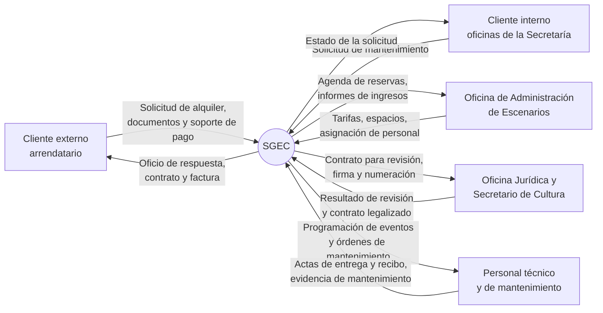

# Documento de Visión y Alcance

## SGEC — Sistema de Gestión de Escenarios y Bienes Culturales

**Secretaría de Cultura – Municipio de Pereira**

**Integrantes:**
Víctor Camilo Castaño Salazar
Santiago Suaza Builes
Juan Miguel Arias Ríos

Curso de Arquitectura de Software
Versión 1.0

---

## 1. Introducción

El presente documento describe la visión y el alcance del sistema SGEC. Su propósito es establecer el acuerdo inicial con el cliente acerca del desarrollo que se va a realizar.

El alcance del sistema se limita al módulo de Administración de Escenarios y Bienes Culturales del Manual de Procedimientos de la Secretaría de Cultura de Pereira (versión 05, vigencia abril 30 de 2023), y dentro de él a los dos procedimientos allí definidos: Alquiler de Escenarios Culturales y Mantenimiento Preventivo y/o Correctivo de Escenarios y Bienes Culturales. Las características descritas corresponden a las actividades, responsables y registros establecidos en ese manual; no se incorporan funcionalidades adicionales.

El contenido del documento es el siguiente:

1. Introducción
2. Contexto de negocio
   2.1 Antecedentes
   2.2 Frase del problema
   2.3 Objetivos de negocio
3. Visión de la solución
   3.1 Frase de visión
   3.2 Características del sistema
4. Alcance y limitaciones
   4.1 Alcance
   4.2 Limitaciones
5. Contexto del sistema
   5.1 Resumen de involucrados
   5.2 Diagrama de contexto
   5.3 Entorno de operación
6. Información adicional

---

## 2. Contexto de negocio

### 2.1 Antecedentes

La Secretaría de Cultura del Municipio de Pereira administra, a través de la Oficina de Administración de Escenarios y Bienes Culturales, los escenarios culturales del municipio, entre ellos el Centro Cultural Lucy Tejada y el Teatro Municipal Santiago Londoño. Esta oficina atiende dos frentes de trabajo definidos en el Manual de Procedimientos de la Secretaría.

El primero es el alquiler de escenarios culturales a clientes externos. El procedimiento comprende la recepción de la solicitud de forma verbal, escrita o por correo electrónico y su registro en la agenda digital, la respuesta al cliente a través del aplicativo SAIA informando los requisitos y el valor a consignar según el Acuerdo de Tarifas, la recepción de los documentos exigidos, la elaboración del estudio previo y del contrato, el pago y la facturación, la revisión por parte de la Oficina Jurídica, la firma del Secretario de Cultura y la numeración del contrato, el acompañamiento logístico durante el evento y la recepción del inmueble verificando su estado físico. El procedimiento incluye además el control de entradas, asistentes e ingresos, y el control de los eventos sociales otorgados en calidad de préstamo.

El segundo frente es el mantenimiento preventivo y correctivo. Las oficinas de la Secretaría radican sus solicitudes por SAIA, correo electrónico o teléfono; la oficina determina si el arreglo puede ejecutarlo el personal de mantenimiento de la entidad o si debe elevarse a otra dependencia de la Alcaldía Municipal, y ejecuta o coordina la labor. Se realizan además revisiones constantes de los ascensores del Lucy Tejada, las plantas eléctricas, las motobombas, la alarma contraincendios, la silletería de los auditorios, los baños, las luminarias y la rampa de ingreso para personas con discapacidad del Teatro Municipal Santiago Londoño.

Hoy ambos procedimientos se apoyan en una agenda digital sin integración con el trámite, en oficios radicados, en el aplicativo documental SAIA y en soportes físicos y registros fotográficos dispersos.

### 2.2 Frase del problema

La información del alquiler de escenarios está repartida entre la agenda digital, los oficios radicados, los documentos entregados por el cliente, los soportes de pago y los contratos en trámite, sin que exista un punto único donde consultar en qué estado va cada solicitud ni qué espacios están comprometidos en una fecha determinada. Esto genera riesgo de cruces en la programación de los auditorios, demoras en el trámite de legalización de los contratos, dificultad para consolidar la relación de entradas, asistentes e ingresos, y pérdida de trazabilidad sobre los documentos que respaldan cada arrendamiento. La situación se repite en el mantenimiento, donde las solicitudes llegan por tres canales distintos y no se dispone de un registro consolidado de lo solicitado, lo ejecutado y lo elevado a otras dependencias. Por lo anterior, se decide construir un sistema que soporte ambos procedimientos.

### 2.3 Objetivos de negocio

| ID | Descripción del objetivo de negocio |
|----|-------------------------------------|
| ON-1 | Sistematizar el procedimiento de alquiler de escenarios culturales establecido en el Manual de Procedimientos de la Secretaría de Cultura, desde la recepción de la solicitud hasta la recepción del escenario una vez concluido el evento. |
| ON-2 | Sistematizar el procedimiento de mantenimiento preventivo y correctivo de escenarios y bienes culturales, incluyendo la clasificación de las solicitudes y el registro de su ejecución. |
| ON-3 | Mantener una agenda única y confiable de disponibilidad de los auditorios del Centro Cultural Lucy Tejada y del Teatro Municipal Santiago Londoño, que evite cruces de reservas. |
| ON-4 | Disponer de la información de entradas, asistentes, ingresos y eventos sociales que hoy se lleva de forma manual, para la elaboración de los informes que exige el procedimiento. |

---

## 3. Visión de la solución

### 3.1 Frase de visión

El sistema **SGEC – Sistema de Gestión de Escenarios y Bienes Culturales** será la herramienta de la Oficina de Administración de Escenarios y Bienes Culturales para tramitar el alquiler de los escenarios culturales del municipio y atender las solicitudes de mantenimiento. Permitirá registrar cada solicitud, consultar la disponibilidad de los espacios, llevar el contrato a través de sus etapas de elaboración, pago, revisión jurídica, firma y numeración, registrar la entrega y el recibo del escenario, y dejar constancia de la ejecución de los mantenimientos. SGEC reemplaza el manejo disperso que hoy se hace en agenda, oficios y soportes físicos, reuniendo en un solo sistema la información de los dos procedimientos.

### 3.2 Características del sistema

| ID | Descripción | Prioridad | Objetivo de negocio asociado |
|----|-------------|-----------|------------------------------|
| CAR-01 | El sistema debe permitir registrar la solicitud de alquiler recibida de forma verbal, escrita o por correo electrónico, dejándola en la agenda y asociándole el número de radicado del oficio de confirmación. | Alta | ON-1 |
| CAR-02 | El sistema debe permitir consultar la disponibilidad de los escenarios en una fecha y franja determinadas antes de comprometer una reserva. | Alta | ON-1, ON-3 |
| CAR-03 | El sistema debe generar el oficio de respuesta al cliente, indicando los requisitos exigidos y el valor a consignar según el Acuerdo de Tarifas vigente. | Alta | ON-1 |
| CAR-04 | El sistema debe permitir registrar y verificar la recepción de los documentos exigidos al cliente para iniciar el trámite del contrato. | Alta | ON-1 |
| CAR-05 | El sistema debe permitir elaborar el estudio previo y el contrato de arrendamiento a partir de los datos de la solicitud. | Alta | ON-1 |
| CAR-06 | El sistema debe permitir registrar el recibo de pago, el comprobante de consignación del banco y la factura correspondiente. | Alta | ON-1 |
| CAR-07 | El sistema debe soportar el flujo de revisión jurídica del contrato, con la verificación de que la documentación esté completa y vigente, que los datos del arrendatario correspondan y que el clausulado se ajuste a la normatividad. | Alta | ON-1 |
| CAR-08 | El sistema debe registrar la firma por parte del Secretario de Cultura y la numeración del contrato, dejándolo en estado legalizado. | Alta | ON-1 |
| CAR-09 | El sistema debe permitir consultar el estado en que se encuentra cada solicitud y cada contrato dentro del trámite. | Alta | ON-1 |
| CAR-10 | El sistema debe mantener la programación de reservas de los auditorios del Teatro Municipal Santiago Londoño y del Centro Cultural Lucy Tejada, y permitir asignar el personal de acompañamiento logístico del evento. | Alta | ON-3 |
| CAR-11 | El sistema debe permitir registrar el acta de entrega del espacio antes del evento y el acta de recibo una vez concluido, dejando constancia del estado físico del inmueble. | Alta | ON-1 |
| CAR-12 | El sistema debe permitir registrar la encuesta de satisfacción del cliente aplicada al finalizar el arrendamiento. | Media | ON-1 |
| CAR-13 | El sistema debe permitir registrar la relación de entradas, el control de asistentes y de ingresos, y el control de los eventos sociales otorgados en calidad de préstamo. | Alta | ON-4 |
| CAR-14 | El sistema debe generar los informes de ingresos, entradas y eventos sociales que exige el procedimiento. | Media | ON-4 |
| CAR-15 | El sistema debe permitir registrar las solicitudes de mantenimiento del cliente interno, indicando el canal por el que fueron recibidas. | Alta | ON-2 |
| CAR-16 | El sistema debe permitir clasificar cada solicitud de mantenimiento según sea atendida por el personal de la entidad o deba elevarse a otra dependencia de la Alcaldía Municipal. | Alta | ON-2 |
| CAR-17 | El sistema debe permitir registrar la ejecución del mantenimiento y adjuntar el registro fotográfico correspondiente. | Alta | ON-2 |
| CAR-18 | El sistema debe permitir programar y registrar las revisiones periódicas de ascensores, plantas eléctricas, motobombas, alarma contraincendios, silletería de auditorios, baños, luminarias y la rampa de acceso para personas con discapacidad. | Media | ON-2 |
| CAR-19 | El sistema debe manejar perfiles de usuario diferenciados conforme a los responsables definidos en el procedimiento, de modo que cada usuario solo acceda a las funciones de su rol. | Alta | ON-1, ON-2 |
| CAR-20 | El sistema debe registrar qué usuario creó o modificó cada registro y en qué fecha, para efectos de trazabilidad. | Media | ON-1, ON-2 |

---

## 4. Alcance y limitaciones

### 4.1 Alcance

| Número de release | Tema principal | ID de características a incluir |
|-------------------|----------------|----------------------------------|
| 1.0 | Trámite de alquiler y contrato | CAR-01, 02, 03, 04, 05, 06, 07, 08, 09, 19 |
| 2.0 | Ejecución del evento y cierre | CAR-10, 11, 12, 13, 14, 20 |
| 3.0 | Mantenimiento de escenarios | CAR-15, 16, 17, 18 |

### 4.2 Limitaciones

El alcance del sistema se limita estrictamente a lo establecido en el módulo de Administración de Escenarios y Bienes Culturales del Manual de Procedimientos. En consecuencia, el sistema no cubre:

- Los demás módulos de la Secretaría de Cultura: Despacho, Biblioteca Pública, Emisora Cultural, Promoción Cultural, Música, Presupuesto Interno y Convenios.
- El recaudo o el pago en línea. El cliente consigna en el banco y el sistema únicamente registra el recibo, el comprobante y la factura.
- La contabilidad, la tesorería y la ejecución presupuestal, que continúan en los sistemas financieros de la Alcaldía Municipal.
- La sustitución del aplicativo documental SAIA ni de la ventanilla única de radicación; el sistema registra el número de radicado, no lo genera.
- La gestión de las solicitudes una vez son elevadas a otras dependencias de la Alcaldía Municipal; el sistema registra que fueron elevadas y su resultado.
- La venta o emisión de entradas para los eventos. El sistema registra la relación de entradas y el control de asistentes con fines de informe.
- Tableros de control, analítica avanzada o funcionalidades basadas en inteligencia artificial. Los únicos informes contemplados son los de ingresos, entradas y eventos sociales que exige el procedimiento.

---

## 5. Contexto del sistema

### 5.1 Resumen de involucrados

| Nombre | Descripción | Responsabilidades |
|--------|-------------|-------------------|
| Jefe de la Oficina de Administración de Escenarios y Bienes Culturales | Dueño del proceso | - Aprobar la visión y el alcance - Validar los requisitos del arrendamiento y las tarifas - Aprobar las entregas del proyecto |
| Auxiliar administrativo | Usuario principal del sistema | - Proporcionar y validar requerimientos - Mostrar cómo se realizan hoy las tareas a automatizar - Validar prototipos |
| Oficina Jurídica de la Secretaría de Cultura | Usuario revisor | - Definir los criterios de revisión del contrato - Validar el flujo de legalización |
| Secretario de Cultura | Aprobador | - Firmar los contratos de arrendamiento |
| Operarios calificados, luminotécnico y técnico de sonido | Usuarios operativos | - Validar las actas de entrega y recibo de espacios - Validar la asignación de acompañamiento logístico |
| Técnico operativo de mantenimiento | Usuario operativo | - Validar el flujo de solicitudes y el registro de ejecución |
| Cliente externo (arrendatario) | Usuario final externo | - Presentar la solicitud y los documentos exigidos - Diligenciar la encuesta de satisfacción |
| Oficinas de la Secretaría de Cultura | Cliente interno | - Presentar las solicitudes de mantenimiento |
| Víctor Camilo Castaño Salazar | Equipo de desarrollo | - Análisis, diseño y construcción del sistema |
| Santiago Suaza Builes | Equipo de desarrollo | - Análisis, diseño y construcción del sistema |
| Juan Miguel Arias Ríos | Equipo de desarrollo | - Análisis, diseño y construcción del sistema |

### 5.2 Diagrama de contexto

El diagrama siguiente muestra el contexto del sistema, las entidades externas a éste y los flujos de información.

**Convenciones:** elipse = sistema a desarrollar; rectángulo = entidad externa; flecha = flujo de datos.

### 5.3 Entorno de operación

El sistema será usado desde navegadores web por el personal de la Oficina de Administración de Escenarios y Bienes Culturales, la Oficina Jurídica y el Despacho de la Secretaría de Cultura. Deberán soportarse los siguientes navegadores:

- Google Chrome
- Mozilla Firefox
- Microsoft Edge

Los equipos de trabajo de la Secretaría operan sobre Windows. El personal técnico y de mantenimiento consultará y registrará información desde dispositivos móviles durante los eventos y las labores de mantenimiento, por lo que la interfaz deberá adaptarse a pantallas pequeñas. El sistema se ejecutará en un servidor dispuesto para albergar la aplicación y el acceso se hará mediante conexión cifrada.

---

## 6. Información adicional

Los criterios de aceptación del proyecto incluyen:

- Sistema desplegado y en operación.
- Protocolo de aceptación aprobado al 100%.
- Cobertura verificada de las actividades de los procedimientos del módulo.
- Manual técnico y de administración entregado.
- Manual de usuario entregado.

Normatividad aplicable al módulo, según el Manual de Procedimientos:

- Ley 397 de 1997 – Ley General de Cultura.
- Ley 1170 de 2007 – Ley de Teatro.
- Ley 1493 de 2011 – Espectáculo público de las artes escénicas.
- Decreto 1080 de 2015 – Decreto Único Reglamentario del Sector Cultura.
- Acto Administrativo de especificaciones técnicas de alquiler de escenarios.
- Acuerdo de Tarifas vigente.
